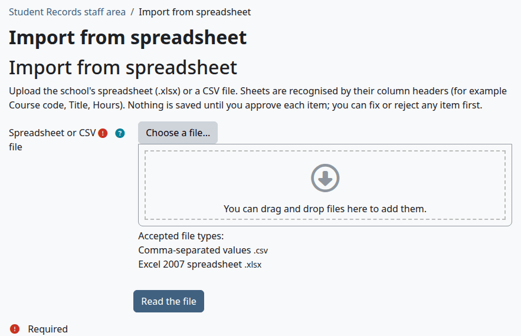
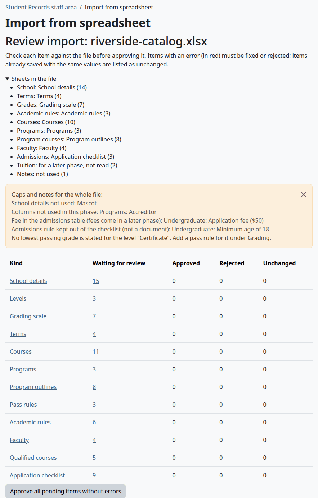
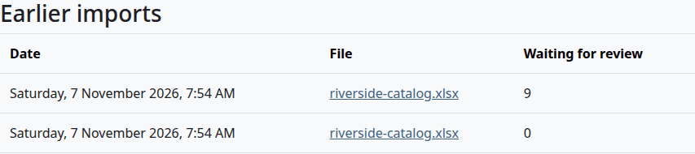
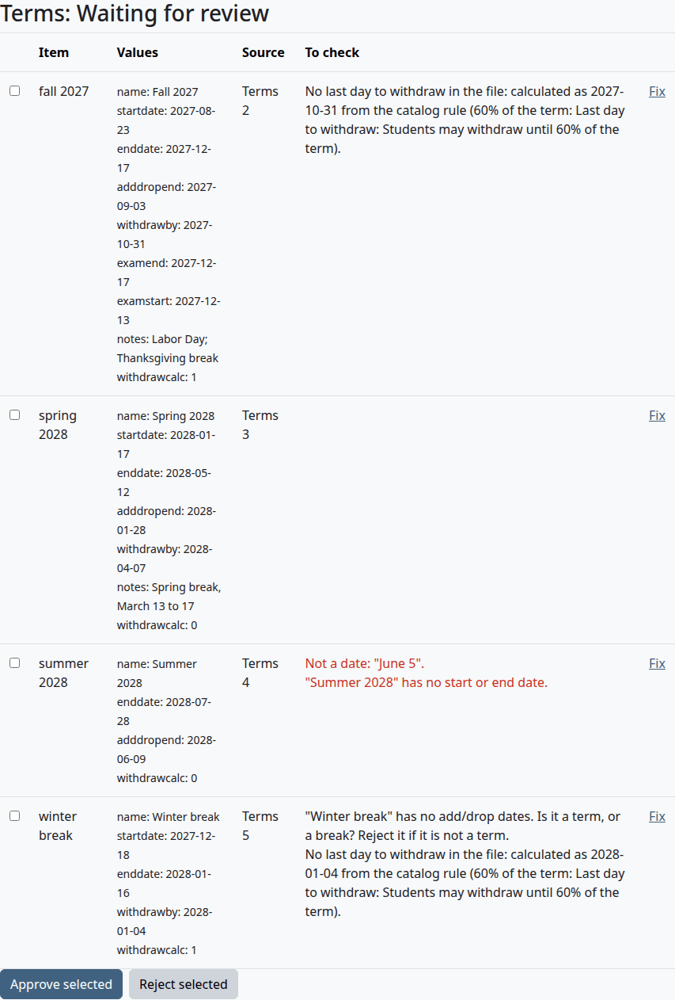
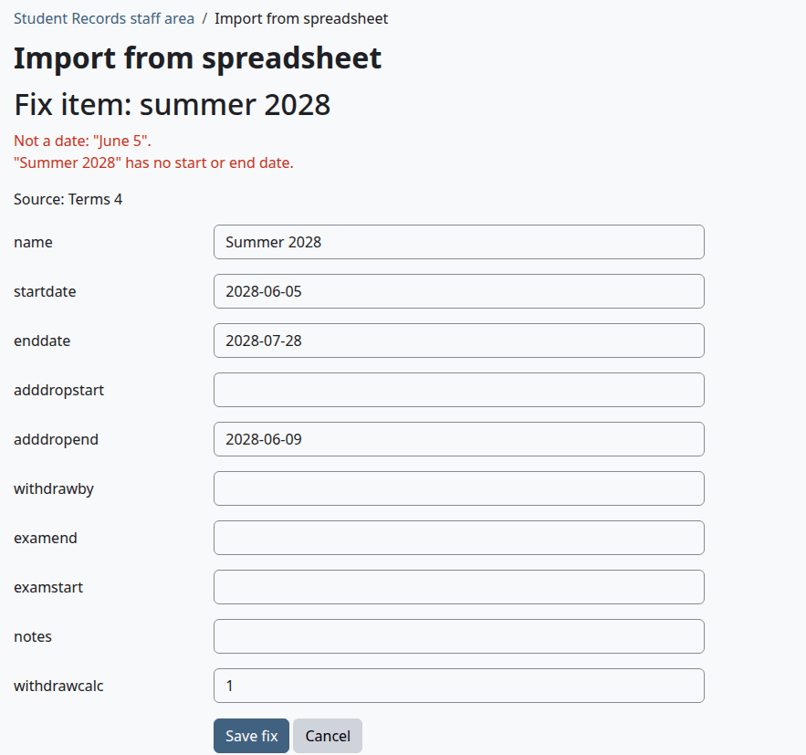
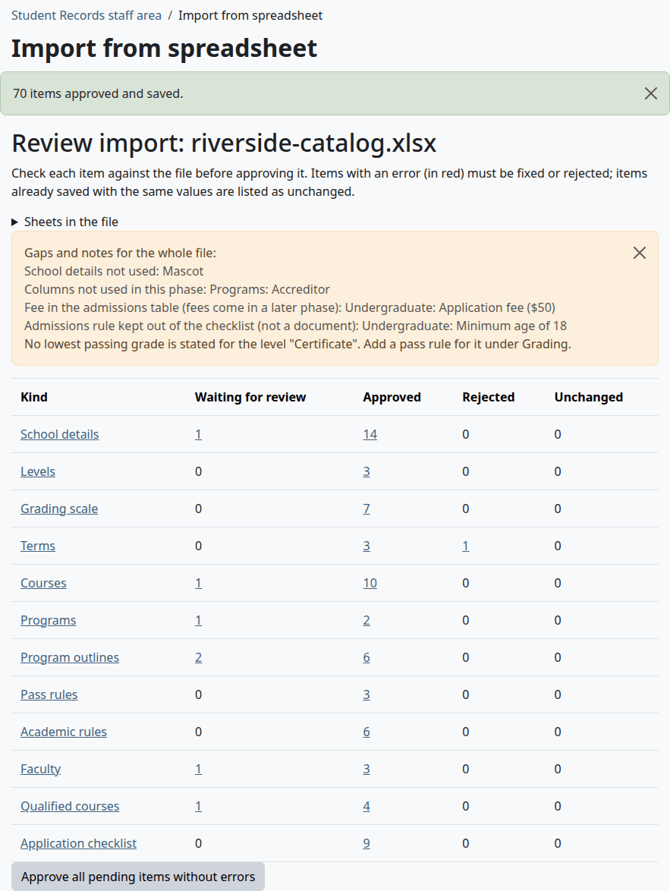
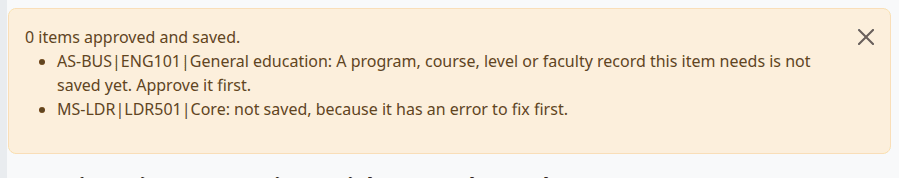
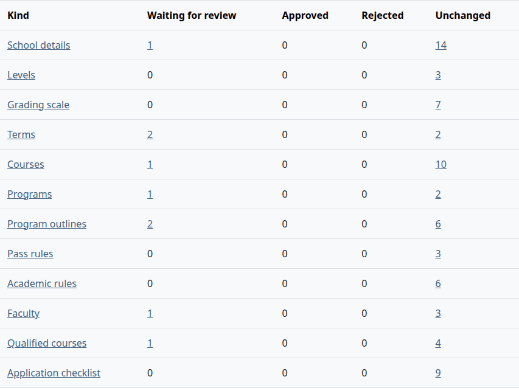
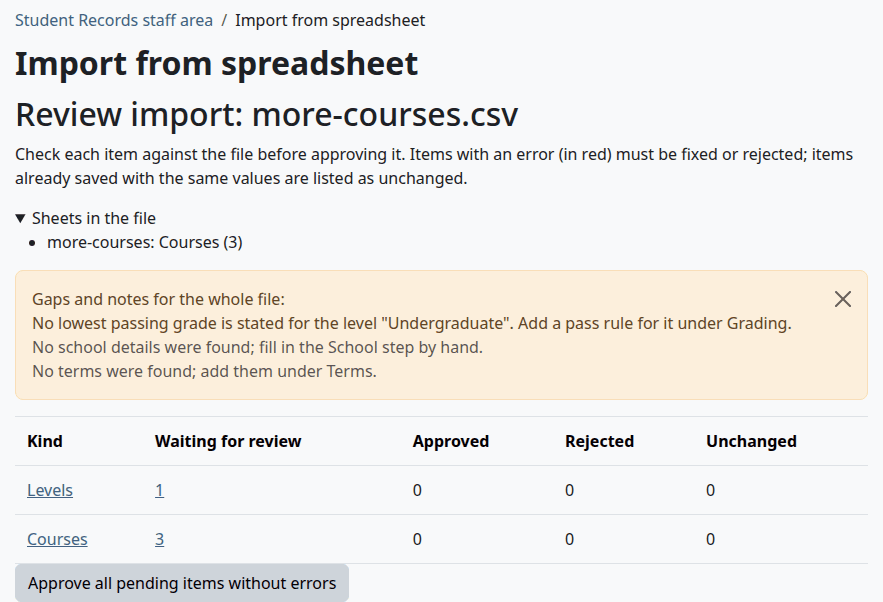

# Import from a spreadsheet

The import reads the school's catalog from an .xlsx workbook or a CSV file, so you don't have to type it. This page is for the person who sets up Student Records. Nothing is saved until you approve it, and you can fix or reject any item first.

## Contents

- [What the import can read](#what-the-import-can-read)
- [What the import can't read](#what-the-import-cant-read)
- [Make your file](#make-your-file)
- [How a sheet is recognised](#how-a-sheet-is-recognised)
- [The columns of each sheet](#the-columns-of-each-sheet)
- [Read a file](#read-a-file)
- [Read the review page](#read-the-review-page)
- [Look at the items of one kind](#look-at-the-items-of-one-kind)
- [Fix an item](#fix-an-item)
- [Reject items](#reject-items)
- [Approve items](#approve-items)
- [The order of parents](#the-order-of-parents)
- [Import a file again](#import-a-file-again)
- [What each check means](#what-each-check-means)
- [Related pages](#related-pages)

## What the import can read

Each row of your file becomes an item that waits for review. These are the kinds of item, in the order the import saves them:

| Kind | What it saves | Where you see it afterwards |
|---|---|---|
| "School details" | Answers of the setup wizard | [Setup wizard](setup-wizard.md), steps 1, 2 and 3 |
| "Levels" | Academic levels | [Grading](grading-and-levels.md) |
| "Grading scale" | Letters and marks | [Grading](grading-and-levels.md) |
| "Terms" | Terms and their dates | [Terms](terms-and-calendar.md) |
| "Courses" | The course catalog, and the prerequisite links | [Course catalog](programs-and-courses.md) |
| "Programs" | Programs | [Programs](programs-and-courses.md) |
| "Program outlines" | The courses of each program | [Programs](programs-and-courses.md) |
| "Pass rules" | Lowest passing grades | [Grading](grading-and-levels.md) |
| "Academic rules" | The rules as the catalog words them | [Grading](grading-and-levels.md), and as suggestions on Standing rules (SAP) |
| "Faculty" | Faculty and staff records, each with a highest credential | [Faculty and staff](faculty-and-staff.md) |
| "Qualified courses" | The courses each teacher may teach | [Faculty and staff](faculty-and-staff.md) |
| "Application checklist" | Documents required for admission | [Admissions process](admissions-process.md) |

The import only adds and updates. It never deletes anything.

## What the import can't read

- Students, registrations, course offerings, prices and Moodle accounts. Add these on their own pages.
- A term's grade freeze. Add it on the [Terms](terms-and-calendar.md) page.
- Fees and tuition. A sheet of them is listed as "for a later phase, not read".
- Any file that isn't .xlsx or .csv. The older .xls format and .ods are refused by the file picker. Save your file as .xlsx first.

A faculty or staff record from the import has no link to a Moodle account. Link it on the record afterwards.

## Make your file

The plugin has no template and no sample file to download. It doesn't need one: it reads your own layout, as long as the column headers are ones it knows. [How a sheet is recognised](#how-a-sheet-is-recognised) lists them.

These rules hold for every file:

- The file is at most 10 MB, with at most 20,000 rows on a sheet and 512 columns.
- An .xlsx workbook has one sheet per kind of data. Every sheet is read, whatever its name, and hidden sheets too.
- A CSV file holds one kind of data. Its columns are split by commas, semicolons or tabs, whichever the first line has most of. It can be UTF-8, UTF-16 or Windows-1252.
- The first row with anything in it holds the headers. A title above the headers stops the sheet from being recognised.
- Case and punctuation in a header don't matter: "Add/drop end" and "add drop end" are the same.
- For a formula, the import reads the value the spreadsheet last saved. It doesn't work anything out.

> Known problem in 1.4.6: in a CSV file, a line with only commas, semicolons, tabs or spaces on it counts as a row with something in it. Above the headers, such a line becomes the header row, and "Sheets in the file" says "not used". Delete those lines at the top of the file.

Dates can be `2027-08-23`, `8/23/2027` (month first) or a date cell of a spreadsheet. Anything else is "Not a date". `August 23, 2027` and `23/8/2027` don't work.

## How a sheet is recognised

The import looks at the headers of each sheet and takes the first row of this table that fits. The sheet's name plays no part.

| Read as | The sheet needs |
|---|---|
| "School details" | First header Field, Item, Setting or Question, and second header Value or Answer |
| "Academic rules" | First header Rule, Policy or Academic rule |
| "Grading scale" | Letter or Letter grade, and Quality points, Grade points, Points or GPA points |
| "Program outlines" | Program code or Program, and Course code or Course number |
| "Programs" | Program code; or Program name with Credential or Award |
| "Qualified courses" | Faculty name, Faculty, Instructor or Instructor name, and Course code, Course, Course number, Qualified course or Qualified to teach |
| "Courses" | Course code or Course number, and Title, Course title or Course name |
| "Terms" | Start, Start date or Begins; End, End date or Ends; and Term, Term name or Session |
| "Faculty" | Name, Full name, Staff name or Faculty name, and Role title, Role, Position, Job title, Type or Staff type |
| "Application checklist" | Level, Program level or Credential level, and Prior degree, Previous degree, TOEFL iBT, TOEFL, IELTS or Required documents |

A sheet that fits none of these is listed as "for a later phase, not read" when a header has the word amount, fee, fees, tuition, refund, TOEFL, IELTS, prior degree or Duolingo. Any other sheet is listed as "not used".

## The columns of each sheet

A column the import doesn't know is left out. The tables below give the headers it knows for each field. Any of the headers in a row will do.

### School details

Two columns: the label, then the value. A row with an empty value is left out.

| Answer of the wizard | Labels the import knows |
|---|---|
| School name | Institution name, School name, Name of school, College name, University name |
| Legal name | Legal entity, Legal name |
| Other names | Other names, Also known as, DBA, Doing business as |
| Legal address | Principal place of business, Address, Main address, Legal address, Mailing address |
| Campus address | Instructional facility, Campus, Campus address, Instructional site, Site address |
| State | State. If it's missing, an address ending in a form like `, IL 62999` fills it in |
| Website | Website, Web site, URL |
| Phone | Phone, Telephone, Main phone |
| Email | Email, E-mail |
| Registrar name | Registrar, Registrar name |
| State agency | State regulator, State agency, Regulator, Licensed by, State approval |
| State license number | License number, License no, State license number |
| Accreditor | Accreditation, Accreditor, Accrediting agency, Accredited by. A value that starts with not, none, no or n/a leaves the accreditor empty |
| Federal aid module | Title IV federal aid, Federal aid, Title IV, Federal financial aid. Needs the words yes, eligible, participates or approved, or no, not, none, does not or ineligible |
| F-1 module | F-1, F-1 students, I-20, SEVP, International students. The same words |
| Term type | Calendar type, Calendar, Term type, Academic calendar. The value must name semester, quarter, trimester, term, continuous or rolling |
| Unit of credit | Credit unit, Unit of credit |
| Office hours | Office hours, Hours of operation |
| Time zone | Time zone, Timezone. Use Moodle's name for it, such as `America/Chicago` |
| OPEID | OPEID, OPE ID |

Any other label is listed under "School details not used".

### Terms

| Field | Headers |
|---|---|
| Term name | Term, Term name, Name, Session |
| Start date | Start, Start date, Begins, First day, Classes begin |
| End date | End, End date, Ends, Last day, Classes end |
| Add/drop starts | Add drop start, Drop add start, Add drop begins |
| Add/drop ends | Add drop end, Drop add end, Add drop deadline, Last day to add, Add drop ends |
| Last day to withdraw | Withdraw, Withdraw by, Withdraw deadline, Last day to withdraw, Withdrawal deadline |
| Final exams | Final exams, Exams, Exam week, Finals. One cell for the start and end, with `to`, `-` or `through` between them, such as `2027-12-13 to 2027-12-17` |
| Holidays and breaks | Holidays breaks in term, Holidays, Breaks, Notes |

With no last day to withdraw in the file, the import works one out, and the term shows it as calculated. When you approve the term, the date is worked out again with the school's rule as it is saved then: "Last day to withdraw (% of the term)" from the Calendar step, else 60%. A rule in the file comes as a "School details" item, which sets that rule when you approve it, and School details are saved before terms.

> Known problem in 1.4.6: the item shows a date at the percent of an academic rule about withdrawing in the file, else at 60% of the term, whatever rule the school has saved. So with a rule saved and none in the file, the date on the term differs from the date on the item. Go by the date on the term after you approve it.

### Grading scale

| Field | Headers |
|---|---|
| Letter | Letter, Grade, Letter grade |
| Lowest % | Min, Min %, Minimum, Minimum %, From, From %, Lowest |
| Highest % | Max, Max %, Maximum, Maximum %, To, To %, Highest |
| Grade points | Quality points, Grade points, Points, GPA points |
| Counts in GPA | Counts in GPA, In GPA, GPA. No, N, False or 0 means no, and anything else means yes |
| Earns credit | Earns hours, Earns credit, Earns credits, Earns. Yes, Y, True or 1 means yes, and anything else means no |
| Description | Description, Meaning |

Put No under Counts in GPA for marks such as W, or the import asks for their grade points.

A further column where every filled cell starts with Pass or Fail is read as a level's pass rule. The header gives the level's name, and its description in brackets, such as `Undergraduate (Associate and bachelor)`. The column must say Pass or Fail for each letter with grade points, and can be empty for marks. A letter with no description gets one made from these columns, such as `Undergraduate: Pass; Graduate: Fail`.

### Courses

| Field | Headers |
|---|---|
| Course code | Course code, Code, Course number, Course |
| Course title | Title, Course title, Name, Course name |
| Hours | Hours, Credits, Credit hours, Clock hours, Units |
| Credit or clock hours | Hour type, Unit type, Units type, Credit type. A value with the word clock means clock hours. Credit, semester, quarter or unit mean credit hours |
| Level | Level, Academic level |
| Prerequisites | Prerequisites, Prerequisite, Prereqs, Pre requisites |

The course code is saved in upper case with no spaces, so `ENG 101` becomes `ENG101`.

In the Prerequisites column, the import knows a course code as 2 to 5 letters, then 3 or 4 digits, with or without a space and with an optional letter at the end, such as `ENG 101` or `BIO105L`. Each code it knows becomes a link that registration checks. See [How prerequisites work](programs-and-courses.md#how-prerequisites-work).

> Known problem in 1.4.6: a code in another form, such as `CS-101`, makes no link. Codes joined by "or" each become a link too, so `ENG 101 or ENG 100` asks for both courses. The item then warns "Prerequisite written in words: ...". For a choice of courses, put only the code that registration should check.

### Programs

| Field | Headers |
|---|---|
| Program code | Program code, Code, Program ID. With none, the code is made from the name |
| Program name | Program name, Name, Program, Title |
| School or department | School, Department, Division, College |
| Level | Level, Credential level, Degree level. This helps to find the level: see below |
| Credential | Credential, Award, Degree |
| Total hours | Total hours, Total credits, Total credit hours, Total clock hours, Hours, Credits |
| Credit or clock hours | Hour type, Unit type, Units |
| Hours of the chosen track | Track credits choose one, Track credits, Track hours, Concentration credits |
| Minimum GPA to graduate | Min GPA, Minimum GPA, GPA required, Graduation GPA |
| Grade rules | Grade rules, Grading rules, Minimum grades |
| Maximum time to finish | Max time, Maximum time, Maximum time frame |
| Delivery | Delivery, Delivery mode, Mode, Modality. The words online, on campus, in person, hybrid and blended set the delivery mode too |
| Location | Location, Campus, Site, Instructional site |
| CIP code | CIP, CIP code |
| Length | Length, Duration, Program length |

A column the import doesn't know is listed under "Columns not used in this phase".

The import works out the rest:

- The level is the level most of the program's courses have. With none, it goes by the words in the level and credential columns, and looks for a level of the file with a fixed name: doctor for Doctoral, Doctorate or Graduate, master or graduate for Graduate or Postgraduate, and bachelor, associate or undergrad for Undergraduate. They're tried in that order.
- The credential type comes from the words in the level and credential columns.
- A program counts as a degree unless those words say certificate, diploma or non-degree.
- Grade rules written in clear words become pass rules, such as `Core min C` or `B or better in all courses`. Rules the import can't read stay as text, with a note.

> Known problem in 1.4.6: the word Undergraduate holds graduate. So when the courses give no level, a program with Undergraduate in the level or credential column finds the level Graduate or Postgraduate, or no level. Write undergrad, associate or bachelor instead.

> Known problem in 1.4.6: grade rules become pass rules only when the same file has a grading scale. Without one, no rule is made and no note shows, and the words are kept only as the program's grade rules text. Put the grading scale in the same file, or [add the pass rules](grading-and-levels.md#add-a-pass-rule) by hand.

### Program outlines

| Field | Headers |
|---|---|
| Program code | Program code, Program |
| Group or track | Group track, Group, Track, Requirement group, Category |
| Course code | Course code, Course, Course number |
| Course title | Course title, Title |
| Hours | Hours, Credits |
| Requirement | Requirement, Required, Type. A value with track or option means track option, and elective means elective. An empty value, required or core means required |

A course that's in an outline and not in your course list is added as a course too, with a warning. It gets the title and hours from this sheet, credit hours, and no level.

### Academic rules

The first column holds the rule's title. Each other column is a level, and its header gives the level's name and, in brackets, its description. The word `same` copies the value to its left.

- A rule whose title has the words minimum passing, lowest passing or passing grade also makes a pass rule for the level, when the value reads like `D or better` or `80%`.
- A rule with withdraw in its title and a percent in its value also makes a "School details" item that sets "Last day to withdraw (% of the term)".
- Rules about good standing, completion and maximum time become suggestions on the Standing rules (SAP) page. See [Holds and standing](holds-and-standing.md).

### Faculty

| Field | Headers |
|---|---|
| Name | Name, Full name, Staff name, Faculty name |
| Role or job title | Role title, Role, Title, Position, Job title |
| Faculty or staff | Type, Staff type, Category. A value with staff and without faculty means staff. Anything else means faculty |
| Highest credential | Highest credential first listed, Highest credential, Highest degree, Degree, Credentials. It becomes a credential of the type Degree |
| Department or school | Department, School |
| Email | Email, E-mail |
| Courses qualified to teach | Qualified courses, Courses qualified to teach, Qualified to teach, Courses taught, Teaching qualifications. Separate the codes with commas, semicolons or slashes |

The last word of a name is the last name. A title such as Dr. or Prof. goes in its own field, and text in brackets is dropped with a warning.

### Qualified courses

A sheet with one row per person and course, as an alternative to the last column above.

| Field | Headers |
|---|---|
| Name | Faculty name, Faculty, Instructor, Instructor name, Name, Full name |
| Course code | Course code, Course, Course number, Qualified course, Qualified to teach. One cell can hold several codes |

### Application checklist

| Field | Headers |
|---|---|
| Level | Level, Program level, Credential level, Program. The text must name a level that the same file has, or a credential such as Master or Certificate. The words All levels make a document for every program |
| Prior degree | Prior degree, Previous degree, Prior education, Admission requirement. It becomes a required document, unless it says None or N/A. A value with the word foreign becomes an optional one |
| English tests | TOEFL iBT, TOEFL, IELTS, Duolingo. A number in any of them makes an optional "English proficiency test" document with the scores in its description |
| Other documents | Other, Documents, Required documents, Other requirements. Separate them with `;` |

In the Other column, only pieces that read like a document become one, such as a statement, letter, transcript, resume, photo or ID. The word optional makes it optional. A piece about a fee and a piece that isn't a document are listed in the notes for the whole file, and left out.

## Read a file

Who can do this: site administrators, and anyone with the capability `local/studentrecords:import`. Managers have it by default.

Before you start:

- Your file is ready, with its headers in the first row.
- If you want to keep the school's answers from the wizard, leave those rows out of the file, or reject them below.

1. Go to Student Records > Import from spreadsheet. The wizard's Import step has the same link.
2. Under "Spreadsheet or CSV file", select "Choose a file...", or drag the file onto the page.
3. Select "Read the file".

Check that:

- The page "Review import" opens with the name of your file.
- Nothing is saved yet. Each item waits for review, and the file is kept with the import.

What can go wrong:

- "The file could not be read as a spreadsheet (.xlsx)." The file has the wrong format, or it's damaged or has a password. Open it in your spreadsheet program and save it as .xlsx again.
- "This file is too large to read. Split it into smaller files, or remove the rows and columns that are not used." The file is over a limit. Empty rows and columns that only have formatting don't count.

## Read the review page

From the top down, the page shows:

- "Sheets in the file". Select it to open the list: each sheet with what it was read as and its number of rows. Check this first. A sheet that says "not used" has headers the import doesn't know.
- "Gaps and notes for the whole file:", when there are any. These don't stop you from approving. Text in red means a problem with the grading scale: fix the file and read it again, or put it right on the Grading page after you approve.
- A table with a row for each kind, and a count for each state:

| State | Meaning |
|---|---|
| "Waiting for review" | Not saved. You can fix, approve or reject it |
| "Approved" | Saved |
| "Rejected" | Not saved, and kept on the list with that state |
| "Unchanged" | Equal to what is saved already, so there is nothing to do |

- The button "Approve all pending items without errors".

The page keeps your import. To come back to it later, go to Student Records > Import from spreadsheet and select the file under "Earlier imports". That list shows the last 20 imports, with the number of items that still wait.

## Look at the items of one kind

Select the name of a kind in the table, or a count to see the items in that state. The list opens under the table.

| Column | Meaning |
|---|---|
| Tick box | Select the item. Only items waiting for review have one |
| "Item" | The item's key, in the import's own short form |
| "Values" | What would be saved. Each line has the field's raw name |
| "Source" | The sheet and row it came from |
| "To check" | Errors in red, and warnings. See [What each check means](#what-each-check-means) |
| "Fix" | Opens the item, while it waits for review |

Check each item against your file. An error stops an item from being saved until you fix or reject it. A warning doesn't stop it, so read the warnings before you approve.

## Fix an item

Who can do this: the same people. It works on an item that waits for review.

1. On the item's row, select "Fix".
2. Change the values. Each value has its own box, labelled with the field's raw name.
3. Select "Save fix".

Check that:

- The item shows "Fixed by an admin." under "To check", and its errors are gone.

Nothing checks what you type. The fix clears every problem of the item, so a wrong value is saved as it stands when you approve. Type values in the form the import uses:

| Field | Type |
|---|---|
| Any date | `2028-06-05`. A date in any other form is saved as empty, even over a date that was saved before |
| `withdrawcalc` on a term | `1` to work out the last day to withdraw when you approve, `0` to use the date in `withdrawby` |
| `value` of `fedaid` or `f1` | `1` for yes, `0` for no |
| `value` of `calendartype` | `semester`, `quarter`, `trimester`, `term`, `continuous` or `rolling` |
| `credentialtype` | `certificate`, `diploma`, `associate`, `bachelor`, `master`, `doctorate` or `other` |
| `isdegree`, `ingpa`, `earns` | `1` for yes, `0` for no |
| `unittype` | `credit` or `clock` |
| `deliverymode` | `online`, `inperson` or `hybrid` |
| `stafftype` | `faculty` or `staff` |
| `requirement` | `required`, `track` or `elective` |

Some values can't be changed here:

- A list, such as the prerequisite links of a course or the credentials of a person. It has no box.
- `field` on a school detail, which is the setting the value goes to. Its box is there, and a change to it is ignored.

What can go wrong:

- You fix the date of a term that had a date error, and the term ends up with no last day to withdraw. The import doesn't work one out for such a term. Type `1` in `withdrawcalc` in the same fix, or open the term after you approve it and select "Save changes".

> Known problem in 1.4.6: "Save fix" checks nothing. A date typed in another form is saved as empty, even over a date that was saved before. Type each value as the table above shows, and check the record on its own page after you approve it.

## Reject items

Who can do this: the same people.

1. Open the kind, and tick the items.
2. Select "Reject selected".

Check that:

- The page says, for example, "1 items rejected."
- The items count under "Rejected". They stay on the list, and they can't be approved afterwards. To bring one in after all, read the file again.

A row that is a break and not a term is a good case for this. The warning on such an item says so.

## Approve items

Who can do this: the same people.

Before you start:

- You checked the items, and fixed or rejected the ones with errors.

To approve some items of one kind:

1. Open the kind, and tick the items.
2. Select "Approve selected".

To approve everything:

1. Select "Approve all pending items without errors".

The button works on every kind in the import, even with one kind open on the page. Items with an error stay waiting. It saves items in the order of [the table at the top](#what-the-import-can-read), so parents come first.

Check that:

- The page says, for example, "70 items approved and saved."
- The counts move to "Approved".

- The items show on their own pages, such as Terms or Course catalog.

What can go wrong:

- "{item}: not saved, because it has an error to fix first." You ticked an item with an error. It stays waiting.
- "A program, course, level or faculty record this item needs is not saved yet. Approve it first." See the next section.

The page shows up to 30 of these lines.

## The order of parents

Some items need another item to be saved first. "Approve all pending items without errors" takes care of this. If you approve one kind at a time, go in the order of [the table at the top](#what-the-import-can-read).

| You approve | It needs | Without it |
|---|---|---|
| "Program outlines" | The program and the course | The message above, and the item stays waiting |
| "Pass rules" | The level, program or course it names | The message above, and the item stays waiting |
| "Qualified courses" | The faculty record and the course | The message above, and the item stays waiting |
| "Application checklist" | The level it names | The message above, and the item stays waiting |
| "Courses" | The level it names | No message. The course is saved with no level |
| "Programs" | The level it names | No message. The program is saved with no level |
| "Academic rules" | The level it names | No message. The rule is saved for all levels, and the same rule for another level then replaces it |
| "Courses" | The courses it names as prerequisites | No message. Only the links to courses saved by then are made, and approving the other course later doesn't add them |

For the last four rows, approve the parents first or use the one button. To put a level on a course afterwards, edit the course.

> Known problem in 1.4.6: a course, program or academic rule approved before its level is saved without it, and such a rule also replaces the rule with the same title that is saved for all levels. A course approved before its prerequisite never gets the link. Use "Approve all pending items without errors", or approve "Levels" first and each prerequisite course before the courses that need it. To mend a course or program, read the file again and approve it once more. To add a missing link, see [Add a prerequisite link](programs-and-courses.md#add-a-prerequisite-link).

The import links a course to its prerequisites when you approve the course. It only adds links, and never removes one.

## Import a file again

You can read a file as often as you like. Each time is a new import, with its own review page.

- An item equal to what is saved counts as "Unchanged".
- An item that differs waits for review, and approving it updates the saved record. Terms match on name, courses and programs on code, grades on letter, levels on name, and faculty on first name, last name and type.
- An item you rejected before waits for review again.

An approved item replaces every value the import knows, so a value your file doesn't have is saved as empty. For example, a CSV file with only Course code, Title and Credits clears the level and the prerequisites text of a course that had them. A level named in a file with no description clears the level's description. Read the "Values" before you approve an update. Two things stay:

- The delivery mode and location of a program, when the file leaves them out.
- A last day to withdraw that staff picked on a term, when the file has none.

A last day to withdraw stated in the file replaces the saved date. Approving a term, a qualified course or an application checklist document also makes it active again.

> Known problem in 1.4.6: an update saves each value that the file leaves out as empty, as above. Fill in every column the import knows for that kind, or reject an update whose "Values" leave out something you want to keep.

A file that holds only courses shows the notes "No school details were found; fill in the School step by hand." and "No terms were found; add them under Terms.". They only say what the file doesn't have. It also says that a level has no lowest passing grade in this file, even when the level has a pass rule saved.

## What each check means

Errors stop an item until you fix or reject it.

| Message | What to do |
|---|---|
| "Could not tell yes or no from "...". " | Fix `value`: `1` or `0` |
| "Calendar type not recognised: "...". Choose it in the Calendar step." | Reject it and answer on the Calendar step, or fix `value` |
| "Not a date: "..."." on a term date | Fix the date. See [Make your file](#make-your-file) |
| ""..." has no start or end date." | Fix `startdate` or `enddate` |
| ""..." ends before it starts." | Fix the dates |
| "Add/drop dates of "..." are outside the term." | Fix `adddropend` |
| "No grade points for ...." | Fix `points`, or set `ingpa` to `0` for a mark |
| "No grade passes for the level ...." | The Pass or Fail column has no Pass. Fix the file, or set `minletter` |
| "No title for ...." | Fix `title` |
| "Course code ... appears more than once with a different title or hours." | Decide which is right, then fix the item |
| "Hours of ... in the program outline differ from the course catalog." | Check the hours. Fix the file, or fix the item to clear the error |
| "No total hours for ...." | Fix `totalhours` |
| "Only one name given: "..."." | Fix `firstname` |
| "Program ... is not in the programs list." | The outline names a program that isn't in the file. Add it to the file, or reject the item |

Warnings don't stop an item. Read them, and check the result.

| Message | Meaning |
|---|---|
| "The file states "..."; the accreditor is left empty." | The value says the school has no accreditor |
| "State ... taken from the address." | The file has no State row |
| "Not a date: "..."." on the final exams cell | The exam dates are left out |
| ""..." has no add/drop dates. Is it a term, or a break? Reject it if it is not a term." | Reject it if it's a break |
| "No hours for ...." | The course is saved with no hours |
| "Credit or clock hours not stated for ...; credit hours assumed." | Check the type on the course or program |
| "Prerequisite written in words: "...". Check it; only course codes are linked." | Only the codes in the text become links, and a student needs each of them, so an "or" between two codes asks for both. A rule such as "or permission of the dean" isn't enforced |
| "Prerequisite ... is not in the course catalog." | The code isn't in this file. A link is made only if a course with that code is saved by then |
| "Requirement "..." not recognised; set to required." | Check the requirement of the row |
| "... is in a program outline but not in the course catalog; added as a course." | Give the course a level and check its hours afterwards |
| "Delivery mode not recognised: "...". Choose Online, In person or Hybrid on the program." | Set "Delivery mode" on the program afterwards |
| "Hybrid program ... has no location. Enter where in-person teaching takes place." | Set "Location" on the program afterwards |
| "... is a degree program in clock hours; degree programs normally use credit hours." | Check the unit |
| "Minimum GPA is not a number: "...". Saved as a note only." | Set "Minimum GPA to graduate" on the program afterwards. The words aren't saved anywhere you can see them |
| "The academic rules say "...", which differs from the grading scale." | The pass column and the rule disagree. The pass column wins |
| "Read from the words "...". Check that the rule is right." | The import turned words into a rule |
| "Removed "..." from the name; check the name." | Text in brackets was dropped |
| ""..." appears more than once." | Two rows have the same name. Each is its own item |
| "Could not tell the level or credential of "..."; it would apply to all programs." | Fix `levelname` or `credentialtype`, or accept a document for everyone |
| "The level of ... could not be found; choose it after approving." | Set "Level" on the program afterwards |
| "... has no courses in the outline." | Add the program's courses, or leave it with no list. See [Programs and courses](programs-and-courses.md) |
| "...: the program total is ..., but the outline adds up to ...." | Required courses plus the track hours don't add up to the total. See [Programs and courses](programs-and-courses.md) |
| "The program uses a course in different units (...)." | A course is in clock hours and the program in credit hours, or the other way round |
| "Not turned into a rule (handle by hand if needed): "..."" | Add a pass rule on the Grading page if you need one |
| "Course ... is not in this file's course catalog. It must be saved before this item can be approved." | Save the course first |
| "No last day to withdraw in the file: calculated as ... (...% of the term). Staff can change it on the term." | The item uses 60% of the term. The term gets the school's rule, if one is saved. See [Terms](#terms) |
| "No last day to withdraw in the file: calculated as ... from the catalog rule (...% of the term: ...)." | The date uses the rule in the file. That rule is an item under "School details": approve it too |

Notes for the whole file are at the top of the review page.

| Message | Meaning |
|---|---|
| "School details not used: ..." | Labels the import doesn't know |
| "Columns not used in this phase: ..." | Columns the import doesn't know, on a Programs or Application checklist sheet |
| "Fee in the admissions table (fees come in a later phase): ..." | A fee in the Other column. Add it in [Billing setup](billing-setup.md) |
| "Admissions rule kept out of the checklist (not a document): ..." | A piece of the Other column that isn't a document |
| "The grading scale has no marks that are not used in GPA (for example I, W, P). Add the marks the school uses." | Every row counts in the GPA |
| "No lowest passing grade is stated for the level "...". Add a pass rule for it under Grading." | This file has no rule for that level |
| "No school details were found; fill in the School step by hand." | The file has no School details sheet |
| "No terms were found; add them under Terms." | The file has no Terms sheet |
| "The letter ... appears more than once.", "The percentage range of ... is not possible.", "The percentage ranges of ... overlap.", "Gap in the percentage ranges between ...." | In red. The scale in the file has a mistake. Items are still saved if you approve them |
| "The column for ... must say Pass or Fail for every grade.", "In the column for ..., a lower grade passes while a higher one fails." | In red. That level gets no pass rule from the file |

## Related pages

- [Setup wizard](setup-wizard.md)
- [Terms and the calendar](terms-and-calendar.md)
- [Grading and levels](grading-and-levels.md)
- [Programs and courses](programs-and-courses.md)
- [Faculty and staff](faculty-and-staff.md)
- [Admissions process](admissions-process.md)
- [Troubleshooting](../troubleshooting.md)
