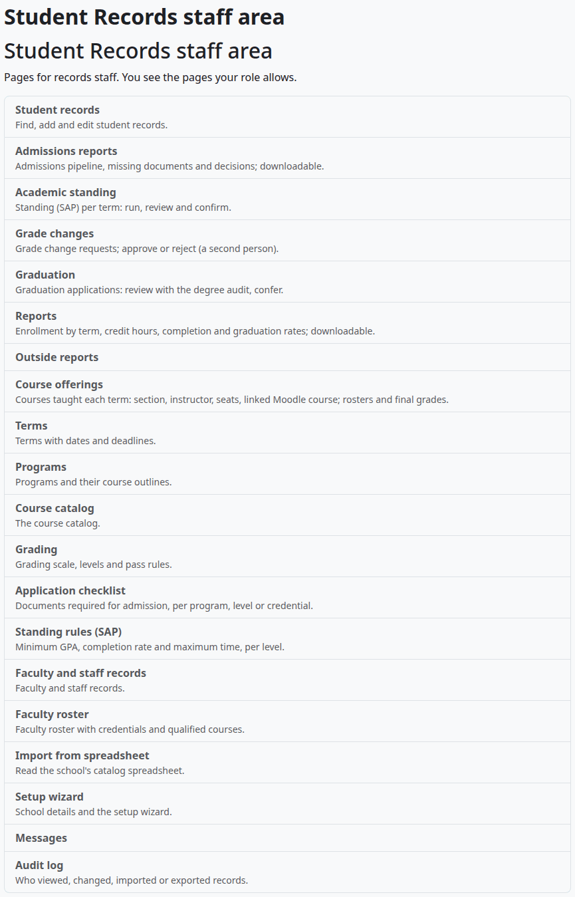
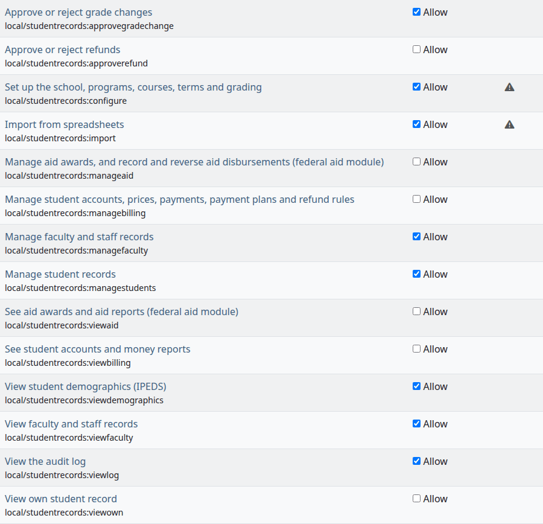
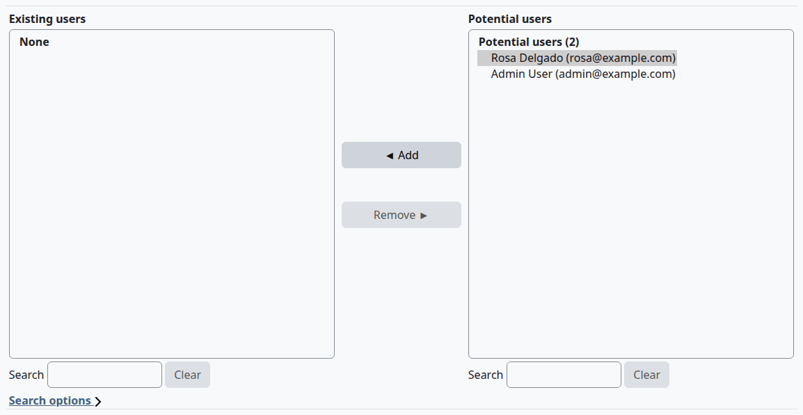
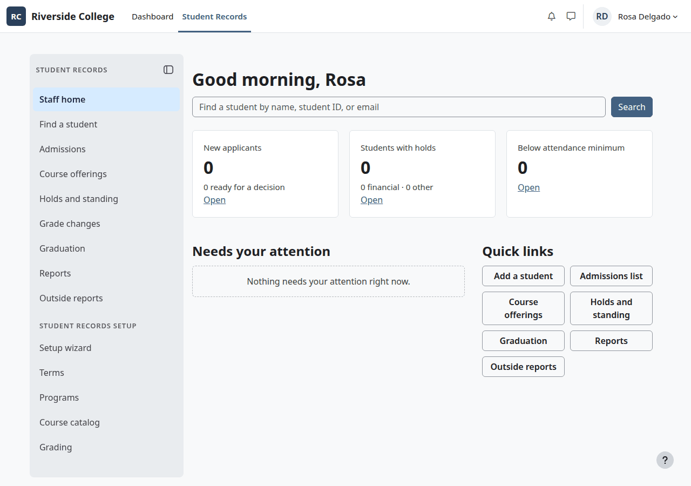
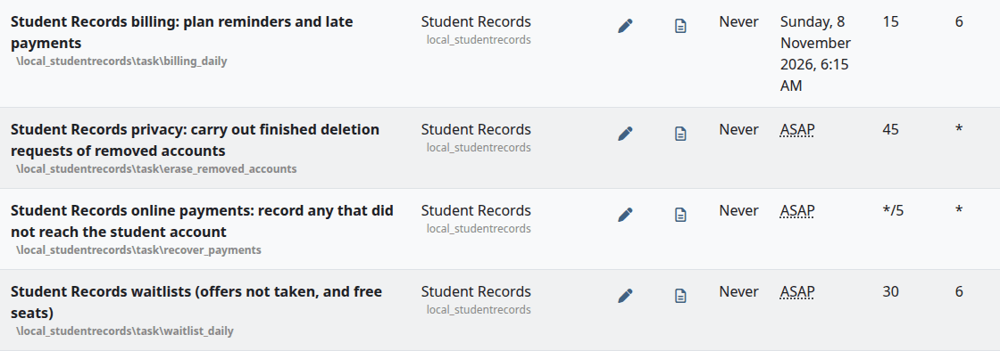
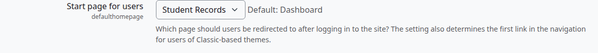

# Install and set up

This page takes a site administrator from a Moodle site without Student Records to a site that is ready for the setup wizard. It covers the requirements, the install, the Moodle roles to make, cron and the start page.

## Contents

- [Requirements](#requirements)
- [Install from a ZIP file](#install-from-a-zip-file)
- [Install by hand](#install-by-hand)
- [Find Student Records after the install](#find-student-records-after-the-install)
- [Moodle roles to make](#moodle-roles-to-make)
- [Make a role for the Registrar](#make-a-role-for-the-registrar)
- [Make sure cron runs](#make-sure-cron-runs)
- [Make Student Records the start page](#make-student-records-the-start-page)
- [What comes next](#what-comes-next)
- [Related pages](#related-pages)

## Requirements

| What | Needed |
|---|---|
| Moodle | 4.5 to 5.3 |
| PHP | 8.1 to 8.4, as your Moodle version requires, with the zip and SimpleXML extensions |
| Database | PostgreSQL, MySQL or MariaDB |
| Cron | Moodle's cron must run. See [Make sure cron runs](#make-sure-cron-runs) |

Two other plugins are optional. Student Records works without them:

| Plugin | What it adds |
|---|---|
| [Academic Transcript](../academic-transcript/README.md) 1.4.3 or later | Official and Unofficial transcripts, transcript requests and "Post final grades" |
| [Student Records theme](../theme/README.md) 1.0.3 or later | The Student Records menu in a left drawer, and cards on the Dashboard and course pages. With another theme, the menu is a box at the top of the page |

## Install from a ZIP file

Who can do this: a site administrator.

> Not walked through: the test site has the plugin installed from the start, so no test site can show this. The steps come from Moodle's plugin installer and the plugin's release files.

Before you start:

- Back up the database and the Moodle data folder. One without the other can't be restored.
- Plan a quiet time. The install puts the site in maintenance mode for about a minute.

1. Download `local_studentrecords-1.4.6.zip` from the [releases page](https://github.com/Clouve/moodle-plugins/releases). Don't unzip it.
2. Go to Site administration > Plugins > Install plugins.
3. Drop the ZIP file into "ZIP package" and select "Install plugin from the ZIP file". Moodle works out the plugin type, so leave the other fields alone.
4. Check the validation result and select "Continue".
5. Select "Upgrade Moodle database now" and follow the screens.
6. Go to Site administration > Development > Purge caches and select "Purge all caches".

What can go wrong:

- Moodle says the plugin installer is disabled, or the plugin folder can't be written to. Install by hand.

## Install by hand

Who can do this: a site administrator with access to the Moodle code folder.

> Not walked through: the test site has the plugin installed from the start, so no test site can show this. The steps come from Moodle's plugin installer and the plugin's release files.

1. Unzip the release ZIP. It holds one folder, `studentrecords`.
2. Put that folder in the `public/local/` folder of your Moodle code on Moodle 5.1 and later, or in `local/` on Moodle 5.0 and earlier.
3. Make sure the web server can read the files.
4. Go to Site administration > Notifications and follow the screens, or run `php admin/cli/upgrade.php` in the Moodle folder as the web server user.

To upgrade later, back up first, then install the new ZIP file the same way. The upgrade keeps all data.

## Find Student Records after the install

Who can do this: a site administrator, or anyone with a staff capability.

1. Select the "Student Records" tab in the top menu. It shows only for someone with at least one page in Student Records.

The Student Records staff area lists every staff page you can open, most with a line on what the page is for. There are two ways to reach it:

- In the Student Records menu, select "All staff pages". It is the last item under Student Records setup, so it shows for anyone with a page under that heading. Admissions and Financial Aid staff have no such page, so they don't see it.
- A site administrator can go to Site administration > Plugins > Local plugins > Student Records staff area.

Student Records has no settings in Site administration: the [setup wizard](setup-wizard.md) and its own pages hold them all.

## Moodle roles to make

Student Records adds 16 capabilities to Moodle, and no roles of its own until you ask. Decide who does what, then give each person a role. [Roles and permissions](../roles-and-permissions.md) lists what each capability allows.

| Person | Moodle role | What to do |
|---|---|---|
| Site administrator | Site administrator | Nothing. They can open everything |
| Manager | Moodle's Manager role, at system level | Nothing more. It holds every capability but "View own student record", which every signed-in user has. The rules about a person's own record still apply |
| Registrar | A role you make | See below |
| Admissions staff | A role you make | `local/studentrecords:managestudents`, `local/studentrecords:viewstudents`, `local/studentrecords:viewdemographics`, and Moodle's `moodle/user:viewalldetails` |
| Grade change approver | A role you make | `local/studentrecords:approvegradechange` alone, if this person is not a Registrar |
| Finance staff | Made by the plugin | Billing setup > "Create the Finance role", then "Give people the Finance role". See [Billing setup](billing-setup.md) |
| Financial Aid staff | Made by the plugin | Only with the federal aid module on: Staff area > Federal aid > "Create the Financial Aid role". See [Federal aid](federal-aid.md) |
| Teachers | Moodle's Teacher or Non-editing teacher, in each course | Nothing more. They see the students of their own courses, and take attendance there |
| Students | None | A student record linked to their Moodle account. Every signed-in user can see their own record |

Give a Registrar role these capabilities at system level:

| Capability | What it opens |
|---|---|
| `local/studentrecords:managestudents` | Student files, admissions, standing, graduation, reports and outside reports |
| `local/studentrecords:viewstudents` | The student list |
| `local/studentrecords:viewdemographics` | Demographics, the counts by race and sex on the Counts tab, and any saved export with race, ethnicity or sex. All three starter exports have them |
| `local/studentrecords:viewfaculty` | Faculty and staff records and the roster |
| `local/studentrecords:managefaculty` | Add a person's record, and their qualified courses |
| `local/studentrecords:viewlog` | The [Audit log](audit-log.md) |
| `local/studentrecords:approvegradechange` | Deciding grade changes |
| `local/studentrecords:configure` | Course offerings, rosters, Terms, Programs, Course catalog, Grading, the application checklist, Standing rules, Messages and the setup wizard |
| `local/studentrecords:import` | Import from spreadsheet |
| `moodle/user:viewalldetails` | Finding a Moodle account in the "Moodle user" and "Moodle account" boxes |

Without `local/studentrecords:configure`, a Registrar can't open Course offerings, so they get no rosters and no "Get final grades from Moodle". With Academic Transcript, add its capabilities too, and Moodle's `moodle/site:configview` for the Site administration tab, where most of its pages are. Its pages inside a course also need an enrolment in that course or Moodle's `moodle/course:view`. See [Roles and permissions](../roles-and-permissions.md#registrar).

## Make a role for the Registrar

Who can do this: a site administrator.

Before you start:

- The person has a Moodle account.

To make the role:

1. Go to Site administration > Users > Permissions > Define roles. The Roles and staff step of the wizard has a "Define roles" link to the same page.
2. Select "Add a new role".
3. Leave "Use role or archetype" on "No role" and select "Continue".
4. Type a "Short name", such as `srregistrar`, and a "Custom full name", such as Registrar.
5. Under "Context types where this role may be assigned", tick "System".
6. In the list of capabilities, tick "Allow" for each capability in the table above. Those of Student Records are under the heading Student Records, and `local/studentrecords:viewstudents` is further down, with the capabilities at course level.
7. Select "Create this role".

To give the role to someone:

1. Go to Site administration > Users > Permissions > Assign system roles.
2. Select the role's name.
3. Under "Potential users", select the person. Search for them if the list is long.
4. Select "Add".

Check that:

- The person's next sign-in shows the "Student Records" tab.
- They see "Staff home" and the setup pages in the Student Records menu.

What can go wrong:

- The person sees "There is nothing here for you yet. If you expected to see your records, please contact the school office." The role isn't assigned yet, or it was assigned in a course and not at system level.
- A page says they don't have permission. Check the capability for that page in [Roles and permissions](../roles-and-permissions.md). A change to a role applies on the person's next page.

## Make sure cron runs

Who can do this: a site administrator.

Student Records needs Moodle's cron. Without it, messages written during other work never go, and the daily jobs never run. Run cron every minute or so, as Moodle recommends.

The plugin adds these tasks. To see them, go to Site administration > Server > Tasks > Scheduled tasks.

| Task | When | What it does |
|---|---|---|
| "Student Records billing: plan reminders and late payments" | 06:15 each day | Sends plan reminders, adds late fees and places billing holds. It does nothing while billing is off |
| "Student Records waitlists (offers not taken, and free seats)" | 06:30 each day | Ends seat offers that weren't taken, and offers free seats |
| "Student Records online payments: record any that did not reach the student account" | Every 5 minutes | Records a payment that reached Moodle but not the student's account |
| "Student Records privacy: carry out finished deletion requests of removed accounts" | Once an hour | Finishes approved deletion requests of accounts that Moodle has already removed |

Messages that wait go as an ad-hoc task at the next cron run. See [Messages](messages.md#what-cron-does).

## Make Student Records the start page

Who can do this: a site administrator.

By default people land on Moodle's Dashboard. You can send them to the Student Records home page instead.

1. Go to Site administration > Appearance > Navigation.
2. Under "Start page for users", pick "Student Records".
3. Select "Save changes".

Check that:

- The next person who signs in lands on the Student Records home page.

What each person sees there:

- Someone with a Student Records menu lands on their home. Someone who has several gets the first of student, staff, finance, financial aid and teacher, and switches with the menu.
- Someone whose Student Records pages have no home, such as someone who only decides grade changes or has only setup pages, goes to the Student Records staff area.
- Someone with no Student Records pages but with a course sees the link "Go to my courses".
- Someone with no Student Records pages and no course sees "There is nothing here for you yet. If you expected to see your records, please contact the school office."
- Someone with no student record, no staff pages and exactly one course goes straight to that course.

Uninstalling the plugin puts the start page back. See [Privacy and uninstall](privacy-and-uninstall.md).

## What comes next

1. Run the [setup wizard](setup-wizard.md). Answer the School, Approvals and Calendar steps.
2. Add your [terms](terms-and-calendar.md).
3. Add your [grading scale, levels and pass rules](grading-and-levels.md).
4. Add your [courses and programs](programs-and-courses.md), by hand or with the [import](import.md).
5. Add [faculty and staff records](faculty-and-staff.md), and tick "No LMS access" for staff who never use courses.
6. Set up the [application checklist](admissions-process.md) and [standing rules](holds-and-standing.md).
7. Set up [billing](billing-setup.md), if the school uses it.
8. Check the [messages](messages.md). All of them are on after the install, so turn test mode on until you go live.
9. Add the school's [FERPA notice](ferpa-and-letters.md). The plugin has no default text.
10. Add [course offerings](course-offerings.md) for the first term, with their class days, times and rooms.
11. Add student records. See [The student file](student-file.md).

Each person's guide starts from the [Student Records guide](README.md).

## Related pages

- [Setup wizard](setup-wizard.md)
- [Import from a spreadsheet](import.md)
- [Roles and permissions](../roles-and-permissions.md)
- [Messages](messages.md)
- [Student Records theme](../theme/README.md)
- [Privacy and uninstall](privacy-and-uninstall.md)
- [Troubleshooting](../troubleshooting.md)
