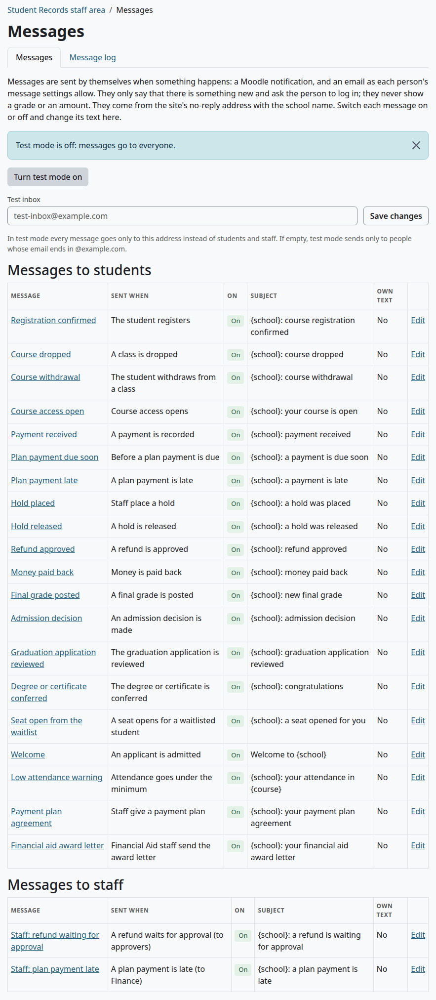
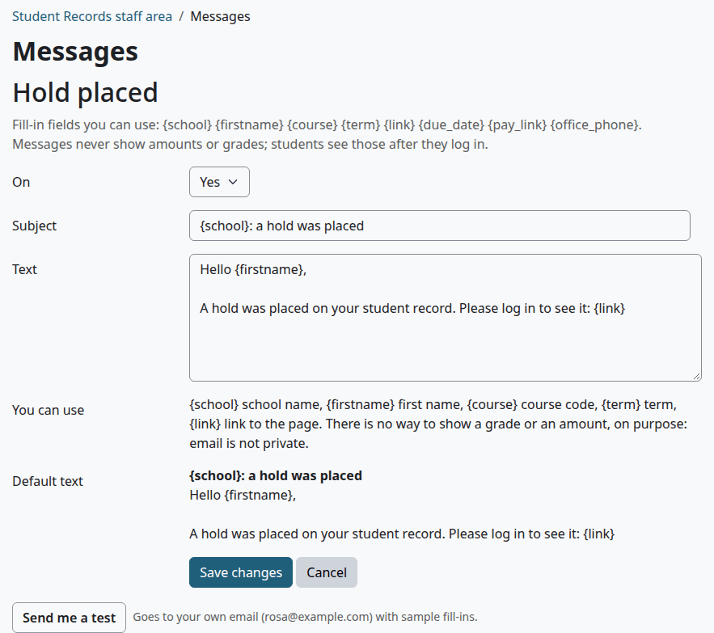
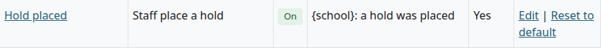
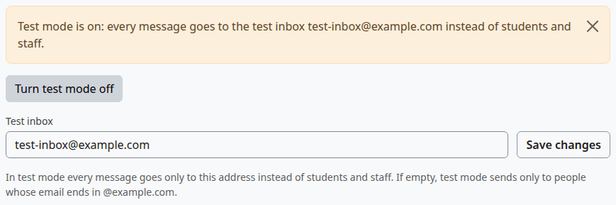
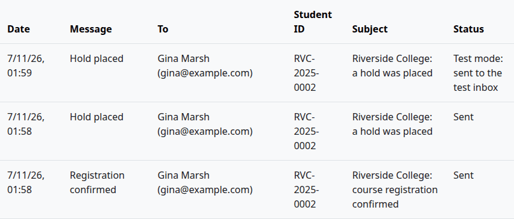
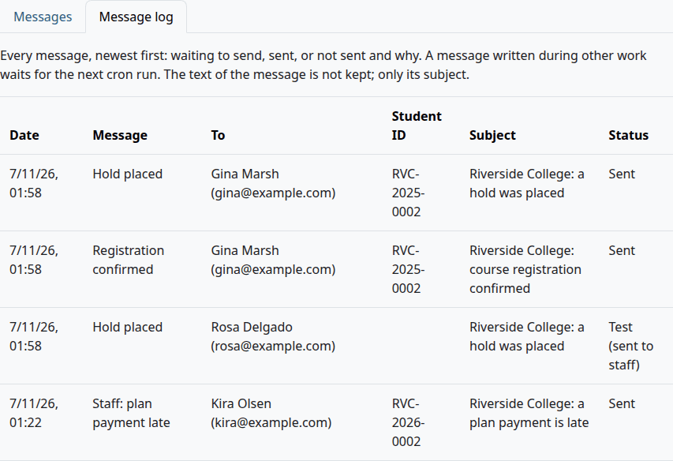
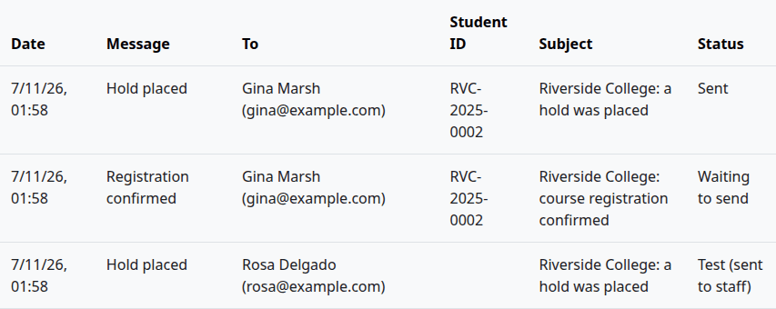
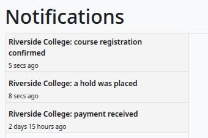
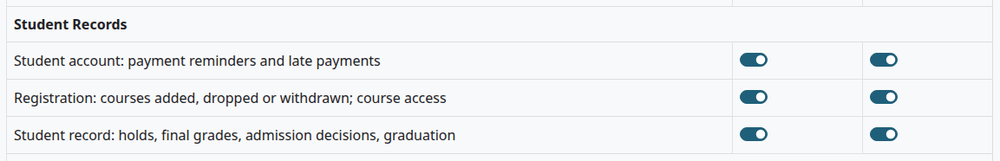

# Messages

Student Records sends 22 messages by itself when something happens, such as a registration or a hold. This page is for the Registrar and whoever sets up the school. It covers each message, its text, test mode, the message log and what cron does.

## Contents

- [How messages work](#how-messages-work)
- [Open the Messages page](#open-the-messages-page)
- [The 22 messages](#the-22-messages)
- [Change a message](#change-a-message)
- [Send yourself a test](#send-yourself-a-test)
- [Test mode and the test inbox](#test-mode-and-the-test-inbox)
- [The message log](#the-message-log)
- [What cron does](#what-cron-does)
- [What a person gets](#what-a-person-gets)
- [Related pages](#related-pages)

## How messages work

- All 22 messages are on after the install. You can switch off each one and change its text.
- Each message is a Moodle notification. It also goes by email if the person's own notification preferences say so.
- A message only says that there is something new and asks the person to log in. It never holds a grade or an amount, and no fill-in can add one.
- It comes from the site's no-reply address, with the school name as the sender's name.
- Each message is written to the [message log](#the-message-log), sent or not.

A message goes at once when it's written outside other work. A message written during other work, such as a registration, waits for the next cron run. See [What cron does](#what-cron-does).

## Open the Messages page

Who can do this: anyone with the capability `local/studentrecords:configure`. Site administrators and Managers have it. A Registrar needs it on their role.

1. Go to Student Records > Messages.

The page has two tabs, "Messages" and "Message log". The first shows whether test mode is on, the box for the test inbox, and two tables, "Messages to students" and "Messages to staff". Each row has:

| Column | What it shows |
|---|---|
| "Message" | The message's name. Select it to open the message |
| "Sent when" | What sends it |
| "On" | "On" or "Off" |
| "Subject" | The subject, with its fill-ins |
| "Own text" | Yes when the school changed the subject or text |
| Links | "Edit", and "Reset to default" when it has its own text |

## The 22 messages

Each message belongs to one of Moodle's four notification groups. See [What a person gets](#what-a-person-gets).

### Messages to students

| Message | It goes when | Group |
|---|---|---|
| "Registration confirmed" | The student is registered, by staff or online | Registration |
| "Course dropped" | A course is dropped | Registration |
| "Course withdrawal" | The student is withdrawn from a course | Registration |
| "Course access open" | A course that waited for payment opens | Registration |
| "Seat open from the waitlist" | A seat is offered from the waitlist. It's held for 2 days | Registration |
| "Payment received" | A payment is recorded, by staff or online | Student account |
| "Plan payment due soon" | The days set in Billing setup before a plan payment is due, once for each payment. Not for the down payment | Student account |
| "Plan payment late" | The daily task finds a late plan payment, and places the hold | Student account |
| "Refund approved" | A refund is approved. Not for a return of aid, and not when a refund is rejected | Student account |
| "Money paid back" | Money paid back is recorded | Student account |
| "Payment plan agreement" | Staff give a payment plan with "Email the plan agreement to the student" ticked | Student account |
| "Financial aid award letter" | Financial Aid staff send the award letter | Student account |
| "Hold placed" | A hold is placed, by staff or by the daily task for a late payment | Student record |
| "Hold released" | A hold is released. Not when a hold ends on its date | Student record |
| "Final grade posted" | A final grade is saved or changes, from any source. An approved grade change sends it too | Student record |
| "Admission decision" | A decision is recorded | Student record |
| "Welcome" | The decision is to admit, on top of "Admission decision" | Student record |
| "Graduation application reviewed" | An application is approved or denied | Student record |
| "Degree or certificate conferred" | A degree or certificate is conferred | Student record |
| "Low attendance warning" | Saving attendance takes the student's rate in a course under the minimum. It can go again after the rate recovers | Student record |

### Messages to staff

| Message | Who gets it | It goes when |
|---|---|---|
| "Staff: refund waiting for approval" | Everyone with `local/studentrecords:approverefund` at system level who also has `local/studentrecords:viewbilling` | A refund above $0 is proposed, or a return of aid is sent to Finance |
| "Staff: plan payment late" | Everyone with `local/studentrecords:managebilling` at system level who also has `local/studentrecords:viewbilling` | The daily task finds a late plan payment, and places the hold |

Staff messages go only to people who hold these capabilities through a role. A site administrator with no such role gets none. The Finance role and Moodle's Manager role have all three. If nobody has `approverefund` or `managebilling`, the log says "Not sent: no Moodle account".

> Known problem in 1.4.6: the plugin picks the people for a staff message by `approverefund` or `managebilling` alone, but Moodle sends it only to people who also have `local/studentrecords:viewbilling`. Someone without it gets nothing, and the log says "Not sent (error)" for them.

### What has no message

Nothing is sent for a grade change request or a rejected grade change, academic standing, a graduation application or its cancellation, a rejected refund, a hold that ends on its date, a waitlist offer that lapses, a cancelled plan, a course that waits for payment, or a FERPA acknowledgment.

### Default text

Every text starts "Hello {firstname}," and a blank line. The subjects start with `{school}:`, except Welcome.

| Message | Subject after `{school}:` | Text after the greeting |
|---|---|---|
| "Registration confirmed" | course registration confirmed | Your registration for {course} ({term}) is confirmed. Please log in to see it: {link} |
| "Course dropped" | course dropped | You were dropped from {course} ({term}). Please log in to see it: {link} |
| "Course withdrawal" | course withdrawal | You were withdrawn from {course} ({term}). Please log in to see it: {link} |
| "Course access open" | your course is open | You can now open {course} ({term}) in Moodle. Please log in to see it: {link} |
| "Seat open from the waitlist" | a seat opened for you | A seat opened in {course} ({term}) and it is held for you for 2 days. Log in to register: {link} |
| "Payment received" | payment received | We received a payment on your student account. Please log in to see it: {link} |
| "Plan payment due soon" | a payment is due soon | A payment on your payment plan is due soon. Please log in to see it: {link} |
| "Plan payment late" | a payment is late | A payment on your payment plan is late. Please log in to see it: {link} |
| "Refund approved" | refund approved | A refund on your student account was approved. Please log in to see it: {link} |
| "Money paid back" | money paid back | Money was paid back to you from your student account. Please log in to see it: {link} |
| "Payment plan agreement" | your payment plan agreement | Your payment plan for {term} is set up. Your first payment is due {due_date}. The full schedule and the plan terms are on your account: {link}, then a blank line and: You can pay online any time: {pay_link} |
| "Financial aid award letter" | your financial aid award letter | Your financial aid award letter for {term} is ready. Log in to see it and to accept or decline your awards: {link} |
| "Hold placed" | a hold was placed | A hold was placed on your student record. Please log in to see it: {link} |
| "Hold released" | a hold was released | A hold on your student record was released. Please log in to see it: {link} |
| "Final grade posted" | new final grade | A final grade was posted for {course} ({term}). Please log in to see it: {link} |
| "Admission decision" | admission decision | There is news about your application. Please log in to see it: {link} |
| "Welcome" | The subject is Welcome to {school} | Welcome to {school}. You have been admitted. Log in to see your next steps: {link}, then a blank line and: Questions? Call us at {office_phone}. |
| "Graduation application reviewed" | graduation application reviewed | Your graduation application was reviewed. Please log in to see it: {link} |
| "Degree or certificate conferred" | congratulations | There is news about your degree or certificate. Please log in to see it: {link} |
| "Low attendance warning" | your attendance in {course} | Your attendance in {course} ({term}) is now under the school's minimum. Please talk to your teacher or the school office ({office_phone}). See your attendance: {link} |
| "Staff: refund waiting for approval" | a refund is waiting for approval | A refund is waiting for approval. Please log in to see it: {link} |
| "Staff: plan payment late" | a plan payment is late | A student's plan payment is late. Please log in to see it: {link} |

One default text promises more than the plugin does, so you may want your own wording:

- "Financial aid award letter" says the student can accept or decline online. Only staff change an award, and no page gives the student a link to the letter.

"Payment plan agreement" and "Plan payment due soon" say nothing about the amount, on purpose.

## Change a message

Who can do this: the same people.

1. On the Messages page, select the message's name, or "Edit".
2. Under "On", pick Yes or No.
3. Change the "Subject" and the "Text".
4. Select "Save changes".

| Fill-in | Becomes |
|---|---|
| `{school}` | "School name" from the setup wizard |
| `{firstname}` | The person's first name |
| `{course}` | The course code, for messages about a course |
| `{term}` | The term, for messages about a term. In "Financial aid award letter" it's the award year |
| `{link}` | The link the message is about. See below |
| `{due_date}` | The date of the next plan payment |
| `{pay_link}` | The link to pay online |
| `{office_phone}` | "Phone" from the setup wizard |

> Known problem in 1.4.6: the form's line "You can use" says: "{school} school name, {firstname} first name, {course} course code, {term} term, {link} link to the page. There is no way to show a grade or an amount, on purpose: email is not private." It leaves out the last three fill-ins, which work all the same. The line under the message's name lists all eight.

A fill-in with nothing to show comes out empty, and a word in braces that isn't on this list stays as you typed it.

The page `{link}` opens is fixed: the account for a Student account message, Registration for "Seat open from the waitlist", the student's record for the others, and the refund or the account for a staff message.

Check that:

- The message's row says "On" or "Off" as you set it.
- "Own text" says Yes, and the row has a "Reset to default" link.

A subject equal to the default doesn't count as your own. To go back to the default subject and text, select "Reset to default". The page says "The default text is used again." The switch stays as it is.

> Known problem in 1.4.6: saving the form always keeps the "Text" as your own, even when you changed only "On" or left the text as it was. The browser sends its line breaks in another form, so the text never equals the default. The row then says Yes under "Own text", and the message keeps this copy if a later release changes the default. After such a save, select "Reset to default": it brings back the default subject and text, and keeps the switch.

A message that's off is still written to the log, as "Not sent: message switched off".

## Send yourself a test

Who can do this: the same people.

1. Open the message.
2. Select "Send me a test".

The page says "Test message sent." The test uses sample values: ABC 101 as the course, Sample term as the term, and a date 7 days on. Its subject starts with `[TEST]`.

- It goes to your own Moodle email address, or to the test inbox while test mode is on and a test inbox is saved. The line next to the button says which.
- It goes by email only, with no Moodle notification. So a test can arrive when a real message doesn't, and the other way round.
- The log says "Test (sent to staff)".

> Not walked through: the test site sends no mail, so the arrival of an email can't be shown. The page's message and the log row were seen, and the rest comes from the code.

## Test mode and the test inbox

Use test mode on a test site, and on a new site until it goes live, so that no real student gets a message.

Who can do this: the same people.

1. On the Messages page, type an address under "Test inbox" and select "Save changes".
2. Select "Turn test mode on".

Check that:

- The notice says "Test mode is on: every message goes to the test inbox test-inbox@example.com instead of students and staff."

| Test mode | Test inbox | What happens to a message | The log says |
|---|---|---|---|
| Off | Either way | It goes to the person | "Sent" |
| On | Filled in | It goes only to the inbox, by email, with `[TEST]` in the subject | "Test mode: sent to the test inbox" |
| On | Empty | It goes only to people whose email ends in @example.com | "Sent", or "Not sent: test mode (not a test address)" |

Test mode is read when a message goes, not when it's written. So a message that waits for cron follows the setting at the moment cron runs.

To end it, select "Turn test mode off". The notice says "Test mode is off: messages go to everyone." Do this before you go live.

What can go wrong:

- "Enter a valid email address for the test inbox, or leave it empty." Check the address.

> Not walked through: the test site sends no mail, so the arrival of an email in the inbox can't be shown. The notice and the log rows were seen.

## The message log

Who can do this: the same people.

1. On the Messages page, select the tab "Message log".

The log shows the latest 300 messages, newest first. It keeps the subject, not the text. The time is in the school's time zone.

| Status | Meaning |
|---|---|
| "Waiting to send" | Written during other work, and waiting for the next cron run |
| "Sent" | Handed to Moodle. Email then follows the person's preferences |
| "Not sent (error)" | Sending failed, for example a staff message to someone without `local/studentrecords:viewbilling`. It isn't tried again |
| "Not sent: message switched off" | The message is off |
| "Not sent: no Moodle account" | The student has no linked account, or it's suspended or deleted, or nobody holds a staff message's capability |
| "Not sent: test mode (not a test address)" | Test mode is on with no inbox, and the address doesn't end in @example.com |
| "Test mode: sent to the test inbox" | It went to the test inbox, and not to the person |
| "Test (sent to staff)" | "Send me a test" |

A message that waits shows like this until cron has run:

## What cron does

Moodle's cron does the work that doesn't happen on a page. For how to check that it runs, see [Make sure cron runs](install-and-setup.md#make-sure-cron-runs).

| Work | When | Messages it sends |
|---|---|---|
| Messages that wait | The next cron run | Whatever was written during other work |
| "Student Records billing: plan reminders and late payments" | 06:15 each day | "Plan payment due soon", "Plan payment late", "Hold placed", "Staff: plan payment late" |
| "Student Records waitlists (offers not taken, and free seats)" | 06:30 each day | "Seat open from the waitlist" |
| "Student Records online payments: record any that did not reach the student account" | Every 5 minutes | "Payment received" for an online payment it records, and "Course access open" when that payment opens a course |

Most messages are written during other work, so they wait for cron. Five go at once: "Hold placed" when staff place a hold, "Hold released", "Graduation application reviewed", "Payment plan agreement" and "Financial aid award letter". On a site where cron runs every minute, the wait is short. On a site where cron doesn't run, almost nothing is sent, and the log stays on "Waiting to send".

When a waiting message goes, cron reads three things again: test mode, the message's switch and the person's account. A message switched off after it was written goes as "Not sent: message switched off". A message that fails isn't tried again.

The times above are the defaults. An administrator can change them under Scheduled tasks.

## What a person gets

A message shows in the person's notifications, under the bell in the top bar. The link in it opens the page it's about.

> Not walked through: the test site sends no mail, so the email copy can't be shown. The Moodle notification and the log were seen.

Each person chooses how they get them. They go to their name in the top bar > Preferences > Notification preferences. A student has three rows under Student Records, and staff with `local/studentrecords:viewbilling` have a fourth. Each is on for Web and for Email by default:

| Group | Messages |
|---|---|
| "Student account: payment reminders and late payments" | Payments, plans, refunds and the award letter |
| "Registration: courses added, dropped or withdrawn; course access" | Registration, course access and waitlist seats |
| "Student record: holds, final grades, admission decisions, graduation" | Holds, grades, admission, graduation and low attendance |
| "Student Records staff: refunds waiting for approval, late plan payments" | The two staff messages |

A person who turns email off still gets the notification, and the log still says "Sent".

## Related pages

- [Install and set up](install-and-setup.md)
- [Setup wizard](setup-wizard.md)
- [Registration](registration.md)
- [Payment plans](payment-plans.md)
- [Refunds](refunds.md)
- [Attendance](attendance.md)
- [Troubleshooting](../troubleshooting.md)
