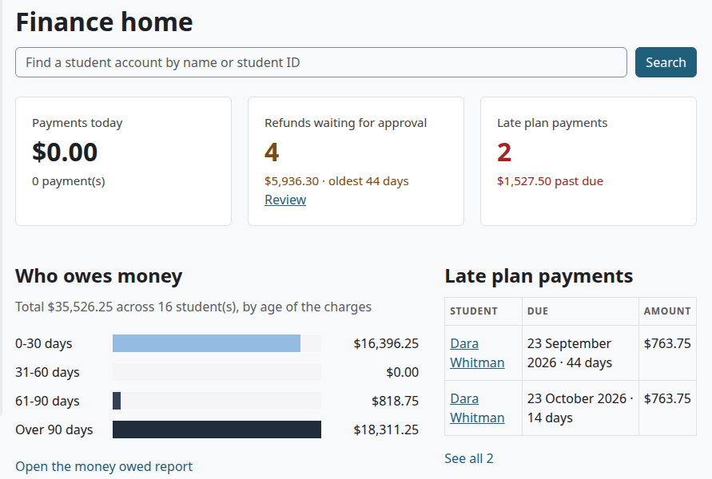
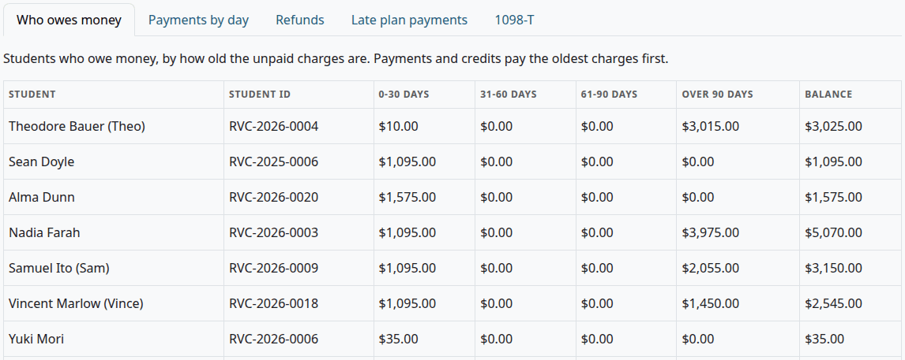
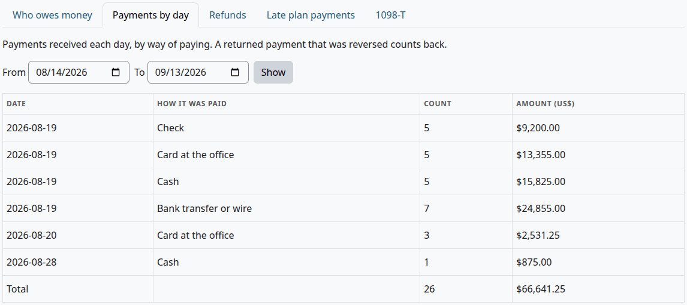
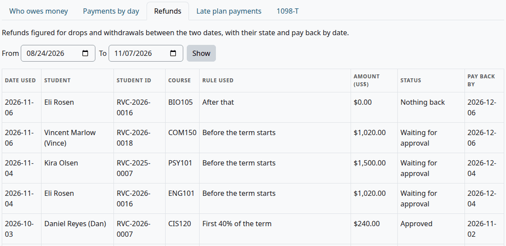
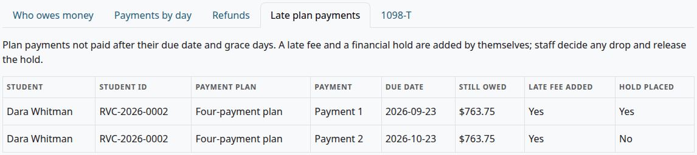
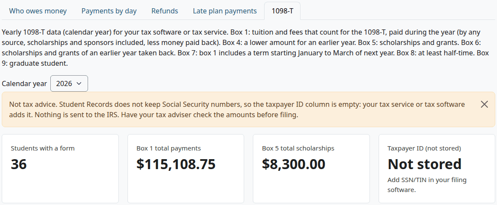
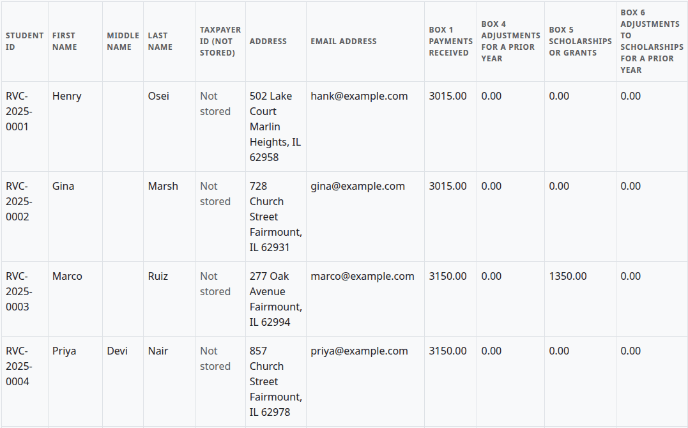

# Money reports

Money reports show who owes money, what came in, what went back, which plan payments are late, and the 1098-T data of a year. This page lists each report for finance staff, with its filters and columns, and says how the code works out the 1098-T figures.

Nothing on this page is tax advice. Have your tax adviser check the 1098-T data before you file.

## Contents

- [Open the money reports](#open-the-money-reports)
- [Finance home](#finance-home)
- [Who owes money](#who-owes-money)
- [Payments by day](#payments-by-day)
- [Refunds](#refunds)
- [Late plan payments](#late-plan-payments)
- [Download a report](#download-a-report)
- [1098-T](#1098-t)
- [How the boxes are worked out](#how-the-boxes-are-worked-out)
- [Related pages](#related-pages)

## Open the money reports

Who can do this: finance staff and managers. It needs the capability `local/studentrecords:viewbilling`.

1. Select the Student Records tab.
2. In the left menu, under Finance, select one of these:

| Menu item | Opens |
|---|---|
| Payments | The report Payments by day |
| Payment plans | The report Late plan payments |
| 1098-T | The report 1098-T |
| Reports | The report Who owes money |

Each report has the same five tabs, so you can go from one to the next. The page's heading is Money reports. The menu item Refunds opens the [Refunds](refunds.md) page, not the report of that name.

## Finance home

Finance home is the first page of the Finance menu. It sums up the reports.

| Part | What it shows |
|---|---|
| Find a student account by name or student ID | Searches [Student accounts](student-accounts.md#find-an-account) |
| Payments today | Payments dated today, less reversals, and how many |
| Refunds waiting for approval | How many, their total, the age of the oldest, and a link "Review" |
| Late plan payments | How many, and what is past due |
| Who owes money | The total across students, split by the age of the charges, with a link "Open the money owed report" |
| Late plan payments list | The first five, with a link "See all" and the number |

## Who owes money

Students who owe money, by how old the unpaid charges are. This report has no filters.

| Column | What it shows |
|---|---|
| Student | The name |
| Student ID | The student ID |
| 0-30 days | Unpaid charges 0 to 30 days old |
| 31-60 days | Unpaid charges 31 to 60 days old |
| 61-90 days | Unpaid charges 61 to 90 days old |
| Over 90 days | Older unpaid charges |
| Balance | The sum of those four |

The age of a charge counts from the date on its line. Every line that lowers the balance, such as a payment, a credit or a refund, pays the oldest charges first, whichever term they belong to. A student with a balance of $0.00 or less isn't listed.

## Payments by day

Payments received each day, by way of paying.

Filters: "From" and "To", both included. Select "Show" after you change them. The report opens on the first of this month through today. The days are the school's days, in its time zone.

| Column | What it shows |
|---|---|
| Date | The date on the payment line |
| How it was paid | The way of paying |
| Count | How many lines |
| Amount (US$) | Their total |

The last row is the total of the report. A reversal of a payment keeps its way of paying and counts back, on the date of the reversal, so a day can show a negative amount. Credits and refunds aren't payments, so they aren't here.

## Refunds

Refunds figured for drops and withdrawals between two dates, with their state and pay back by date.

Filters: "From" and "To", both included, on the date used. The report opens on the first of this month through today.

| Column | What it shows |
|---|---|
| Date used | The date the refund was figured on |
| Student | The name |
| Student ID | The student ID |
| Course | The course. A return of aid has none. |
| Rule used | The rule's name, or "No rule fits: nothing back". A return of aid shows "Return of aid helper" and the percent of the term completed. |
| Amount (US$) | The refund |
| Status | Waiting for approval, Approved, Rejected or Nothing back |
| Pay back by | The date |

Every refund shows here, with any status, and returns of aid too.

## Late plan payments

Plan payments not paid after their due date and grace days, on active plans. This report has no filters.

| Column | What it shows |
|---|---|
| Student | The name |
| Student ID | The student ID |
| Payment plan | The plan's name |
| Payment | Down payment, or Payment and a number |
| Due date | The date |
| Still owed | What is left of this payment |
| Late fee added | Yes or No |
| Hold placed | Yes or No. With two late payments and one hold, only the first says Yes. |

For what the daily task does, see [Late payments, late fees and holds](payment-plans.md#late-payments-late-fees-and-holds).

## Download a report

Every report has a Download list and a button under the table.

1. Open the report, and set its filters.
2. In the list, choose a format: Comma separated values (.csv), Microsoft Excel (.xlsx), HTML table, Javascript Object Notation (.json), OpenDocument (.ods) or Portable Document Format (.pdf).
3. Select "Download".

The file has the columns of the report. Its name is `studentrecords_`, the report, and today's date. Each download goes in the audit log.

## 1098-T

Who can do this: finance staff and managers. It needs `local/studentrecords:viewbilling`.

Student Records keeps no Social Security numbers, and it sends nothing to the IRS. It gives you a spreadsheet for your tax software or tax service. The page says so itself:

> Not tax advice. Student Records does not keep Social Security numbers, so the taxpayer ID column is empty: your tax service or tax software adds it. Nothing is sent to the IRS. Have your tax adviser check the amounts before filing.

Before you start:

- Set "Counts for the 1098-T" on each price. See [Add a price](billing-setup.md#add-a-price).
- Set "Half-time credit hours per term (1098-T box 8)" and "Graduate levels (1098-T box 9)". See [Change the billing settings](billing-setup.md#change-the-billing-settings).

1. Select 1098-T in the left menu.
2. In "Calendar year", choose the year. The list has this year and the six before it. Until the end of March the page opens on last year, and from April on this year.
3. Read the notice, the tiles and the table.
4. Under the table, choose a format and select "Download". The file name has the year in it.
5. Give the file to your tax service, which adds the taxpayer IDs and files the forms.

| Tile | What it shows |
|---|---|
| Students with a form | How many rows the year has |
| Box 1 total payments | The sum of box 1 |
| Box 5 total scholarships | The sum of box 5 |
| Taxpayer ID (not stored) | "Not stored", and "Add SSN/TIN in your filing software." |

The table has a row for each student with an amount in box 1, 4, 5 or 6.

| Column | What it holds |
|---|---|
| Student ID | The student ID |
| First name, Middle name, Last name | The legal name |
| Taxpayer ID (not stored) | Empty in the file. On the page it says "Not stored". |
| Address | The U.S. address on the student's file, or else the home address |
| Email address | The email on the student's file |
| Box 1 payments received | See below |
| Box 4 adjustments for a prior year | See below |
| Box 5 scholarships or grants | See below |
| Box 6 adjustments to scholarships for a prior year | See below |
| Box 7 next year January-March | X, or empty |
| Box 8 at least half-time | X, or empty |
| Box 9 graduate student | X, or empty |
| Qualified charges billed in the year | For your checks |
| Payments in the year | For your checks |
| Money paid back in the year | For your checks |

## How the boxes are worked out

This section says what the code does. It doesn't say what your school should report. Your tax adviser decides that.

The code first works out one figure for a date: the amount covered. It is the smaller of two sums up to that date, and never below 0:

- qualified charges less refunds: charge and refund lines marked "Counts for the 1098-T"
- money paid: payment lines, less money paid back, plus credits of the kinds in the table below

| Box or column | How the code works it out |
|---|---|
| Box 1 payments received | How much the amount covered rose during the year |
| Box 4 adjustments for a prior year | How much the amount covered fell during the year |
| Box 5 scholarships or grants | Credits of the kinds Scholarship, Grant and Federal grant dated in the year, less reversals of credits from the same year |
| Box 6 adjustments to scholarships for a prior year | Those credits reversed in the year, when the credit itself is from an earlier year |
| Box 7 next year January-March | X when box 1 is above 0, and a qualified line dated in the year belongs to a term that starts from January to March of the next year |
| Box 8 at least half-time | X when the student's load on their file is full time, or they have at least the half-time credit hours in a term that starts in the year. Registered, completed and withdrawn classes count. Only credit hour courses count, so a clock hour program needs a check. |
| Box 9 graduate student | X when the level of the student's program is one of the graduate levels |
| Qualified charges billed in the year | Qualified charge and refund lines dated in the year |
| Payments in the year | Payment lines dated in the year, less reversals |
| Money paid back in the year | Money paid back lines dated in the year |

Each kind of credit counts differently:

| Kind of credit | Counts as money paid for box 1 | Counts in box 5 |
|---|---|---|
| Scholarship | Yes | Yes |
| Grant | Yes | Yes |
| Federal grant | Yes | Yes |
| Federal loan | Yes | No |
| Sponsor or employer | Yes | No |
| Waiver | No | No |
| Discount | No | No |
| Adjustment | No | No |

Dates decide the year. A line counts in the year of the date on the line, which staff can set when they add it. Plan fees, late fees and returns of aid don't count for the 1098-T.

## Related pages

- [Finance guide](finance.md)
- [Billing setup](billing-setup.md)
- [Student accounts](student-accounts.md)
- [Payment plans](payment-plans.md)
- [Refunds](refunds.md)
- [Federal aid](federal-aid.md#aid-reports)
