# Online payments

Students can pay their account online through Moodle's own payment system, with any payment provider the school turns on. This page is for the administrator who sets it up, for finance staff, and for anyone who helps a student pay.

PayPal comes with Moodle. Other providers, such as Stripe, are add-ons. Each school makes its own payment account and keys. Student Records holds no card details, and it keeps no keys.

## Contents

- [What you need](#what-you-need)
- [Set up a payment account](#set-up-a-payment-account)
- [Choose the account in Billing setup](#choose-the-account-in-billing-setup)
- [Pay online as a student](#pay-online-as-a-student)
- [What happens after a payment](#what-happens-after-a-payment)
- [What a student can run into](#what-a-student-can-run-into)
- [If a payment doesn't reach the account](#if-a-payment-doesnt-reach-the-account)
- [Pay back an online payment](#pay-back-an-online-payment)
- [Related pages](#related-pages)

## What you need

Online payment works when all of these are true:

- Billing is on. See [Turn billing on or off](billing-setup.md#turn-billing-on-or-off).
- A Moodle payment account exists, is enabled and has a payment provider turned on with its keys.
- That account is chosen in Billing setup.
- Moodle's cron runs, so that the recovery task can do its work.

## Set up a payment account

Who can do this: a site administrator. It needs the Moodle capability `moodle/payment:manageaccounts`.

Before you start:

- You have the keys from your payment company. For PayPal these are a Client ID and a Secret.

> Not walked through: real keys need a real PayPal account, so no test site can show a payment going through.

1. Go to Site administration > General > Payments > Payment accounts.
2. Select "Create payment account".
3. Fill in "Account name". Leave "Enable" ticked.
4. Select "Save changes".

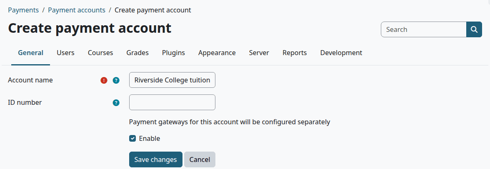

5. In the list of accounts, on the row of the new account, select PayPal under Payment gateways.
6. Tick "Enable".
7. Fill in the fields below.
8. Select "Save changes".

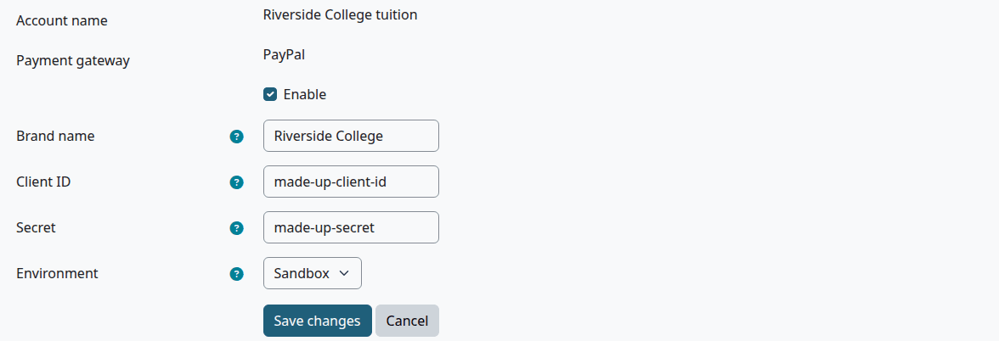

| Field | What to enter |
|---|---|
| Brand name | The name students see at PayPal |
| Client ID | From your PayPal account |
| Secret | From your PayPal account |
| Environment | Sandbox for the payment company's test mode, Live for real money. Use Sandbox first. |

Check that:

- The account is in the list, with a tick next to PayPal.

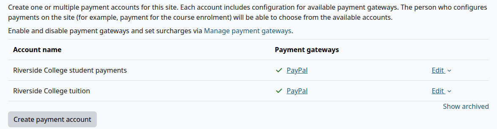

To add another provider, install its plugin first. Its gateway then shows on the same row. To turn a provider on or off for the whole site, or to set a surcharge, use Site administration > Plugins > Payment gateways > Manage payment gateways. PayPal is on there by default.

## Choose the account in Billing setup

Who can do this: finance staff and managers. It needs the capability `local/studentrecords:managebilling`.

1. Open [Billing setup](billing-setup.md#open-billing-setup).
2. In "Payment account for online payments", choose the account.
3. Select "Save changes".

The list has only accounts that are enabled, aren't archived and have a provider turned on.

Check that:

- The notice "Online payment is off" is gone from the top of Billing setup.

With billing on and no usable account, Billing setup shows this notice. A person who may manage payment accounts also gets a link to them.

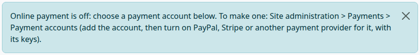

## Pay online as a student

Who can do this: the student, on their own account. It needs the capability `local/studentrecords:viewown`, which every signed-in user has by default. Staff can't pay for a student. They [record the payment](student-accounts.md#record-a-payment) instead.

Before you start:

- The student owes at least $1.00.
- Online payment is set up.

> Not walked through: the last step needs a real PayPal account, so no test site can show it. What happens after "Proceed" comes from the code.

1. Select My account in the left menu.
2. On the Pay online card, select "Pay online". My home has a "Pay online" button too.
3. In "Amount to pay (US$)", keep the whole balance, or type a smaller amount.
4. Select "Continue".
5. Check the amount, then select the button with that amount, such as "Pay $250.00 now". "Cancel" goes back to the account.
6. In the window "Select payment type", choose the provider and check the cost.
7. Select "Proceed".
8. Pay on the payment company's own page.

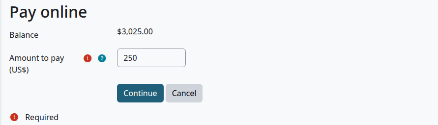

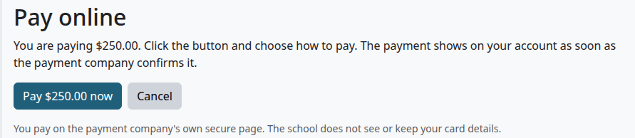

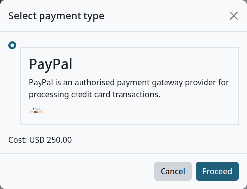

These screens work on a phone too:

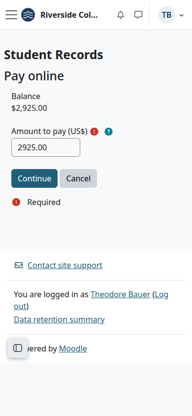

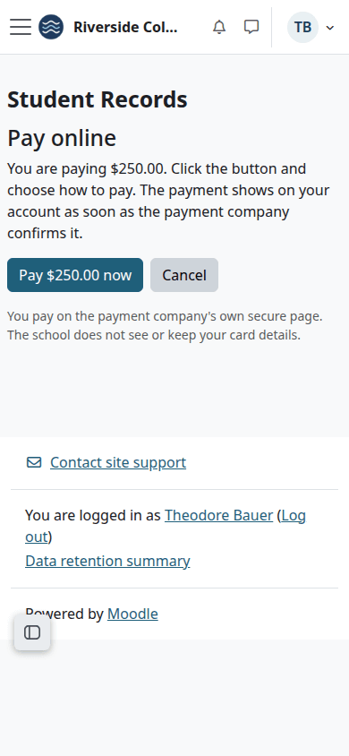

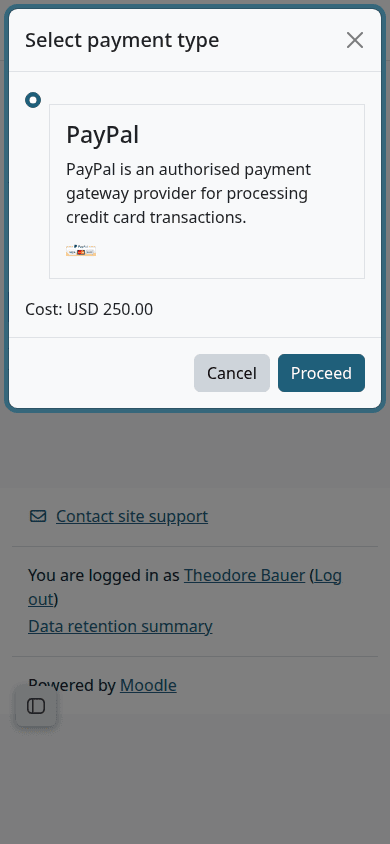

The card at the start offers "your next plan payment" when the student has a plan. The student types that amount in step 3. The form always starts with the whole balance.

## What happens after a payment

The student comes back to My account, with this notice:

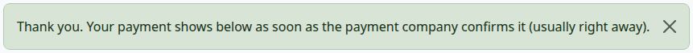

When the payment company confirms the payment, Moodle tells Student Records, and the account gets a line:

| What | Value |
|---|---|
| Description | "Payment: Online" |
| Type | Payment (Online) |
| Date | The date of the payment |
| Term | None. So the tile "Paid in" and the term filter don't count it |
| Receipt | A receipt number, as for any payment |
| Reference on the receipt | The provider's name and "Moodle payment" with a number |
| Amount | The amount of the request. A surcharge from the provider stays out of the account |

The rest works as for a payment staff record: plan payments update, and a course that waited can open. See [Record a payment](student-accounts.md#record-a-payment).

The student gets the message "Payment received" with Moodle's next cron run. It has no receipt in it. The receipt is the number in the Receipt column of My account.

> Known problem in 1.4.6: the Pay online card says "You get a receipt by email." The message that goes out has no receipt in it. It asks the student to log in, and the receipt is on the account.

> Known problem in 1.4.6: with no payment plan, the Pay online card says "Pay your next plan payment (-)". The dash means there is no plan payment.

## What a student can run into

| What the student sees | Why | What to do |
|---|---|---|
| "Enter an amount from $1.00 up to your balance." | The amount is under $1.00 or over the balance | Enter another amount |
| "Online payment is not set up yet. Use one of the other ways to pay, or ask the school." | No usable payment account is chosen. The My home button shows whenever a student owes money, even then | Use the How to pay text, or [choose the account](#choose-the-account-in-billing-setup) |
| "This payment was already made or is no longer open." | The student opened an old payment page. It was paid, or the balance is now below that amount | Start again from My account |
| "Nothing is owed right now." | The balance is $0.00 or less | Nothing to pay |
| "Only the student can pay their own account online." | Someone else opened the student's payment page | Record the payment on the account |

> Known problem in 1.4.6: a balance under $1.00 can't be paid online. The Pay online card and button still show, and the form then refuses every amount with "Enter an amount from $1.00 up to your balance." The student pays another way, or Finance adds a credit for the amount.

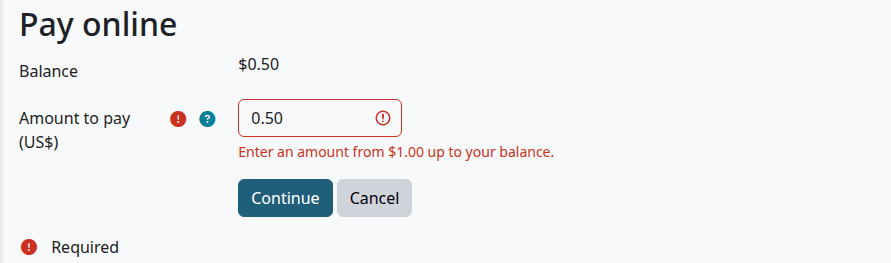

## If a payment doesn't reach the account

Moodle delivers a payment to Student Records once, and it doesn't try again. If that step stops, for example because the accounts were busy, the money is taken and no line is written.

The task "Student Records online payments: record any that did not reach the student account" runs every 5 minutes. It looks for payments that Moodle has and that have no line on an account, and it records them, with the same checks as a normal delivery and the payment's own date. The audit log says "online payment", its number, and "recovered: its delivery did not finish".

Until the task runs, the student sees the same balance and can still pay online. If they do, the second payment gets its own line, and Finance pays it back. The same is true when a student pays one request from two browser tabs. Then the audit log says "second online payment".

The task only looks at payments from the day the plugin was installed, or upgraded to this version. Older payments stay as they are, even with no line. Finance may have entered that money by hand.

A payment that fails the checks is never recorded, by the delivery or by the task. To pass, a payment must:

- be for this request, by the student who started it
- go to the payment account of the request
- be in US dollars
- be at least the amount of the request

Such a payment stays in Moodle's own records, and the audit log says "does not fit request" with "not recorded", once. Finance decides what to do, for example [record the payment by hand](student-accounts.md#record-a-payment) or pay it back on the payment company's site.

The audit log is the page [Audit log](audit-log.md), in the Student Records setup menu. It needs `local/studentrecords:viewlog`, which the Finance role doesn't have.

> Not walked through: this needs a real payment, so no test site can show it. What happens comes from the code.

## Pay back an online payment

Student Records can't send money back to a card or a PayPal account. Pay it back on the payment company's own site, then choose "On the payment company's site (PayPal, Stripe ...)" under [Record money paid back](refunds.md#record-money-paid-back).

To cancel an online payment on the account, for example after a chargeback, [reverse the line](student-accounts.md#reverse-a-line). The recovery task doesn't add a reversed payment again.

## Related pages

- [Finance guide](finance.md)
- [Billing setup](billing-setup.md)
- [Student accounts](student-accounts.md)
- [Refunds](refunds.md)
- [Audit log](audit-log.md)
- [Student guide](student.md)
- [Troubleshooting](../troubleshooting.md)
