# Payment plans

A payment plan splits what a student owes into a down payment and later payments. This page shows finance staff how to give a plan, what the agreement says, how a custom plan works, how to cancel a plan, and what the daily task does when a payment comes near its date or goes late.

To set up your school's plans, see [Add a payment plan](billing-setup.md#add-a-payment-plan).

## Contents

- [How a plan works](#how-a-plan-works)
- [Give a payment plan](#give-a-payment-plan)
- [Give a custom plan](#give-a-custom-plan)
- [Read a plan on the account](#read-a-plan-on-the-account)
- [The plan agreement](#the-plan-agreement)
- [One active plan at a time](#one-active-plan-at-a-time)
- [Cancel a plan](#cancel-a-plan)
- [When a payment on a plan is reversed](#when-a-payment-on-a-plan-is-reversed)
- [Reminders](#reminders)
- [Late payments, late fees and holds](#late-payments-late-fees-and-holds)
- [What the student sees](#what-the-student-sees)
- [Related pages](#related-pages)

## How a plan works

A plan covers the student's whole balance on the day it is given, plus the plan fee. It doesn't cover one term's charges only. Charges added later aren't in the plan.

The down payment is due the day the plan is given. The other payments are due on the plan's dates, and the rest of the money is split evenly among them. Cents left over go on the last payment. A down payment as a percent is worked out to the cent, and a half cent goes up.

Payments and credits added to the account after the plan starts count toward it, in due order. Staff payments, online payments, credits and aid disbursements all count. Refunds don't. It is the day the line was added that matters, not the date on the line. So a payment you enter today with an earlier date still counts.

A plan has a term, and the term does three things:

- Due dates counted from the term start use that term.
- Under the usual course access rule, a plan opens the courses of that term only, once its down payment is paid. See [Billing setup](billing-setup.md#change-the-billing-settings).
- The plan fee and the late fees go on the account with that term.

A down payment of 0 counts as paid at once, so such a plan opens the courses of its term as soon as it is given.

## Give a payment plan

Who can do this: finance staff and managers. It needs the capability `local/studentrecords:managebilling`.

Before you start:

- The student owes money.
- The student has no active plan. See [One active plan at a time](#one-active-plan-at-a-time).

1. [Find the account](student-accounts.md#find-an-account).
2. Select "Give a payment plan".
3. In "Term", choose the term of the plan. The list starts with your oldest term, so don't leave it as it is.
4. In "Plan", choose one of your school's plans. Only plans that fit this student are listed. To set the terms yourself, see [Give a custom plan](#give-a-custom-plan).
5. In "Note", add anything staff should know. A note is optional here.
6. Leave "Email the plan agreement to the student" ticked, unless you don't want the message to go.
7. Select "Give a payment plan".

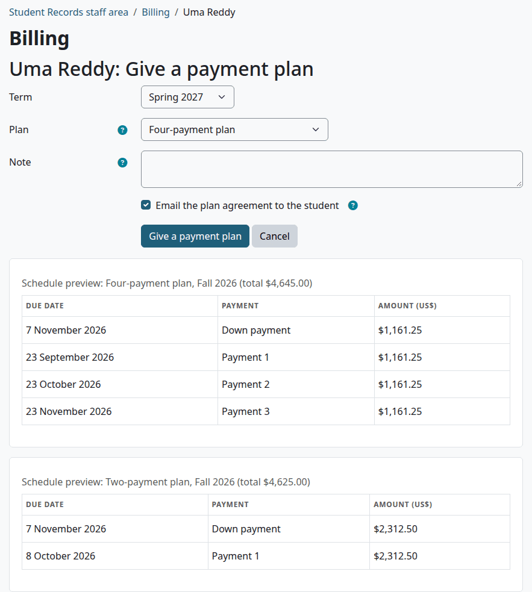

Under the form there is a "Schedule preview" for each plan the student can use, with the total, the due dates and the amounts. The total is the balance plus the plan fee.

> Known problem in 1.4.6: the schedule previews always use the current term, whatever you choose in "Term". In the picture above the plan is for next term, and the previews show the dates of the running term. The amounts are right, and so are fixed dates. For dates counted from the term start, work them out from the term you chose, and check them on the account after you give the plan.

Check that:

- The page says "Saved."
- The top of the account says "On a payment plan".
- A plan fee, if the plan has one, is on the account as "Payment plan fee:" and the plan's name. It isn't refundable, and it doesn't count for the 1098-T.
- The plan is under Payment plans at the bottom of the account, with the status Active.
- The Next payment tile shows the first unpaid payment.

What can go wrong:

- "Nothing is owed, so there is nothing to put on a plan." The balance is $0.00 or less.
- "The due dates of this plan do not work for this term. Check the plan's due dates." The plan's fixed dates don't match its number of payments. Correct the plan in [Billing setup](billing-setup.md#change-a-payment-plan-or-stop-offering-it).

> Known problem in 1.4.6: due dates aren't moved forward. A plan given after a due date has passed starts with that payment past due. Once its grace days are over, the next run of the daily task adds the plan's late fee, if it has one, for each such payment, and a financial hold. To avoid this, choose a term whose dates are still ahead, or give a custom plan with fixed dates. If it has happened, cancel the plan, then reverse the late fees, and the plan fee if you give the plan again. The hold needs someone who manages students. See [Late payments, late fees and holds](#late-payments-late-fees-and-holds).

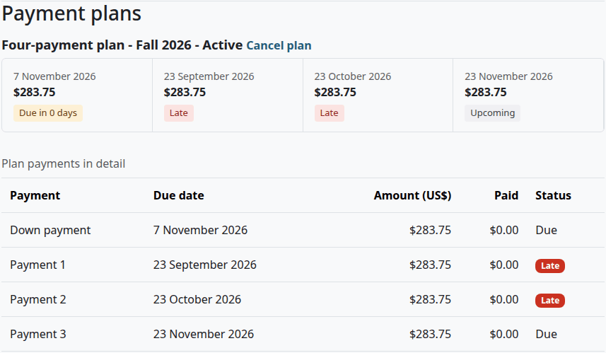

## Give a custom plan

A custom plan is for one student, with its own terms. It needs a note that says why.

Who can do this: finance staff and managers. It needs `local/studentrecords:managebilling`.

Before you start:

- The student owes money, and has no active plan.

1. [Find the account](student-accounts.md#find-an-account).
2. Select "Give a payment plan".
3. In "Term", choose the term of the plan.
4. In "Plan", choose "Custom plan (for this student only)". The form shows the plan's fields.
5. Fill in the fields. They work as they do for a school plan. See [Add a payment plan](billing-setup.md#add-a-payment-plan). "Plan name" is needed.
6. In "Note", say why this student gets this plan. The note is needed.
7. Select "Give a payment plan".

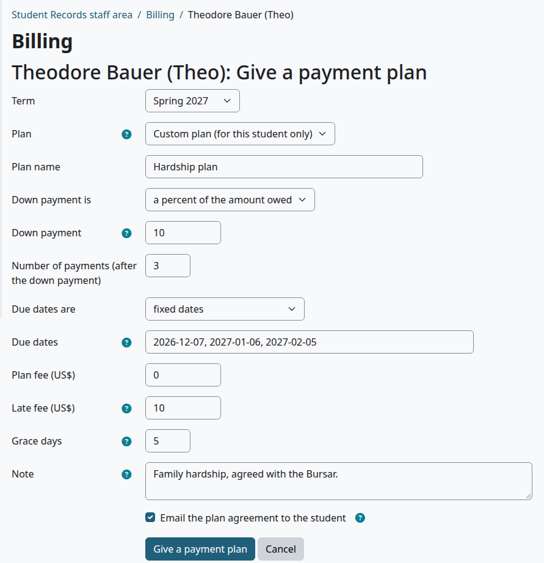

Check that:

- The page says "Saved."
- The plan is under Payment plans. The note shows under the table, for staff.

What can go wrong:

- "A custom plan needs a note saying why." Add the note, then select "Give a payment plan" again.
- "Enter 3 dates written year-month-day (for example 2027-02-01), separated by commas." The number of dates must match "Number of payments (after the down payment)".

## Read a plan on the account

The bottom of the account has a Payment plans section, with every plan the student has had, newest first.

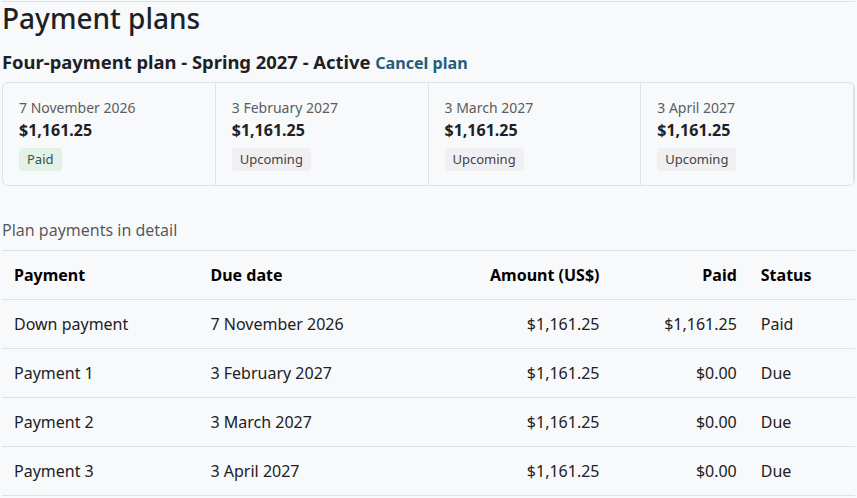

The title has the plan's name, its term and its status:

| Status | What it means |
|---|---|
| Active | The plan is running |
| Paid in full | All its payments are paid |
| Cancelled | Staff cancelled it |
| Closed, with a payment reversed | It was paid in full, then a payment was reversed while another plan was active |

Each payment has a step with its date, its amount and a tag:

| Tag | What it means |
|---|---|
| Paid | Paid in full |
| Late | Unpaid, and past its due date plus the grace days |
| Due in 0 days, Due in 5 days | Unpaid and due within 14 days |
| Upcoming | Unpaid and due later, or past its date but still inside the grace days |

Staff also get the table "Plan payments in detail", with what is paid on each payment and a status of Paid, Due or Late, and the plan's note under it.

"Paid in full" is about the plan, not the account. A late fee or a charge added after the plan started isn't one of the plan's payments.

> Known problem in 1.4.6: money paid for a late fee or for a later charge still counts toward the plan. So a plan can show Paid in full while the account has a balance. Go by the balance at the top of the account, and collect what is left separately.

## The plan agreement

With "Email the plan agreement to the student" ticked, the student gets the message "Payment plan agreement" as soon as you give the plan. It has the plan's term, the first due date, a link to the account and a link to pay online. It has no amounts, and it isn't an e-signature. The full schedule is on the student's account.

The message goes as a Moodle notification, and by email if the student's message settings send it. You can reword it or switch it off. See [Messages](messages.md).

> Not walked through: the email copy of a message needs a real mail server, so no test site can show it. The Moodle notification was checked.

## One active plan at a time

A plan covers the whole balance, so a student has one active plan at a time, for any term. A second plan would count the same payments twice.

If the student has an active plan, "Give a payment plan" goes back to the account with this message:

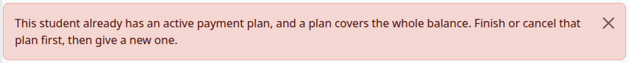

To change a student's plan, [cancel it](#cancel-a-plan), then give a new one. The new plan covers the balance on that day.

## Cancel a plan

Who can do this: finance staff and managers. It needs `local/studentrecords:managebilling`.

Before you start:

- The plan is Active. A finished plan has no "Cancel plan" link.

1. [Find the account](student-accounts.md#find-an-account).
2. In Payment plans, select "Cancel plan" next to the plan's title.
3. In "Reason", say why.
4. Select "Cancel plan".

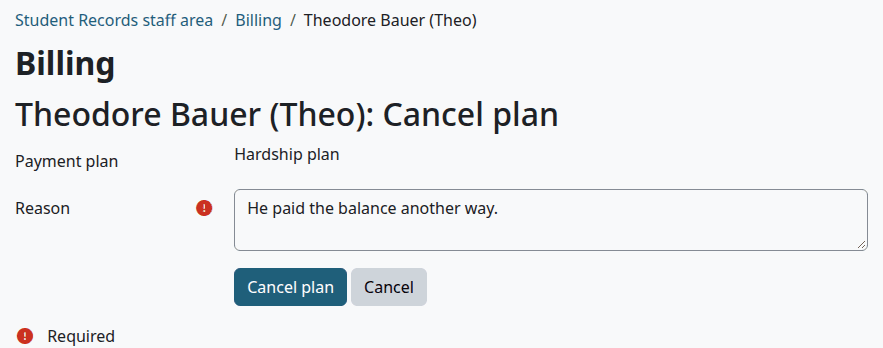

Check that:

- The page says "Saved."
- The plan's title says Cancelled, and the reason is added to the note under the table.
- The top of the account no longer says "On a payment plan".

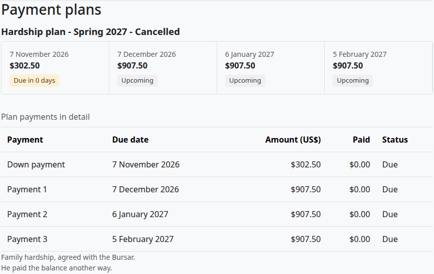

Cancelling removes nothing. The plan stays on the account, with its schedule as it stood. The balance doesn't change, so the plan fee, any late fees and any hold stay until you deal with them. The student gets no message. A course that is already open stays open.

## When a payment on a plan is reversed

A [reversed payment](student-accounts.md#reverse-a-line) counts back on the plan, and the payment it paid goes back to Due or Late.

If the plan was Paid in full, it goes back to Active. If another plan is active, it can't, because a student has one active plan at a time. The person who reversed the payment sees this warning, and the same text is added to the plan's note:

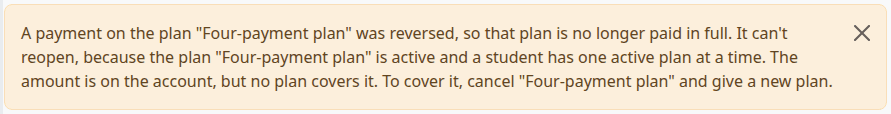

The plan's title then says "Closed, with a payment reversed". The amount is on the account, but no plan covers it. To cover it, cancel the active plan and give a new one.

A closed plan doesn't reopen by itself when the other plan is cancelled. It reopens the next time a payment, a credit or a refund goes on the account, if it still isn't paid in full.

## Reminders

The daily task "Student Records billing: plan reminders and late payments" runs at 06:15. Moodle's cron must be running. See [Install and setup](install-and-setup.md).

With "Reminder (days before a due date)" set above 0, the task reminds a student once about each plan payment that is due within that many days. The default is 7. See [Billing setup](billing-setup.md#change-the-billing-settings).

- The student gets the message "Plan payment due soon". It has no amount in it.
- The down payment gets no reminder.
- A plan on an account with a balance of $0.00 or less gets none.

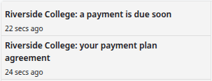

## Late payments, late fees and holds

A payment is late when it is unpaid and today is past its due date plus the plan's grace days. Nobody has to do anything for the next steps. The daily task does them.

For each late payment, in this order:

1. It adds the plan's late fee to the account, once for that payment. The line says "Late fee: plan payment due" and the date. It isn't refundable, and it doesn't count for the 1098-T. A plan with a late fee of 0 adds nothing.
2. It places a financial hold that blocks registration, unless a hold of this plan is already in force. The hold's reason says which plan and which due date.
3. With the hold, the student gets the messages "Hold placed" and "Plan payment late", and everyone with `local/studentrecords:managebilling` and `local/studentrecords:viewbilling` gets "Staff: plan payment late".

So two late payments give two late fees and one hold.

The amount comes from the plan, as it was when the plan was given. A price with the option Late fee doesn't set it. Added by shows the user Moodle's cron runs as, usually the admin.

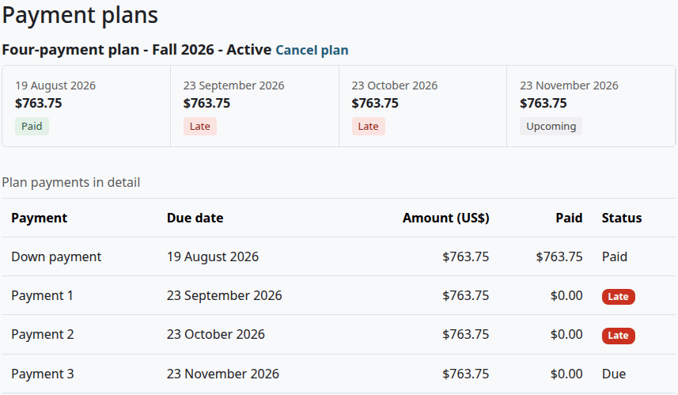

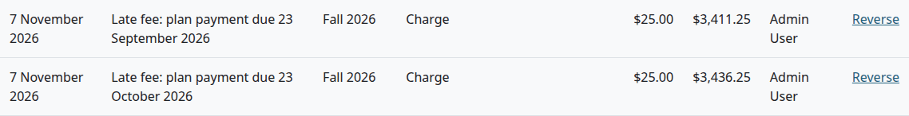

These things don't happen by themselves:

- Nothing drops the student from a class. Staff decide that.
- The hold isn't released when the student pays. Someone with `local/studentrecords:managestudents` releases it on the student's file, and the Finance role doesn't have that capability. Ask the Registrar. See [Holds and standing](holds-and-standing.md).

A hold that staff released isn't placed again for the same late payment. A later payment that goes late can place a new one.

With a balance of $0.00 or less, the task does nothing for that plan, even with payments late. A refund or a reversal can clear an account without paying the plan.

To see every late payment of the school, use the report [Late plan payments](money-reports.md#late-plan-payments).

## What the student sees

The student's My account has the Next payment tile, and a Payment plans section with each plan's steps. They don't get the table in detail, the note or the Cancel plan link. See [What the student sees](student-accounts.md#what-the-student-sees).

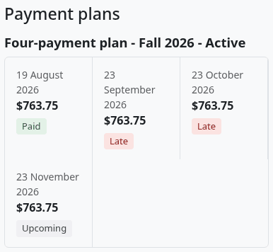

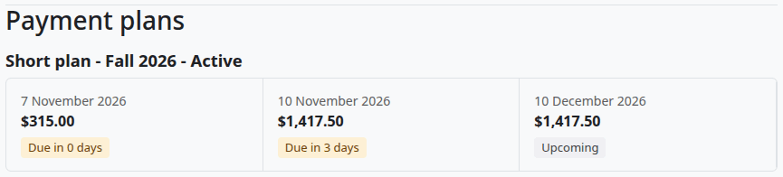

The Pay online card offers the next plan payment, the full balance or another amount. See [Online payments](online-payments.md#pay-online-as-a-student).

## Related pages

- [Finance guide](finance.md)
- [Billing setup](billing-setup.md)
- [Student accounts](student-accounts.md)
- [Online payments](online-payments.md)
- [Money reports](money-reports.md)
- [Holds and standing](holds-and-standing.md)
- [Messages](messages.md)
