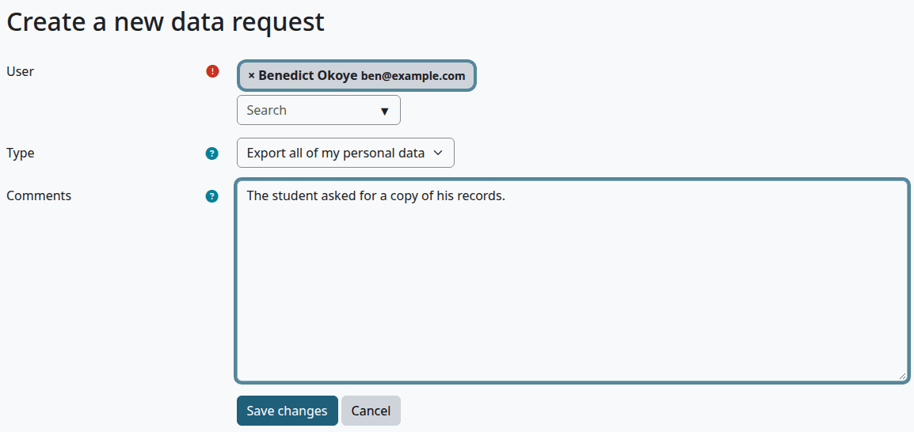
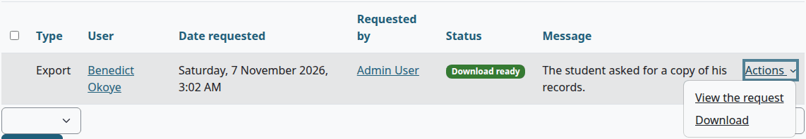
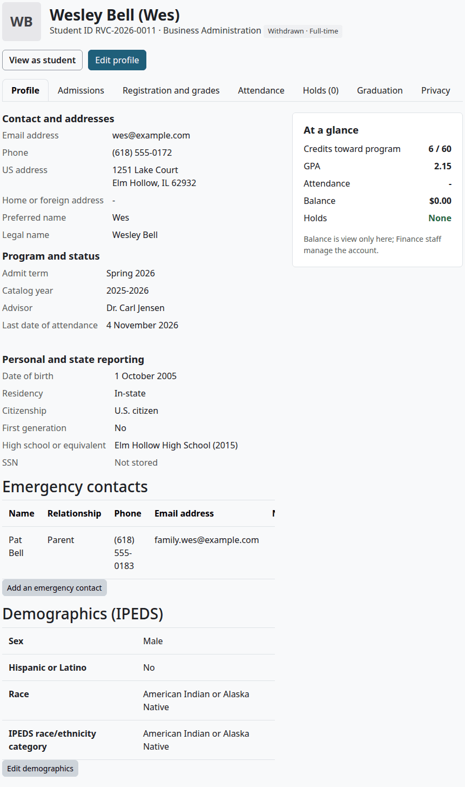
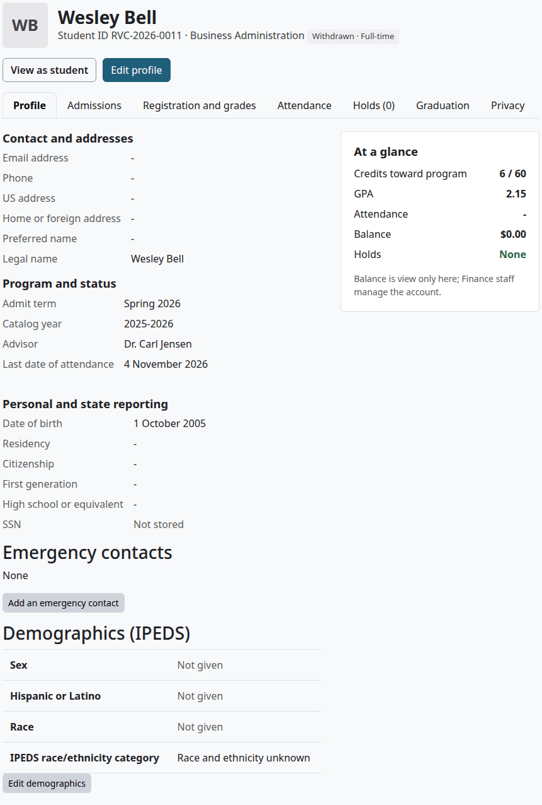
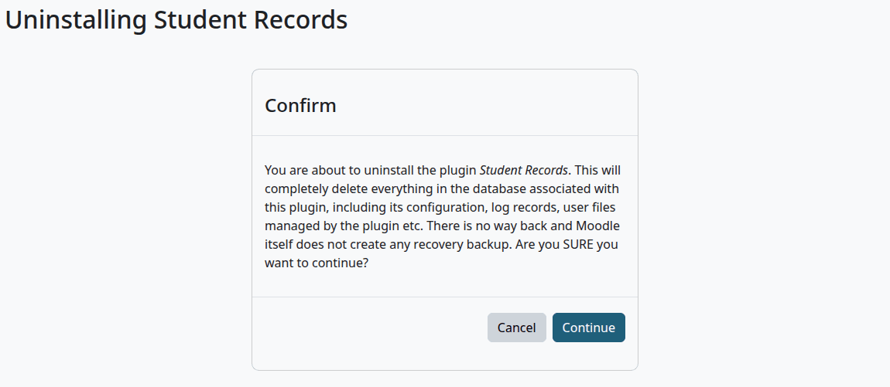

# Privacy and uninstall

This page is for site administrators and privacy officers. It says what Student Records stores, how Moodle's privacy tools treat it, what an export holds, what a deletion removes and keeps, and what happens when you remove the plugin.

This manual gives no legal advice, and no FERPA advice. The plugin makes choices about what a deletion keeps. A school checks those choices against its own duties, and the records it must keep.

## Contents

- [What the plugin stores](#what-the-plugin-stores)
- [What leaves the site](#what-leaves-the-site)
- [Before you use Moodle's privacy tools](#before-you-use-moodles-privacy-tools)
- [Export a person's data](#export-a-persons-data)
- [What an export holds](#what-an-export-holds)
- [Delete a person's data](#delete-a-persons-data)
- [What a deletion removes](#what-a-deletion-removes)
- [What a deletion keeps](#what-a-deletion-keeps)
- [Deleting a Moodle account by hand](#deleting-a-moodle-account-by-hand)
- [Sites with a data registry](#sites-with-a-data-registry)
- [Before you uninstall](#before-you-uninstall)
- [Uninstall the plugin](#uninstall-the-plugin)
- [What stays after an uninstall](#what-stays-after-an-uninstall)
- [Install it again](#install-it-again)
- [Related pages](#related-pages)

## What the plugin stores

The student is the person the data is about. Each row below is kept against the student, except where the table says otherwise. The plugin stores no Social Security numbers.

| What | What it holds |
|---|---|
| Student record | Legal and preferred name, student ID, date of birth, email, phone, addresses, program, terms, status, award, advisor, last date of attendance, withdrawal date, visa details, residency, citizenship, first generation status, high school and staff notes |
| Admissions | Status history, the application checklist and its notes, decisions, prior education |
| Emergency contacts | Their names, relationships, phones, emails and notes. These are about other people, given by the student |
| Demographics | Sex, Hispanic or Latino, race |
| Registration and grades | Each registration, its grade and where the grade came from, grade changes, transfer credit, substitutions, academic standing, waitlist places and the self-registration cart |
| Attendance | A mark for each meeting |
| Holds, graduation | Holds, graduation applications and their reviews |
| FERPA | Notice acknowledgments, release authorizations, and letters issued, with what they said and to whom |
| Student account | Account lines, online payment requests, payment plans and refunds |
| Financial aid | Awards and aid year details |
| Documents | Files on the student's file |
| Message log | Each message sent, with the subject and the status, but not the text |
| Staff | On a faculty or staff record: email, phone, office hours, notes, job details, credentials and qualified courses |
| Change history | Old and new values of fields on the record, with who changed them and when |
| [Audit log](audit-log.md) | Who did what, with the IP address and details |
| Import | The files staff upload, and the items read from them |

The school's terms, programs, courses, sections, grading, price list and rules are settings. They record only who last changed them.

No task or setting deletes old audit log entries or message log rows. A [deletion](#what-a-deletion-removes) removes a person's message log rows.

## What leaves the site

- Messages go through Moodle's message system. They say there is something new, and ask the person to log in, with no grades or amounts.
- Card details stay with the payment company. See [Online payments](online-payments.md).
- The plugin sends nothing to outside agencies. Files such as the Clearinghouse file, saved exports and the 1098-T spreadsheet go only where staff send them after they download them.

## Before you use Moodle's privacy tools

Who can do this: a site administrator, or a person with a privacy officer role.

The tools are at Site administration > Users > Privacy and policies > Data requests. They belong to Moodle, and you don't set up anything for this plugin alone.

Cron must run, because Moodle carries out each approved request in its background tasks. See [Make sure cron runs](install-and-setup.md#make-sure-cron-runs).

A person can ask for themselves only when "Contact the privacy officer" is ticked in Moodle's Privacy settings at Site administration > Users > Privacy and policies. It is off by default, and their profile then has no link for it. Staff make the request for them, as below.

## Export a person's data

Who can do this: a site administrator or a privacy officer.

1. Go to Site administration > Users > Privacy and policies > Data requests.
2. Select "New request".
3. In "User", type the person's name and select them.
4. In "Type", select "Export all of my personal data".
5. In "Comments", say why, if you wish.
6. Select "Save changes".

The request says "Awaiting approval". With Moodle's setting "Allow filtering of exports by course" on, it says "Pending" until the next cron run.

7. On the request's row, select "Actions", then "Approve request".
8. In the box that opens, select "Approve request".

After the next cron run, the request says "Download ready".

9. Select "Actions", then "Download". You get a ZIP file.

Check that:

- The ZIP file has a folder Student Records under the person's name.

What can go wrong:

- The request stays at "Pending" or "Approved". Cron isn't running, or hasn't run yet.

## What an export holds

To read an export, unzip it and open `index.html`. The data is in folders by plugin. Moodle's own data and other plugins' data are there too, and Academic Transcript has its own folder.

Under Student Records, a folder shows only when the person has data of that kind.

For a student:

| Folder | What it holds |
|---|---|
| Student record | The whole record |
| Documents | The files on the file |
| Status history, Application checklist, Admission decisions, Prior education | Admissions |
| Emergency contacts, Demographics (IPEDS) | As on the file |
| Registration and academic history, Transfer credit, Course substitutions, Academic standing, Grade changes | The academic record |
| Attendance, Holds, Graduation, Waitlist, Registration | Marks, holds, applications, waitlist places and the cart |
| FERPA annual notice, FERPA and release authorizations, Letters issued | FERPA records |
| Student account, Online payments, Payment plans, Refunds | Money |
| Financial aid, Financial aid year details of a student (federal aid module). | Aid |
| Message log | Each message's subject and status |
| Change history | Every change to the person's record, and a list of the changes they made |
| Audit log | The action, the record and the time. No details, and an IP address only on entries the person made |

For a staff member:

| Folder | What it holds |
|---|---|
| Faculty or staff record | The record, with credentials, qualified courses and their files |
| Actions as staff | The ids of holds placed and released, grade changes asked for and decided, account lines added and import items decided, and the names of files imported |
| Admissions actions | Decisions recorded and status changes, by id and date |
| Change history | The field and the date of each change they made, with no values |
| Audit log | As for a student |

So a staff member's export says what they did, with record ids and dates, and holds no student's data.

An export also holds Moodle's record of the person's online payments. Each export goes in the [Audit log](audit-log.md#after-a-privacy-request).

## Delete a person's data

Who can do this: a site administrator or a privacy officer.

Before you start:

- Read [What a deletion keeps](#what-a-deletion-keeps) and [Sites with a data registry](#sites-with-a-data-registry).
- Moodle deletes the person's account as well. They can't sign in again, and the student record stays with no account behind it.

1. Go to Site administration > Users > Privacy and policies > Data requests.
2. Select "New request".
3. In "User", type the person's name and select them.
4. In "Type", select "Delete all of my personal data".
5. Select "Save changes".
6. The request says "Awaiting approval". On its row select "Actions", then "Approve request", and "Approve request" again in the box.

After the next cron run, the request says "Deleted".

The page says "A site purpose and category have not been defined. When these are not defined, all data will be removed when processing deletion requests." until your site sets up Moodle's data registry. In Student Records, "all data" means the list below, and the rest stays.

Check that:

- The request says "Deleted".
- Open the file as records staff. The contact details and the personal fields are empty. The legal name, the student ID, the date of birth, the program and the grades are there.

Here is a file before a deletion:

And after it:

What can go wrong:

- The privacy officer gets a notice of an error in Moodle's Enrolment on payment plugin, for a person with online payments. That is Moodle's own call, and the request still ends as "Deleted".
- The request says "Rejected". Moodle never deletes the main site administrator.

## What a deletion removes

| Where | What goes |
|---|---|
| The student record | Preferred name, email, phone, US address, home or foreign address, home country, visa type, SEVIS ID, staff notes, high school and its year, residency, citizenship and first generation status |
| Emergency contacts | Every value. The empty row stays, and shows as "None" |
| Demographics | Every value. The page then says "Not given" |
| Application checklist, prior education | The notes. The rows stay |
| Documents | All the files on the file |
| Self-registration and waitlists | The cart and the waitlist places |
| Message log | The rows of the student, and of messages sent to the person. Queued messages for them don't go |
| A faculty or staff record | Email, phone, office hours and notes |
| Change history | The old and new values of all the fields above. A line says a privacy request cleared them |
| Audit log | The details of entries about the person, and the IP address of entries they made. The entries stay |
| Online payments | Moodle's record of the person's payments, and what the payment provider keeps about them |

## What a deletion keeps

The plugin keeps the rest, because the maintainers assumed that a school must keep it. Check this against your school's duties. No setting changes this list.

| What stays | Why the plugin keeps it |
|---|---|
| Legal name, student ID, date of birth, program, terms, status, award | The permanent academic record |
| Status history, admission decisions, prior education | The permanent academic record |
| Registrations, grades, grade changes, transfer credit, substitutions, academic standing, attendance, holds, graduation applications | The permanent academic record |
| Notice acknowledgments, release authorizations, letters issued | FERPA records |
| Account lines, online payment requests, refunds, payment plans | Financial and tax records |
| Aid awards and aid year details | Aid records |
| Staff names, job details, credentials, qualified courses | The school's staffing record |
| The change history and the audit log, without the values, details and IP addresses above | They show who did what to an official record |

Some things stay that you may want to look at by hand:

- Free text in a row that stays isn't blanked. Examples are a note on an account line, the reason of a hold, a note on an aid award, and the reason of a decision. Staff should keep such text free of what a deletion would remove.
- For a staff member, a deletion leaves the rows of what they did alone. Their name stays on each.
- A faculty record with no linked account, and items read from an import, name no Moodle user, so no request reaches them.
- [Academic Transcript](../academic-transcript/privacy-and-uninstall.md) treats its own data by its own rules. Its deletion removes issued transcripts, so their verification codes stop working.

## Deleting a Moodle account by hand

Deleting an account at Site administration > Users > Browse list of users isn't a data request, and it clears nothing in Student Records.

With Moodle's setting "Create automatic data deletion requests" on, which is the default, Moodle makes a deletion request for that person, and it waits at "Awaiting approval". Until someone approves it, the file keeps all its data. After approval, the deletion runs as above.

## Sites with a data registry

Moodle's data registry is at Site administration > Users > Privacy and policies > Data registry. It sets how long each kind of data is kept. Once it has defaults, a deletion works differently:

- Moodle now approves a person's own data for deletion only when every course they are enrolled in has an end date in the past and its retention period is over. Until then it leaves that data out, and Student Records with it.
- The request still ends as "Deleted", and the Moodle account is deleted. The file keeps every field, contact details too.
- When Moodle later removes what's left of the account, the task "Student Records privacy: carry out finished deletion requests of removed accounts" finishes the job within the hour. That can be long after the request, because it follows your retention periods.

So on such a site, "Deleted" on the request doesn't prove the file is clear. Check the file afterwards.

> Not walked through: the data registry was set up on a test site with a script, and the request was then run. The result above was seen on the site. The late finish comes from the plugin's tests, because the wait follows the retention period.

## Before you uninstall

Uninstalling deletes everything the plugin holds: every student record, account, grade, attendance mark, document, message log entry, change history and audit log entry, with the terms, programs, courses, sections, grading, prices and settings.

Schools keep permanent records, so export what you must keep first. No single button exports the whole plugin. Use these:

- A full backup of the Moodle database and data folder, kept as long as you need it.
- [Reports and exports](reports-and-exports.md) for lists.
- Moodle's data requests for each person whose data you must hand over.
- Official transcripts from [Academic Transcript](../academic-transcript/registrar-guide.md), which keeps its own copies while it stays installed.

Don't count on getting back what you delete. Moodle makes no copy, and the page says so.

## Uninstall the plugin

Who can do this: a site administrator.

1. Go to Site administration > Plugins > Plugins overview.
2. Find Student Records under Local plugins, and select "Uninstall".
3. Read the page, and select "Continue".
4. Moodle deletes the data and asks "Do you want to remove the plugin folder now?". Select "Continue".
5. If Moodle can't delete the folder, it tells you to remove it by hand. Delete `public/local/studentrecords` from your Moodle code folder on Moodle 5.1 and later, and `local/studentrecords` before that.

> Not walked through: step 4's last "Continue" and step 5 remove the plugin folder, and the test sites share one code folder, so these weren't done there. The steps before them were.

Check that:

- Student Records is gone from Plugins overview.
- The "Student Records" tab is gone.

What can go wrong:

- You stopped at step 4 and left the folder in place. Moodle offers to install the plugin again, and with Academic Transcript installed, My transcript stops with "Error reading from database", because it finds the plugin's code and no tables. Remove the folder.

## What stays after an uninstall

- Moodle's users, courses, enrolments and gradebooks. The plugin only added to them.
- The start page goes back to Moodle's default if it was Student Records, and the choice is cleared from users who picked it.
- The Finance and Financial Aid roles are deleted. A role you gave capabilities of another plugin stays.
- Roles you made, such as Registrar, stay with the Student Records capabilities taken out, so a role with nothing else in it is left empty.
- Academic Transcript goes back to its own data, even if its "Source of the transcript" says Student Records. Issued Official transcripts stay as issued. A student's other transcript data was in Student Records, so a transcript drawn now shows only what the plugin holds itself. See [With Student Records](../academic-transcript/with-student-records.md).
- The [Student Records theme](../theme/README.md#with-and-without-student-records) keeps working, with no menu, no strip and no cards.

## Install it again

A new install starts empty, with the setup wizard. Nothing comes back from the old install, and you have to make the Finance and Financial Aid roles again.

## Related pages

- [Student Records](README.md)
- [The student file](student-file.md)
- [FERPA and letters](ferpa-and-letters.md)
- [Messages](messages.md)
- [Audit log](audit-log.md)
- [Install and set up](install-and-setup.md)
- [Academic Transcript: privacy and uninstall](../academic-transcript/privacy-and-uninstall.md)
- [Troubleshooting](../troubleshooting.md)
