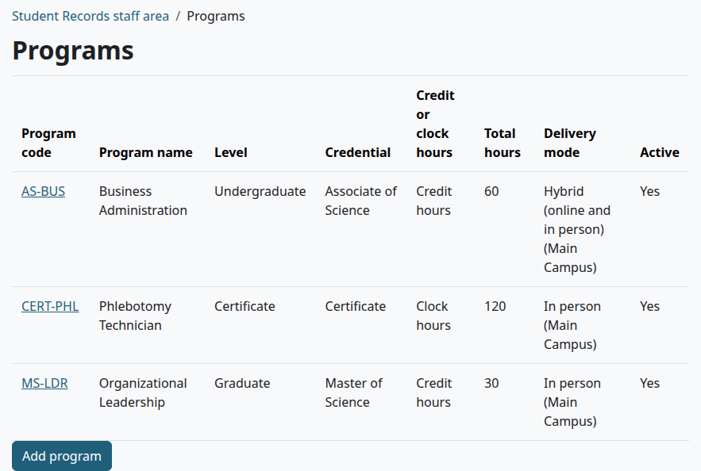
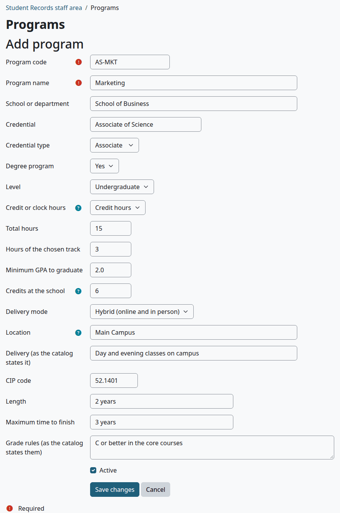
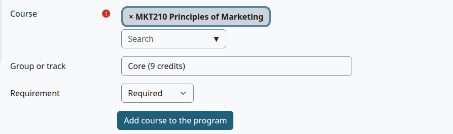
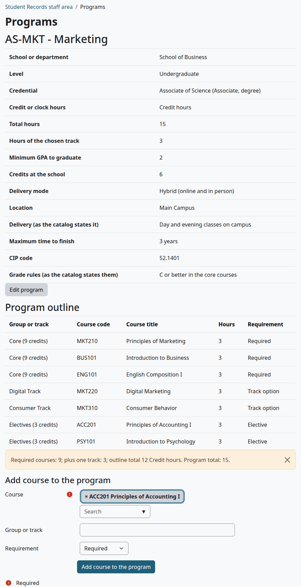
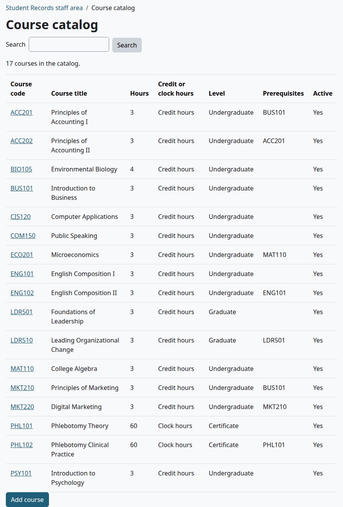
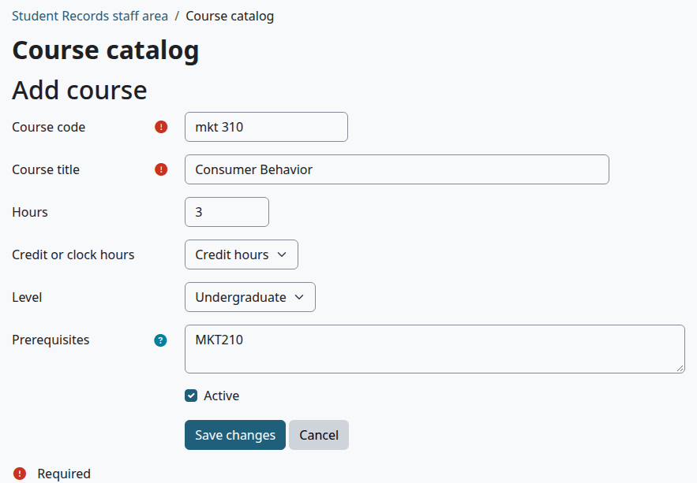
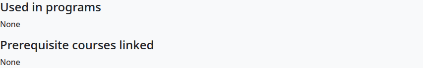
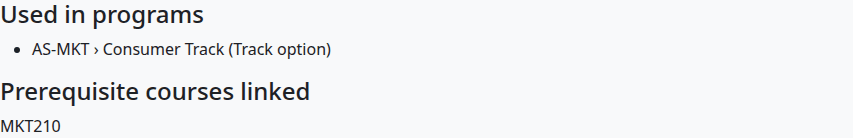

# Programs and courses

Programs are what students study, and the course catalog is every course the school teaches. This page is for the Registrar and whoever sets up the school. It covers programs with their course lists, the catalog, and how prerequisites work.

## Contents

- [Who can do this](#who-can-do-this)
- [See the programs](#see-the-programs)
- [Add a program](#add-a-program)
- [Fill in a program's course list](#fill-in-a-programs-course-list)
- [Required, track and elective courses](#required-track-and-elective-courses)
- [A program with no course list](#a-program-with-no-course-list)
- [Change or turn off a program](#change-or-turn-off-a-program)
- [See the course catalog](#see-the-course-catalog)
- [Add a course](#add-a-course)
- [Change or turn off a course](#change-or-turn-off-a-course)
- [How prerequisites work](#how-prerequisites-work)
- [Add a prerequisite link](#add-a-prerequisite-link)
- [Related pages](#related-pages)

## Who can do this

Everything on this page needs the capability `local/studentrecords:configure`. Site administrators and Managers have it. A Registrar needs it on their role, or these pages won't open.

Add your [levels](grading-and-levels.md#levels) first, because programs and courses pick from them. Add the courses before you fill in a program's course list. You can also bring all of this in from a spreadsheet. See [Import from a spreadsheet](import.md).

## See the programs

1. Go to Student Records > Programs.

Select a program's code to open it.

## Add a program

1. Go to Student Records > Programs and select "Add program".
2. Fill in the form. Only "Program code" and "Program name" are needed.
3. Select "Save changes".

| Field | Default | What it does |
|---|---|---|
| "Program code" | Needed, each code only once | Shown in lists and exports, and used by the import to match a program |
| "Program name" | Needed | Shown wherever the program is named |
| "School or department" | Empty | Shown on the program's page |
| "Credential" | Empty | Printed on enrollment letters. It's the starting text of the credential when a degree is conferred |
| "Credential type" | "Certificate" | "Certificate", "Diploma", "Associate", "Bachelor", "Master", "Doctorate" or "Other". A checklist document can apply to one type. It's also on the Clearinghouse file |
| "Degree program" | No | Says degree or non-degree on the program's page and in exports |
| "Level" | None | Decides the level-wide pass rule and the standing rule of the program's students |
| "Credit or clock hours" | "Credit hours" | How the program counts hours. Degree programs usually use credit hours, and non-degree programs clock hours |
| "Total hours" | Empty | The degree audit needs this many hours earned. Empty means no total |
| "Hours of the chosen track" | Empty | Added to the required courses for the check under the course list |
| "Minimum GPA to graduate" | Empty | The degree audit needs this GPA. Empty means no minimum |
| "Credits at the school" | Empty | How many credits or clock hours must be earned at this school, not by transfer. Empty means no minimum |
| "Delivery mode" | "Choose..." | "Online", "In person" or "Hybrid (online and in person)". Shown on the list and in exports |
| "Location" | Empty | Where in-person teaching takes place. Shown after the delivery mode on the list |
| "Delivery (as the catalog states it)" | Empty | Text for your records, shown on the program's page |
| "CIP code" | Empty | Goes into exports and the Clearinghouse file. A Clearinghouse row with none needs fixing |
| "Length" | Empty | Kept on file. Only this form shows it |
| "Maximum time to finish" | Empty | Text, shown on the program's page. Nothing checks it. The time limit that counts is on the [standing rules](holds-and-standing.md) |
| "Grade rules (as the catalog states them)" | Empty | Text, shown on the program's page. Typing here makes no rule. To make one, see [Add a pass rule](grading-and-levels.md#add-a-pass-rule) |
| "Active" | Ticked | See [Change or turn off a program](#change-or-turn-off-a-program) |

Check that:

- The program's page opens with the facts you typed, and the message "No courses in this program yet."

What can go wrong:

- "This is already used by another record." Another program has this code.
- "Enter a number." One of the hours or GPA fields holds something that isn't a number.

## Fill in a program's course list

The course list is called the "Program outline". It's what the [degree audit](degree-audit-and-graduation.md) checks students against.

Before you start:

- The courses are in the catalog, and active.
- You know your groups, such as Core or Marketing Track.

A row can't be removed or edited on this page, so check the group and the requirement before you add a course.

1. Open the program. Under "Add course to the program":
2. In "Course", type a code or a title and pick the course.
3. In "Group or track", type the group's name. Type it the same way for each course of the group. To state how many hours an elective group needs, put them in the name, as in `Electives (6 credits)`.
4. Pick the "Requirement": "Required", "Track option" or "Elective".
5. Select "Add course to the program".

> Known problem in 1.4.6: "Course" starts with the first course of the catalog in it, so the form adds that course if you don't pick another. Delete that course before you type, and check the box before you select "Add course to the program".

Repeat for each course. The list keeps the order you add them in.

Check that:

- Each course is in the list with its group and requirement.
- The line under the list shows the right sums. It says, for example, "Required courses: 9; plus one track: 3; outline total 12 Credit hours. Program total: 15."

The line is yellow when the outline total differs from "Total hours". The outline total counts the required courses and "Hours of the chosen track". It leaves out electives, so a program with electives shows yellow even when it adds up, as in the picture: 9 and 3 and 3 hours of electives make 15. The line is only a check. It stops nothing.

What can go wrong:

- You add a course and nothing changes. A row with the same course in the same group is skipped, with no message.
- A course is in the wrong group, or has the wrong requirement. No page can remove it. An import can change the requirement of a row with the same course and group. A course in a wrong group stays there.

## Required, track and elective courses

The first course of a group decides what kind of group it is. Give all the courses of a group the same requirement.

| Requirement | How the degree audit counts it |
|---|---|
| "Required" | The student must pass every course of the group |
| "Track option" | The student needs one track. The audit takes the track group with the most hours met or in progress, a finished one first, and ignores the other tracks. It needs every course of that group |
| "Elective" | With hours in the group's name, as in `Electives (6 credits)`, the student needs that many hours from the group. With no number in the name, the group counts as done from the start, and any hours met from it still count |

The number in the name can be followed by credit, credits, credit hours, hours or clock hours.

The audit also checks "Total hours", "Minimum GPA to graduate" and "Credits at the school". See [Degree audit and graduation](degree-audit-and-graduation.md).

## A program with no course list

A program doesn't need a course list. The audit then looks at hours and GPA alone: it counts each course in the program's unit once, however many times it was passed, and transfer credit marked to count toward the program.

A program with no course list, no "Total hours" and no "Minimum GPA to graduate" has nothing to audit, so approving a graduation needs a note.

## Change or turn off a program

1. Go to Student Records > Programs and select the program's code.
2. Select "Edit program".
3. Change what you need. To turn the program off, untick "Active".
4. Select "Save changes".

Programs can't be deleted. An inactive program stays on the list, marked "No", and on the records of its students. It's no longer offered on the student form, or for a new pass rule.

> Known problem in 1.4.6: once a program is inactive, saving a student who is in it clears the student's program, with no warning, because the form has no such option left. Leave a program active while it has students you still edit, or pick the program again on the student form after you turn it back on.

## See the course catalog

1. Go to Student Records > Course catalog.

The page shows 50 courses at a time. "Search" looks in the code and the title. Select a course's code to open it.

## Add a course

1. Go to Student Records > Course catalog and select "Add course".
2. Fill in the form.
3. Select "Save changes".

| Field | Default | What it does |
|---|---|---|
| "Course code" | Needed, each code only once | Saved in upper case with no spaces, so `mkt 310` becomes `MKT310` |
| "Course title" | Needed | Shown wherever the course is named |
| "Hours" | Empty | The hours students earn, and the hours billing and the Clearinghouse file count |
| "Credit or clock hours" | "Credit hours" | How the hours are counted |
| "Level" | None | Shown in the catalog |
| "Prerequisites" | Empty | Text as the catalog states it, shown in the catalog. See [How prerequisites work](#how-prerequisites-work) |
| "Active" | Ticked | See below |

Check that:

- The course is in the catalog with its code in capitals.

What can go wrong:

- "This is already used by another record." Another course has this code. `mkt 310` and `MKT310` are the same code.
- "Enter a number." "Hours" holds something that isn't a number.

## Change or turn off a course

1. Go to Student Records > Course catalog and select the course's code.
2. Change what you need. To turn the course off, untick "Active".
3. Select "Save changes".

Below the form, the page lists "Used in programs" and "Prerequisite courses linked". Both are read only.

Courses can't be deleted. An inactive course stays in the catalog and on students' records. It's no longer offered when you add a section, add a course to a program, mark a teacher as qualified, or add transfer credit.

## How prerequisites work

A course has two kinds of prerequisite, and only one of them is enforced.

| | Prerequisites text | Prerequisite links |
|---|---|---|
| Where it shows | The "Prerequisites" box and the catalog list | "Prerequisite courses linked", on the course's page |
| What makes it | You type it, or the import fills it in | The import only |
| What it does | Nothing. Staff can read it in the course catalog. Students never see it | Registration checks it |

Typing a course code in the "Prerequisites" box makes no link. A course made by hand has no enforced prerequisite, whatever the box says:

A linked course shows the codes it needs:

With a link in place:

- A student must have passed each linked course: a final grade that passes under the [pass rules](grading-and-levels.md#how-a-pass-is-decided), or transfer credit with that course as its equivalent. The transfer credit counts even when it doesn't count toward the program.
- A course in progress doesn't count, so a student can't register ahead for the next course in a series until the grade is in.
- Registering shows "Prerequisites not passed: ...." Online, that stops the student. Staff can override it with a reason. See [Registration](registration.md).

Three limits of the import:

- It links course codes only. Words such as "or permission of the dean" are left out, with a warning.
- It only adds links. Nothing removes a link: not the import, and not clearing the text.
- A link is made only if the other course is saved by the time you approve. See [The order of parents](import.md#the-order-of-parents).

> Known problem in 1.4.6: the import links each course code in the text, so every code is needed. In `MAT110 or ECO201` the student needs both. For a choice of courses, give the import only the code that registration should check.

## Add a prerequisite link

Who can do this: anyone with the capability `local/studentrecords:import`, as well as `local/studentrecords:configure` to see the result.

1. Make a CSV file with the headers `Course code,Title,Credits,Credit type,Level,Prerequisites`.
2. Add a row for the course, with its values as they are in the catalog and the code of the prerequisite under Prerequisites, in the form `MKT 210`.
3. Go to Student Records > Import from spreadsheet, choose the file and select "Read the file".
4. Select the Courses row, and check the item.
5. Tick the item and select "Approve selected".

> Known problem in 1.4.6: the Level column makes a Levels item with no description, and approving it clears the description of that level on the Grading page. Don't approve the Levels item that the same file makes, and don't use "Approve all pending items without errors".

The file must differ from the saved course in some way, or the item counts as "Unchanged" and can't be approved. If the row is the same as the catalog, write the prerequisite text differently, for example with a space in the code.

Fill in every column: a value left out is saved as empty.

The item shows the warning "Prerequisite ... is not in the course catalog." when the file doesn't list that course too. The link is still made if the course is saved.

Check that:

- The course's page shows the code under "Prerequisite courses linked".

## Related pages

- [Setup wizard](setup-wizard.md)
- [Import from a spreadsheet](import.md)
- [Grading and levels](grading-and-levels.md)
- [Course offerings](course-offerings.md)
- [Registration](registration.md)
- [Degree audit and graduation](degree-audit-and-graduation.md)
