# Refunds

A refund comes up by itself when a student drops or withdraws. Someone approves or rejects it, and Finance pays the money back and records it. This page is for finance staff, and it also covers the Return of aid items that Financial Aid sends to Finance.

To set up your rules, see [Add a refund rule](billing-setup.md#add-a-refund-rule).

## Contents

- [How a refund comes up](#how-a-refund-comes-up)
- [How a refund is figured](#how-a-refund-is-figured)
- [Find the refunds that wait](#find-the-refunds-that-wait)
- [Review a refund](#review-a-refund)
- [Figure a refund again](#figure-a-refund-again)
- [Approve a refund](#approve-a-refund)
- [Reject a refund](#reject-a-refund)
- [Record money paid back](#record-money-paid-back)
- [Who can't decide a refund](#who-cant-decide-a-refund)
- [Approve a return of aid](#approve-a-return-of-aid)
- [Related pages](#related-pages)

## How a refund comes up

Staff with `local/studentrecords:managestudents` drop or withdraw a student on the student's file. See [Registration](registration.md). Students can't drop or withdraw online.

With billing on, Student Records figures the refund at that moment. Nobody has to start it.

| What the drop finds | What happens |
|---|---|
| Charges, and a rule that gives money back | A refund with the status Waiting for approval. Everyone with `local/studentrecords:approverefund` and `local/studentrecords:viewbilling` gets the message "Staff: refund waiting for approval". |
| Charges, and a rule that gives nothing back, or no rule | A refund with the status Nothing back, and no message. It shows which rule was used. |
| No charges that can come back. See [How a refund is figured](#how-a-refund-is-figured). | No refund |
| Billing is off | No refund |

The person who drops the student may not see the refund. Only people with `local/studentrecords:viewbilling` can open the Refunds page.

Approving is a separate step, and paying is another. Student Records figures the amount and writes the lines. It never moves money. Moodle can't send money back by itself.

## How a refund is figured

1. The date used is the day of the drop or withdrawal. With the setting "Figure refunds on the last date of attendance" on, it is the student's last date of attendance in that course, when there is one. See [Setup wizard](setup-wizard.md#step-3-calendar).
2. The first active rule in order that fits that date is used. See [Add a refund rule](billing-setup.md#add-a-refund-rule).
3. The charges that can come back are the course's own, and the term's when the student leaves the last course of the term.
4. For each charge, the rule's percent of what is left of that charge after earlier refunds gives the amount. It is worked out to the cent, and a half cent goes up.

The course's own charges are the lines tied to this registration: tuition or fees per credit hour, per clock hour or per course.

The term's charges are the other charge lines of the term with no registration on them. That is more than per-term prices. It also includes a whole-program or one-time price charged in that term, a charge staff added with that term, a plan fee and a late fee. They come into the refund only when the student has no other active registration in the term.

Each kind of charge gets its own percent:

| Charge | Percent used |
|---|---|
| Tuition | "Tuition back (%)" |
| A fee marked refundable | "Refundable fees back (%)" |
| A fee not on the price list | The same, because it counts as a fee |
| Anything marked not refundable | 0, unless the rule has "Also refund non-refundable fees" set to Yes. Then the percent of its kind is used. |

The refund has a "Pay back by" date: the date used, plus the setting "Days to pay a refund back". See [Billing setup](billing-setup.md#change-the-billing-settings).

## Find the refunds that wait

Who can do this: finance staff and managers. It needs the capability `local/studentrecords:viewbilling`.

1. Select Refunds in the left menu. On Finance home, the tile "Refunds waiting for approval" has a link "Review" to the same page.
2. Select a tab: Waiting for approval, Approved, Rejected, Nothing back or All. The page opens on Waiting for approval.

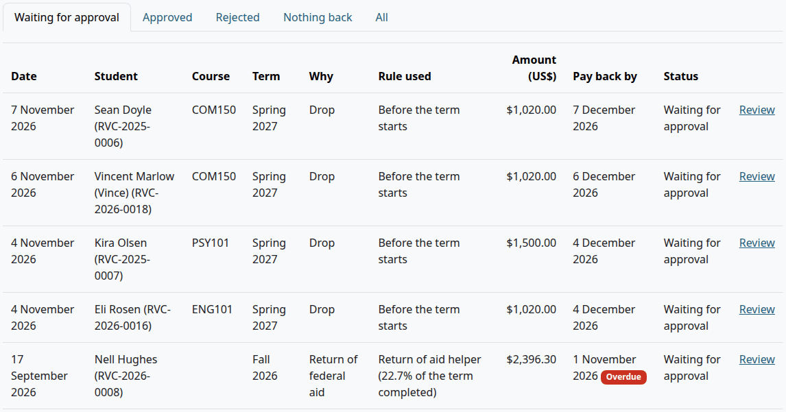

| Column | What it shows |
|---|---|
| Date | The date used |
| Student | The name and student ID |
| Course | The course dropped. A return of aid has none. |
| Term | The term |
| Why | Drop, Withdrawal or Return of federal aid |
| Rule used | The name of the rule, or "No rule fits: nothing back". A return of aid shows "Return of aid helper" and the percent of the term completed. |
| Amount (US$) | The refund |
| Pay back by | The date. A refund that still waits past this date has the tag Overdue. |
| Status | Waiting for approval, Approved, Rejected or Nothing back |
| Last column | "Review" opens the refund |

The account page lists the refunds of one student too. For staff, the status there is a link to the refund.

## Review a refund

Who can do this: finance staff and managers. It needs `local/studentrecords:viewbilling`.

1. [Find the refund](#find-the-refunds-that-wait).
2. Select "Review".

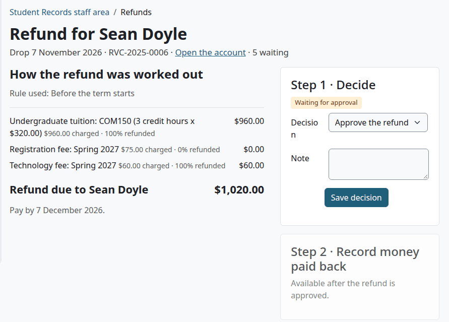

The line under the heading says why, the date used, the student ID, and, while the refund waits, how many refunds wait in all. "Open the account" goes to the student's account.

On the left, "How the refund was worked out" names the rule and lists each charge with what was charged, the percent and the amount back. The total says "Refund due to" and the student's name. Below it is the date to pay by. Past that date, the page says how many days overdue the refund is.

On the right are Step 1 and Step 2.

## Figure a refund again

Use this when another date should count, for example the student's last day in class. It works on a refund that is Waiting for approval or Nothing back.

Who can do this: finance staff and managers. It needs `local/studentrecords:managebilling`.

1. [Open the refund](#review-a-refund).
2. Open "Figure again on another date" at the bottom of the page.
3. In "Date used", set the date.
4. Select "Figure again on another date".

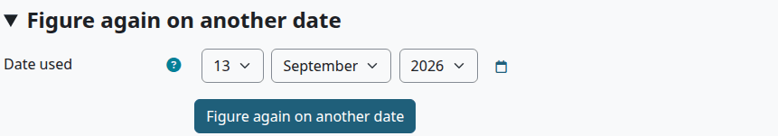

Check that:

- The page says "Saved."
- The rule, the amounts and the date to pay by follow the new date.

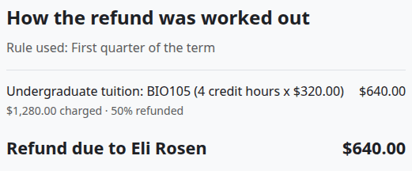

The refund is worked out from scratch on the new date, with the rules and charges of today. A refund with money back on the new date becomes Waiting for approval, and one with none becomes Nothing back.

> Known problem in 1.4.6: when a Nothing back refund becomes Waiting for approval this way, no message goes to the people who approve refunds. Tell them yourself.

A refund that is decided can't be figured again, and neither can a return of aid.

## Approve a refund

Who can do this: finance staff and managers. It needs `local/studentrecords:approverefund`. Nobody can decide a refund on their own account. See [Who can't decide a refund](#who-cant-decide-a-refund).

Before you start:

- The refund is Waiting for approval.

1. [Open the refund](#review-a-refund).
2. Under Step 1, leave "Decision" on "Approve the refund".
3. In "Note", add anything you want on record. A note is optional here.
4. Select "Save decision".

Check that:

- The page says "Saved."
- Step 1 says Approved, with who decided, when, and the note.
- Step 2 is open.

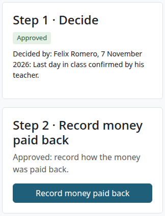

The account gets one Refund line for each charge with money back, with the percent and the charge's name. They lower the balance. A refund doesn't count toward a payment plan.

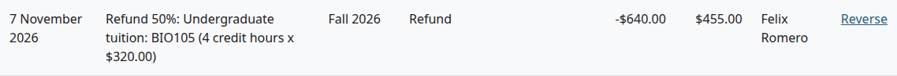

The student gets the message "Refund approved". No money has moved yet. If the student owed more than the refund, the refund only lowers what they owe, and there is nothing to pay back.

What can go wrong:

- "A charge in this refund was reversed or refunded after the refund was figured. Figure the refund again." Nothing was saved. [Figure the refund again](#figure-a-refund-again), then decide it.
- "This refund was already decided." Someone else got there first. Reload the page.

## Reject a refund

Who can do this: finance staff and managers. It needs `local/studentrecords:approverefund`.

Before you start:

- The refund is Waiting for approval.

1. [Open the refund](#review-a-refund).
2. In "Decision", choose "Reject the refund".
3. In "Note", say why. The note is needed.
4. Select "Save decision".

Check that:

- Step 1 says Rejected, with who decided, when, and the note.
- The refund is under the Rejected tab.

Nothing goes on the account, and the student gets no message, so tell them yourself. A decision can't be changed afterward.

What can go wrong:

- "Give a reason." Add a note, and select "Save decision" again.

## Record money paid back

Moodle can't send money back by itself. Pay it back first: on the payment company's own site for an online payment, or by check or bank transfer. Then record it here.

Who can do this: finance staff and managers. It needs `local/studentrecords:managebilling`.

Before you start:

- The school owes the student: the account shows Credit on account.
- You have paid the money back.

1. Do one of these:
   - On an approved refund, under Step 2, select "Record money paid back".
   - On the account, select "Record money paid back". The button shows only when the school owes the student.
2. Fill in the form. The table below says what each field does.
3. Select "Record money paid back".

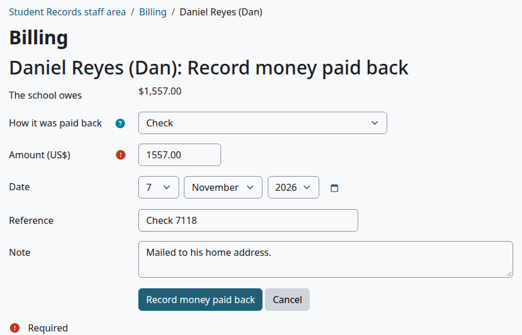

| Field | What to enter | Default |
|---|---|---|
| The school owes | Shows what is owed. You can't change it. | |
| How it was paid back | Check, Bank transfer, "On the payment company's site (PayPal, Stripe ...)", Cash, or Other | Check |
| Amount (US$) | Above zero, and not more than the school owes. Needed. You can pay back part of it. | Empty |
| Date | The date on the line | Today |
| Reference | For example the check number. Up to 100 characters. | Empty |
| Note | For staff | Empty |

Check that:

- The page says "Saved."
- The account has a line "Money paid back:" and how, and the balance went up.

The student gets the message "Money paid back".

A credit balance doesn't need a refund behind it. An overpayment or a credit can leave one too, and you pay it back the same way.

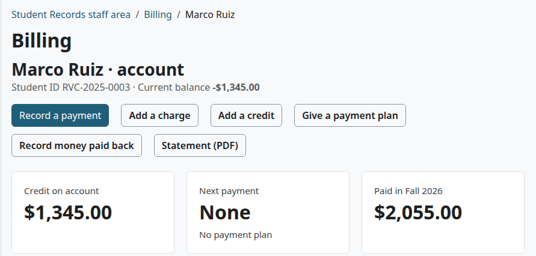

The line isn't tied to any refund. So a refund stays Approved after the money is paid, and it keeps its "Record money paid back" button. Use the account's balance to see what is still owed.

What can go wrong:

- "Enter an amount above zero and not more than the school owes ($1,557.00)." The amount is over what is owed.
- The form says the school owes $0.00, and every amount is refused. The refund didn't take the account below zero, so nothing is owed to the student.

## Who can't decide a refund

| Person | What they see in Step 1 |
|---|---|
| Someone who approves refunds, on their own account | "You cannot decide a refund on your own account. Ask someone else who approves refunds." |
| Someone who can open refunds and doesn't have `local/studentrecords:approverefund` | "Waiting for someone who may approve refunds." |

The first rule has no exception. It applies to managers and site administrators too.

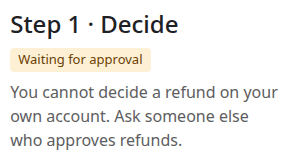

The Finance role has `local/studentrecords:approverefund`. To keep approval with fewer people, a site administrator can take this capability off the role and give it to another one. That role needs `local/studentrecords:viewbilling` too, to open Refunds and to get the message. See [Roles and permissions](../roles-and-permissions.md).

## Approve a return of aid

When a student who had federal aid withdraws, Financial Aid can send the school's share to Finance from the [Return of aid worksheet](aid-helpers.md#send-the-return-to-finance). It lands among the refunds, with the reason "Return of federal aid". This money goes back to the federal aid programs, not to the student.

Who can do this: finance staff and managers. It needs `local/studentrecords:approverefund`.

1. [Find the refund](#find-the-refunds-that-wait).
2. Select "Review" on the row that says Return of federal aid.
3. Check "How the return was worked out".
4. Leave "Decision" on "Approve the refund", add a note if you want one, and select "Save decision".
5. Send the money to the Department of Education. That happens outside Student Records, which has no link to G5 or any other federal system.

> Not walked through: G5 is a federal system outside the plugin, so no test site can show the last step.

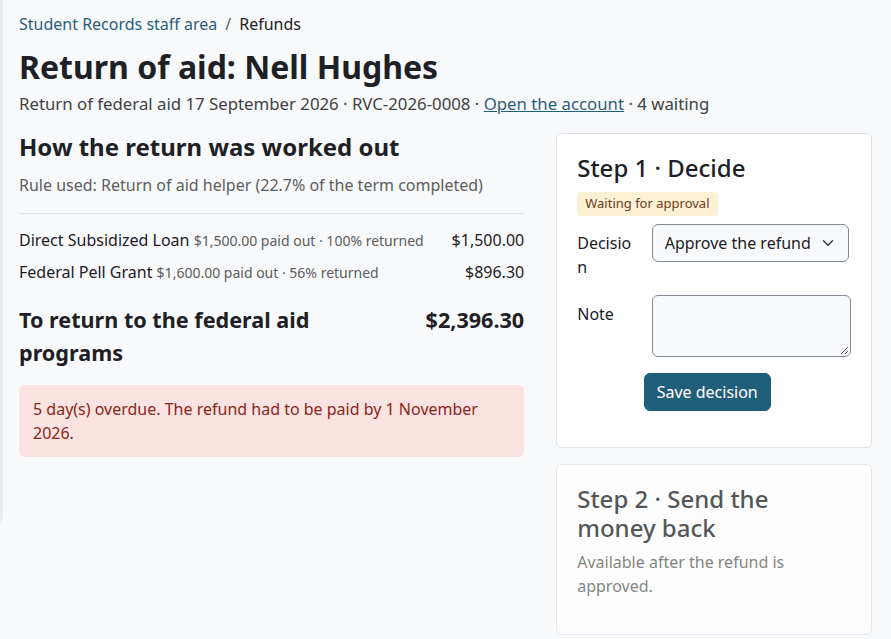

Check that:

- Step 1 says Approved.
- Step 2 says "Approved: send this money to the Department of Education through G5. It does not go to the student, so nothing is paid out here."
- The account has a charge for each fund, such as "Federal aid returned: Direct Subsidized Loan".

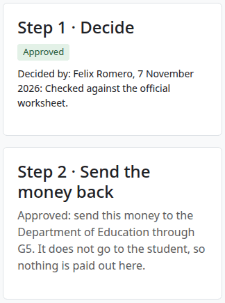

An approved return works differently from a refund:

- It puts the returned aid back on the student's account as charges, so the balance goes up. These charges aren't refundable, and they don't count for the 1098-T.
- There is no money to pay back here, so Step 2 has no button.
- The student gets no message.
- It can't be figured again. To change the figures, Financial Aid works on the worksheet.
- A reversal of these charges needs `local/studentrecords:manageaid`, so Financial Aid does it. See [Reverse a disbursement](federal-aid.md#reverse-a-disbursement).

If you reject it, Financial Aid can send a new one for that term.

## Related pages

- [Finance guide](finance.md)
- [Billing setup](billing-setup.md)
- [Student accounts](student-accounts.md)
- [Money reports](money-reports.md)
- [Return of aid worksheet](aid-helpers.md#the-return-of-aid-worksheet)
- [Registration](registration.md)
