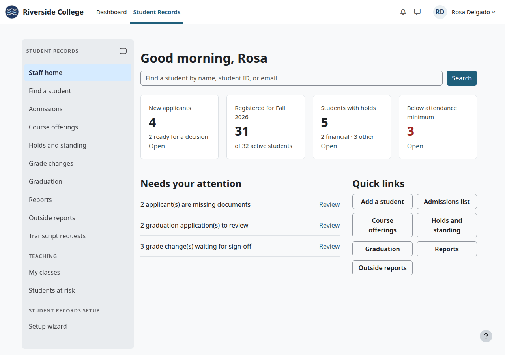

# Registrar's guide

This guide follows the Registrar's work through a school year, in the order it comes up. Each step links to the page that holds the fields and the steps. It is also for records assistants who do part of this work.

## Contents

- [What your role needs](#what-your-role-needs)
- [Your home page](#your-home-page)
- [Before a term starts](#before-a-term-starts)
- [Registration](#registration)
- [During the term](#during-the-term)
- [When a student leaves](#when-a-student-leaves)
- [At the end of a term](#at-the-end-of-a-term)
- [Graduation](#graduation)
- [Requests from students and outsiders](#requests-from-students-and-outsiders)
- [Rules that bind you too](#rules-that-bind-you-too)
- [Related pages](#related-pages)

## What your role needs

The plugin has no Registrar role. Your site administrator makes one at Site administration > Users > Permissions > Define roles and assigns it at system level. [Roles and permissions](../roles-and-permissions.md) has the details.

| Capability | What it opens |
|---|---|
| `local/studentrecords:managestudents` | Student files, Admissions, registration, holds, standing, graduation, letters |
| `local/studentrecords:viewstudents` | Every student's file, to read |
| `local/studentrecords:viewdemographics` | Demographics, and the reports that use them |
| `local/studentrecords:configure` | Terms, Course offerings, Programs, Course catalog, Grading, Application checklist, Standing rules, Messages and the setup wizard, and with them "Get final grades from Moodle". A role without it can't open those pages |
| `local/studentrecords:approvegradechange` | Deciding grade changes. Give it to at least two people, because nobody decides their own request |
| `local/studentrecords:viewlog` | The [Audit log](audit-log.md) |
| `local/studentrecords:viewfaculty`, `local/studentrecords:managefaculty` | Faculty and staff records |
| `local/studentrecords:import` | [Import from a spreadsheet](import.md) |
| `moodle/user:viewalldetails` | The "Moodle user" box on the student form and the "Moodle account" box on a faculty record, which belong to Moodle |

With Academic Transcript, add its capabilities to issue, approve and manage, and Moodle's `moodle/site:configview` for the Site administration tab, where most of its pages are. Its pages inside a course, such as Post final grades, also need an enrolment in that course or Moodle's `moodle/course:view`. See [Roles and permissions](../roles-and-permissions.md#registrar).

## Your home page

In the top menu, select "Student Records". Staff with a student file of their own land on My home instead: select "Staff home" in the menu.

| Part | What it shows |
|---|---|
| The search box | Opens the list of student records. It searches names and student IDs, not email |
| New applicants | Students with the status Applicant, and how many are ready for a decision. "Open" opens Admissions |
| Registered for Fall 2026 | Students registered in the running term, out of all Active students |
| Students with holds | Students with a hold in force, split into financial and other. "Open" opens the Academic standing page, which doesn't list holds: find the student and open the Holds tab |
| Below attendance minimum | Courses of the running term where a student is under the minimum. A student counts once for each such course. "Open" opens that report |
| Needs your attention | Applicants missing documents, graduation applications to review, grade changes waiting for sign-off |
| Quick links | The pages you use most |

The last item of the menu, "All staff pages", opens the [Student Records staff area](install-and-setup.md#find-student-records-after-the-install): every staff page your role allows, in one list.

## Before a term starts

1. Check the term's dates, with add/drop, the last day to withdraw and the grade freeze, on [Terms and calendar](terms-and-calendar.md).
2. Set up the sections: teachers, seats, times, rooms and the linked Moodle courses, on [Course offerings](course-offerings.md).
3. Check the [application checklist](admissions-process.md#set-up-the-application-checklist) and the [Standing rules](holds-and-standing.md#standing-rules-sap).
4. Check the wording of [Messages](messages.md).

New students come through admissions. See the [Admissions guide](admissions.md).

## Registration

1. Students with self-registration [register online](registration.md#register-for-classes-online).
2. You [register a student](registration.md#register-a-student-for-a-course) yourself when the school does it that way, or when a rule stops a student.
3. You [override the rules](registration.md#override-the-rules) when the school agrees. A hold that blocks registration has to be released first.
4. Add [transfer credit](degree-audit-and-graduation.md#add-transfer-credit) for new students.
5. Set the status of each new student to Enrolled, then Active. It doesn't change by itself. See [Move a student to Enrolled and Active](admissions-process.md#move-a-student-to-enrolled-and-active).
6. Before add/drop ends, [drop](registration.md#drop-or-withdraw-a-student-from-a-course) courses students ask to leave.

Watch "Waiting for payment" on the file. Finance decides those, as [Course access](registration.md#course-access) shows.

## During the term

- Keep files up to date: [Edit a student record](student-file.md#edit-a-student-record).
- [Place](holds-and-standing.md#place-a-hold) and [release](holds-and-standing.md#release-a-hold) holds. A hold placed for a late plan payment is yours to release, because the Finance role can't.
- Use "Students at risk" and the report Under minimum attendance. See [Attendance](attendance.md#students-at-risk).
- Mark attendance for a section with no linked Moodle course. Only records staff can.
- Answer requests for [enrollment verification letters](ferpa-and-letters.md#issue-an-enrollment-verification-letter).

## When a student leaves

For one course, [withdraw the student](registration.md#drop-or-withdraw-a-student-from-a-course) before the last day to withdraw. To leave the school, [withdraw from each course and set the status](registration.md#withdraw-a-student-from-the-school). They are separate steps, and neither does the other.

Finance sees the refund a drop or withdrawal proposes, and you don't. With federal aid, tell Financial Aid: the dates you enter feed the Return of aid worksheet.

For a leave of absence, set the status On leave on the edit form. It changes nothing else.

## At the end of a term

1. Get the final grades in, in any of the [three ways](final-grades.md#three-ways-a-grade-comes-in). Don't use "Get final grades from Moodle" before the term is over.
2. Correct mistakes before the [grade freeze](final-grades.md#the-grade-freeze), with "Enter final grade".
3. After the freeze, use a [grade change](final-grades.md#request-a-grade-change). Another person decides it on [Grade changes](final-grades.md#approve-or-reject-a-grade-change).
4. [Run standing](holds-and-standing.md#run-standing-for-a-term) and [confirm it](holds-and-standing.md#confirm-standing). Nothing tells the student, so act on it yourself.
5. Run the [reports](reports-and-exports.md) and the Clearinghouse file you need.

## Graduation

1. Read the [degree audit](degree-audit-and-graduation.md#read-the-degree-audit).
2. Approve any [course substitution](degree-audit-and-graduation.md#approve-a-course-substitution).
3. [Apply for graduation](degree-audit-and-graduation.md#apply-for-graduation) on the student's file. Students can't apply themselves.
4. [Review the application](degree-audit-and-graduation.md#review-an-application).
5. [Confer the credential](degree-audit-and-graduation.md#confer-the-credential).

The record then shows the award, and the status is Graduated.

## Requests from students and outsiders

Read the [release check](ferpa-and-letters.md#read-the-release-check) at the top of the file before you answer.

| Request | Where |
|---|---|
| Someone may hear about a student | [Add a release authorization](ferpa-and-letters.md#add-a-release-authorization) |
| A student wants their directory information withheld | [Withhold directory information](ferpa-and-letters.md#withhold-directory-information) |
| A signed FERPA form | [Record a paper acknowledgment](ferpa-and-letters.md#record-a-paper-acknowledgment) |
| Proof of enrollment | [Issue an enrollment verification letter](ferpa-and-letters.md#issue-an-enrollment-verification-letter) |
| A transcript | [Academic Transcript](../academic-transcript/registrar-guide.md) |
| A document for the file | [Add documents to a file](documents.md#add-documents-to-a-file) |
| What the student sees | [View as student](student-file.md#view-as-student) |
| Who opened or changed a record | [Audit log](audit-log.md) |

## Rules that bind you too

No role is above these, a Manager's or a site administrator's included. If you are also a student, another person must act on your own record. See [Your own record](student-file.md#your-own-record).

## Related pages

- [The student file](student-file.md)
- [Registration](registration.md)
- [Final grades](final-grades.md)
- [Holds and standing](holds-and-standing.md)
- [Degree audit and graduation](degree-audit-and-graduation.md)
- [FERPA and letters](ferpa-and-letters.md)
- [Reports and exports](reports-and-exports.md)
- [Audit log](audit-log.md)
- [Roles and permissions](../roles-and-permissions.md)
