# Registration

This page covers how a student gets into a class and out of it: registration by staff, overrides, online registration by students, waitlists and seat offers, drops, withdrawals, leaving the school and course access. It is for the Registrar and for students. A student's own steps are also in [the student's guide](student.md).

## Contents

- [How registration works](#how-registration-works)
- [Register a student for a course](#register-a-student-for-a-course)
- [Override the rules](#override-the-rules)
- [Drop or withdraw a student from a course](#drop-or-withdraw-a-student-from-a-course)
- [Withdraw a student from the school](#withdraw-a-student-from-the-school)
- [Course access](#course-access)
- [Register for classes online](#register-for-classes-online)
- [When a student can't register online](#when-a-student-cant-register-online)
- [Waitlists and seat offers](#waitlists-and-seat-offers)
- [Messages about registration](#messages-about-registration)
- [Related pages](#related-pages)

## How registration works

A registration puts one student in one section of one term. Staff make it on the student's file. A student makes it on the Registration page, if the school allows it. Both ways check the same rules, and a student's own registration also checks their status and time clashes.

A registration has one of these states:

| State | What it means |
|---|---|
| Registered | The student is in the class |
| Completed | The class has a final grade. See [Final grades](final-grades.md) |
| Dropped | The student left during add/drop. The row stays on the file, with no grade, and its hours don't count |
| Withdrawn | The student left after add/drop. The row shows a W, and its hours count as attempted |

Two dates of the term set what can be done. [Terms and calendar](terms-and-calendar.md) shows where they are set.

| Term date | What it does |
|---|---|
| Add/drop ends | The last day to add a class and the last day to drop one. With no date, adding runs to the end of the term, and dropping to the first day of the term |
| Last day to withdraw | Withdrawing opens the day after add/drop ends and closes after this day. With no date, it doesn't close |

> Known problem in 1.4.6: Add/drop starts is shown on the Terms page, and no rule reads it. So a term takes online registrations as soon as it is active, however far ahead it starts. To keep a term closed, leave Active off until registration opens.

Registering doesn't change the student's status, and neither does leaving a class. See [Student status](student-file.md#student-status).

## Register a student for a course

Who can do this: records and admissions staff. It needs `local/studentrecords:managestudents` at system level.

Before you start:

- The section exists with the status Open, as [Course offerings](course-offerings.md) shows.
- The section's linked Moodle course, if it has one, has an enabled manual enrolment method.

1. Open the file, on the Registration and grades tab.
2. Select "Register for a course".
3. In Course offering, type part of the code and pick the section. The list holds the sections of every term with the status Open. It shows the term, the code, the section, the title and the seats taken, such as (2/20).
4. Select "Register".

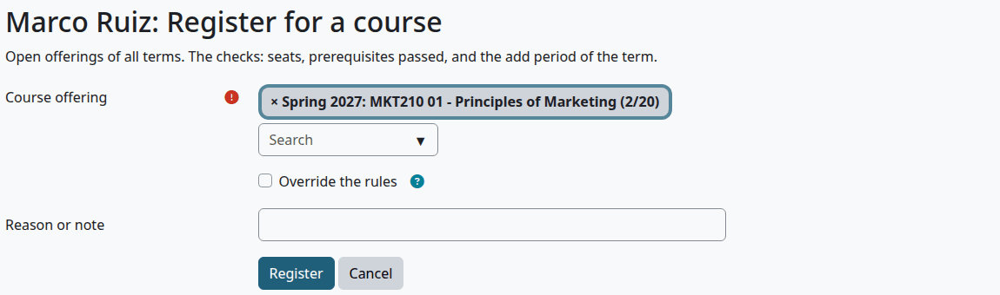

> Known problem in 1.4.6: Course offering starts with the first section on the list in it, of any term. If you don't pick another, the student is registered in that section. Check that the box shows your section before you select "Register".

The form checks these rules, in this order, and shows the first problem:

| Rule | What you see |
|---|---|
| No hold in force blocks registration | "A hold blocks registration: Financial. Release the hold first (it cannot be overridden)." |
| The student isn't already in it | "Already registered in this offering." |
| A seat is free | "This offering is full (6 seats)." A seat held for a student from the waitlist counts as taken |
| The prerequisites are passed | "Prerequisites not passed: BUS101." |
| The add period is open | "The add period of this term is over." |

Prerequisites come from the links the import makes between courses. Text typed in Prerequisites on a catalog course checks nothing, as [Programs and courses](programs-and-courses.md) shows. A course counts as passed by a passing grade, or by active transfer credit with that course as its equivalent. The student's status isn't checked, and neither is a time clash.

Check that:

- The file opens with "Saved."
- The course is under its term, with the state Registered.
- With billing on, the charges are on the student's account. See [Student accounts](student-accounts.md).
- With a linked Moodle course, the student is enrolled, or the course says "Waiting for payment". See [Course access](#course-access).

What can go wrong:

- "The linked Moodle course has no manual enrolment method; add one in the course first." Add the method in the course and try again.

## Override the rules

Who can do this: records and admissions staff. It needs `local/studentrecords:managestudents` at system level.

An override lets staff register, drop or withdraw a student when a rule says no. It needs a reason, and the registration is marked with `*`.

| Rule | Can staff override it |
|---|---|
| Add period over | Yes |
| Section full | Yes, and the section goes over its capacity |
| Prerequisites not passed | Yes |
| Drop period over, add/drop still open, last day to withdraw passed | Yes |
| A hold that blocks registration | No. Release the hold first |
| Already registered in this section | No |

1. Start the registration, drop or withdrawal as usual. It stops with the error on the page.
2. Tick "Override the rules".
3. In "Reason or note", write why.
4. Select the button again.

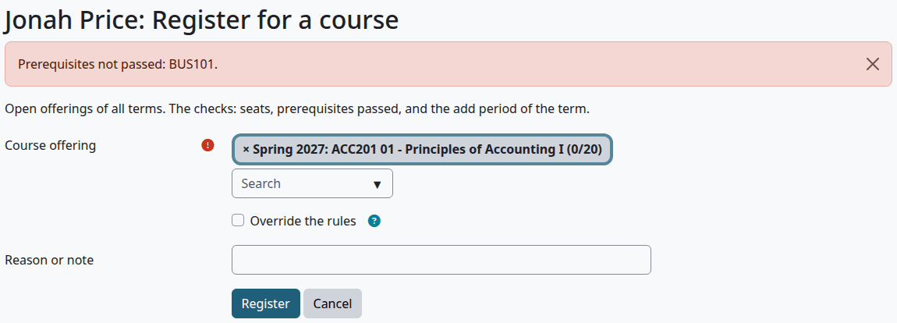

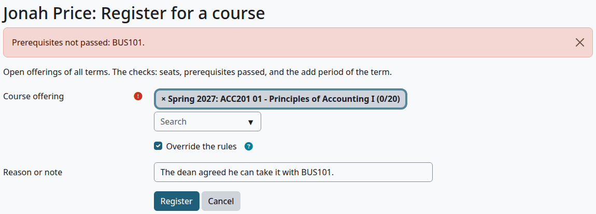

Check that:

- The course shows `*` after its state on the Registration and grades tab.

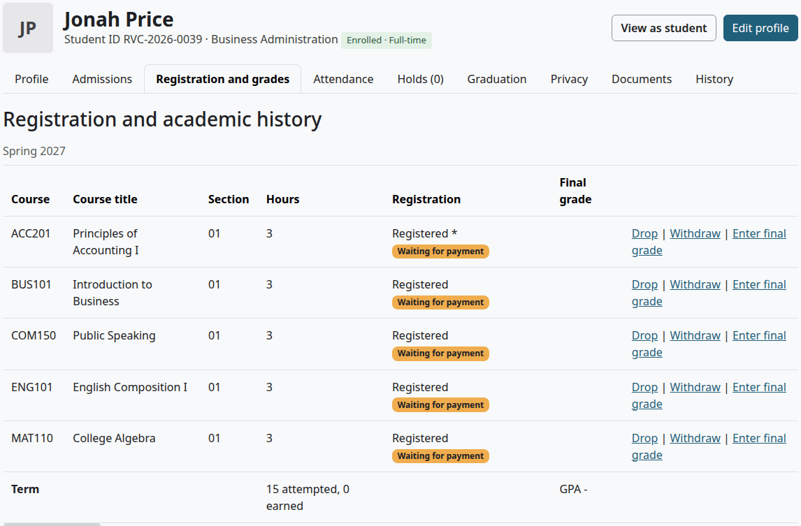

What can go wrong:

- "An override needs a reason." The note was empty.
- "A hold blocks registration: Financial. Release the hold first (it cannot be overridden)." Ticking the box doesn't help. See [Holds and standing](holds-and-standing.md#release-a-hold).

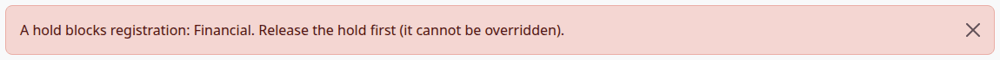

## Drop or withdraw a student from a course

Who can do this: records and admissions staff. It needs `local/studentrecords:managestudents` at system level. Students can't do this themselves: they ask the Registrar's office.

Use "Drop" up to the end of add/drop, and "Withdraw" after that, up to the last day to withdraw.

1. Open the file, on the Registration and grades tab.
2. On the course's row, select "Drop" or "Withdraw".
3. Select the button on the form.

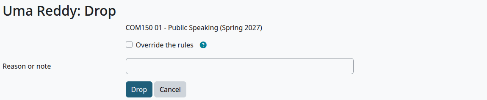

| Field | What it does |
|---|---|
| Override the rules | Needed outside the dates. See [Override the rules](#override-the-rules) |
| Reason or note | Needed with an override. It is kept on the registration |

| | Drop | Withdraw |
|---|---|---|
| Registration state | Dropped | Withdrawn, shown as W |
| Hours | Not counted | Count as attempted, and not earned |
| Attendance | The course leaves the sheet and the Attendance tab | The course stays on the sheet and the Attendance tab |
| Last date of attendance | Unchanged | Filled in from the attendance marks, if it is empty |
| Moodle course | Enrolment suspended | Enrolment suspended |
| Refund | Proposed, when billing is on and there are charges | Proposed, when billing is on and there are charges |
| Seat | Offered to the waitlist | Offered to the waitlist |
| Message | "Course dropped" | "Course withdrawal" |

The enrolment is suspended and never removed, so course work and grades stay in Moodle. It stays active if another active registration of the student uses the same Moodle course.

A refund waits for Finance. Staff who can't see accounts don't see it. See [Refunds](refunds.md).

Check that:

- The file opens with "Saved."
- The course shows Dropped or Withdrawn.

What can go wrong:

- "The drop period (add/drop) is over; use Withdraw."
- "Add/drop is still open; use Drop."
- "The last day to withdraw has passed." Tick "Override the rules" if the school allows it.
- "Only a registered course can be dropped or withdrawn."

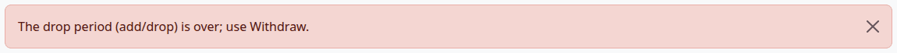

A later registration in the same section reuses the row of the drop or withdrawal. So a W that a student later replaces by registering again leaves the record. It stays in the stored change history, which no page shows, and as a `withdraw` row in the [Audit log](audit-log.md#what-gets-logged).

## Withdraw a student from the school

No single action does this. Withdrawing from every course doesn't make the student Withdrawn, and setting the status doesn't touch the courses. Do both.

Who can do this: records and admissions staff, and nobody on their own record.

1. Withdraw or drop the student from each registered course, as above. A withdrawal fills in Last date of attendance when it is empty.
2. Open the file and select "Edit profile".
3. Under Program and status, set Status to Withdrawn.
4. Set Withdrawal date and Last date of attendance. Tick Enable on each.
5. In "Note on the status change", say why.
6. Select "Save changes".

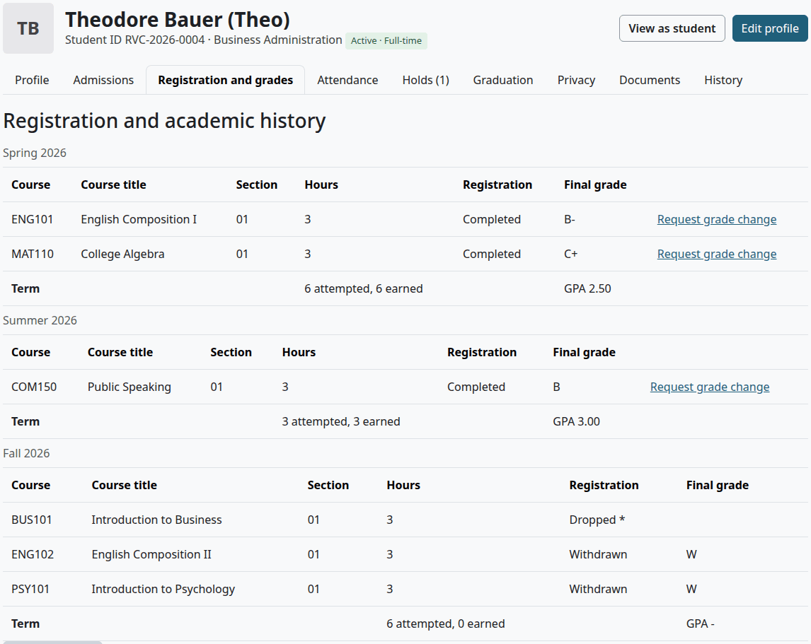

Check that:

- The file's tag says Withdrawn.
- Status history on the Admissions tab has a row, dated by the withdrawal date.

What can go wrong:

- "A withdrawal needs the withdrawal date." and "A withdrawal needs the last date of attendance." Both are required for this status.
- "The last date of attendance cannot be after the withdrawal date."

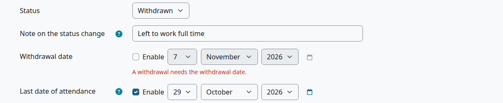

The dates feed Federal aid's Return of aid worksheet, as [Aid helpers](aid-helpers.md) shows.

## Course access

A registration opens the linked Moodle course for the student, unless billing makes it wait.

With billing off, the student is enrolled at once. With billing on, the setting Course access on [Billing setup](billing-setup.md) decides:

| Course access | The student gets into the course |
|---|---|
| right away, when they register | At once |
| after the down payment or an approved payment plan (or when nothing is owed) | When nothing is owed, or when the down payment of a plan for that term is paid |
| after the balance is paid in full | When nothing is owed |

Under the last two rules, a registration with any charge waits, because the charge goes on the account first. A waiting course shows "Waiting for payment" on the file. The student has no access to the course until the rule is met, and teachers don't see the student in the course's Student records list.

The wait ends by itself when a payment meets the rule. Finance can also give access early, as [Give course access now](student-accounts.md#give-course-access-now) shows. The student then gets the message "Course access open".

A section with no linked Moodle course has no access to open.

## Register for classes online

Who can do this: students with the status Admitted, Enrolled or Active. The setting "Students register themselves" on the Calendar step of the [setup wizard](setup-wizard.md) must be Yes.

Before you start:

- At least one term is active and its add period is open.

1. In the Student Records menu, select "Registration".
2. Choose the Term, if there is more than one open. Type in "Find a class" and select "Search" to narrow the list.
3. Select "Add" next to each class you want. It goes in the panel on the right.
4. Read the estimate and any notes in the panel.
5. Select "Review cost and confirm".
6. Select "Confirm registration".

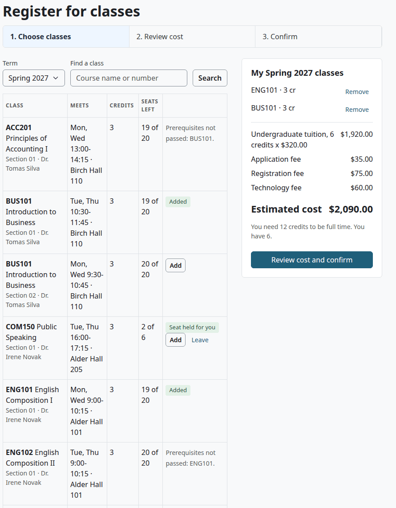

The list shows the open sections of the term. For each section:

| Column | What it shows |
|---|---|
| Class | Code, title, section and teacher |
| Meets | Days, times and room, or the room alone |
| Credits | The hours of the course |
| Seats left | "12 of 20", "Open" for a section with no limit, or "Full · 2 waiting" |
| Last column | "Add", "Added", "Registered", "Join waitlist", your place on the waitlist, or the reason you can't add it, such as "Prerequisites not passed: BUS101." |

The panel, "My Spring 2027 classes" for example, keeps your picks from one visit to the next. Nothing is registered and no seat is held until you confirm.

| In the panel | What it means |
|---|---|
| The list of classes | Classes you are registered in, and picks with a "Remove" button |
| Estimated cost | With billing on, what the picks will add, line by line. It is an estimate of the charges, and the final charges go on your account when you confirm |
| "You need 12 credits to be full time. You have 9." | Shown under the school's full-time credits |
| "ENG101 01 meets at the same time as BUS101 02. Pick another section of one of them." | A time clash. "Review cost and confirm" is hidden until you remove one |

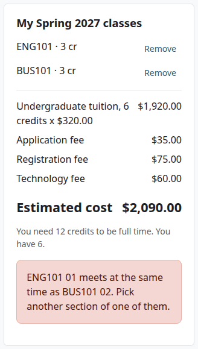

> Known problem in 1.4.6: the panel lists a pick by its course code alone, such as "BUS101 · 3 cr", so two sections of one course look the same, and so do their "Remove" buttons. Remove both, then add the section you want again.

A class with no days or times never clashes. The clash check is for online registration only. Staff registration doesn't look at it.

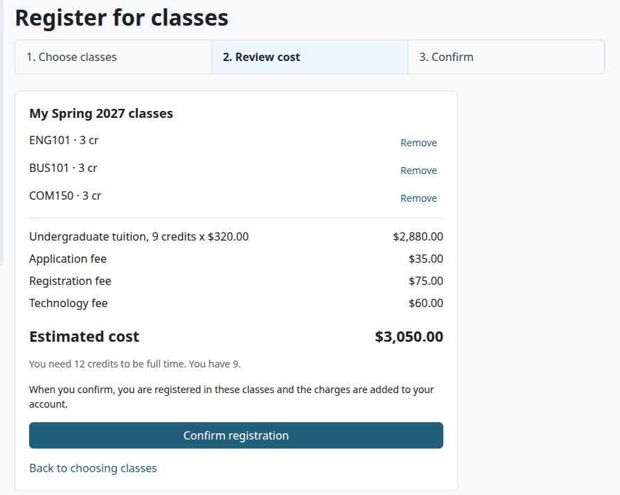

Check that:

- The page says "You're registered." with a confirmation number, such as SR-5-34-T6RK1Q.
- The classes are listed, with "Your balance is now" and the amount when billing is on.

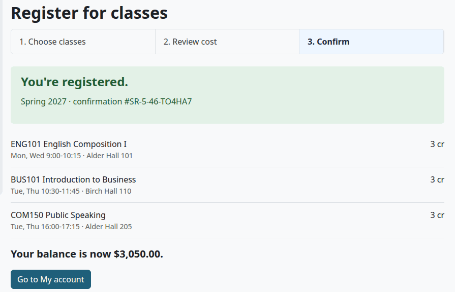

If a class fails at the last step, for example because its last seat went, the page shows the reason and the class stays in the panel. The others are registered.

On a phone the same page stacks: the filters, then the classes, then the panel under them. The list of classes scrolls sideways, so swipe it to reach "Add". "Find a class" shortens the list.

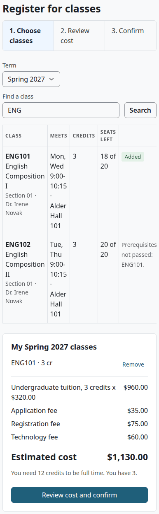

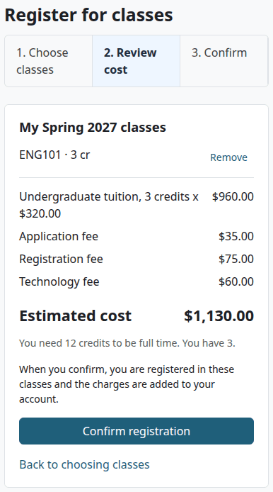

A student can't drop or withdraw online. Registered classes have no Remove button. The student asks the Registrar's office.

## When a student can't register online

The page shows one notice, the first that applies, then the student's classes:

| Notice | Why |
|---|---|
| "The registrar's office registers students at this school. Your classes are below." | Self-registration is off for the school |
| "Your status is Inquiry, so you cannot register online. Please contact the registrar's office." | The status isn't Admitted, Enrolled or Active |
| "Registration is not open for any term right now. Check back when the add period starts." | No active term has its add period open. The wording says "starts", but the check only looks at the end of the add period |

Under the notice are "My classes", with every registered class of every term, and "Picked or waiting", where the student can still take back picks and leave waitlists.

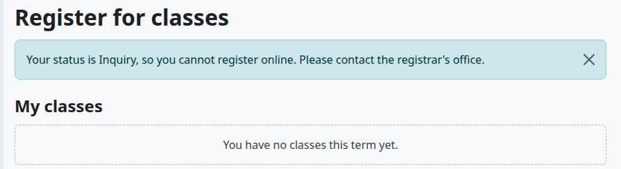

## Waitlists and seat offers

This is the waitlist of one section. It needs self-registration on. A program waitlist is another thing: see [Program waitlists](admissions-process.md#program-waitlists).

Who can do this: students who could register online. Staff can see the list and can register anyone, with an override.

Join a waitlist:

1. On the Registration page, find a full section. "Join waitlist" is where "Add" would be.
2. Select "Join waitlist".

Check that:

- The page says "You are on the waitlist. We will message you if a seat opens."
- The section shows your place, such as "Waitlist #3", with "Leave".

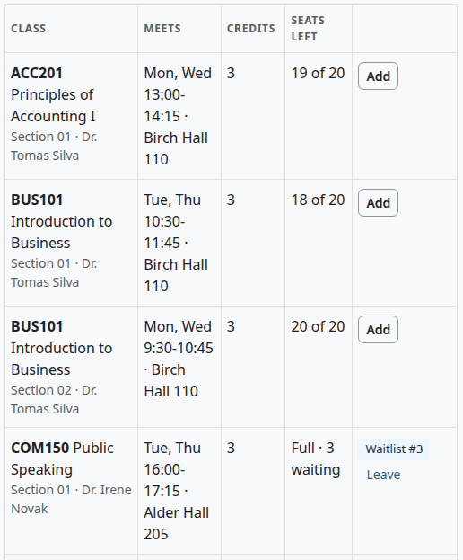

A section can have a waitlist only with a seat limit. The rules for adding a class apply, so a student with a blocking hold or a missing prerequisite can't join.

When a seat opens, by a drop, a withdrawal or more seats on the section:

1. The first student waiting who can take it is offered the seat. A student who can't, because of a hold, a status or a prerequisite, is passed over and keeps their place.
2. The student gets the message "Seat open from the waitlist", after cron.
3. The section shows "Seat held for you", with "Add" and "Leave". The seat is held for 2 days, and it counts as taken for everyone else.
4. The student selects "Add", then confirms as usual.

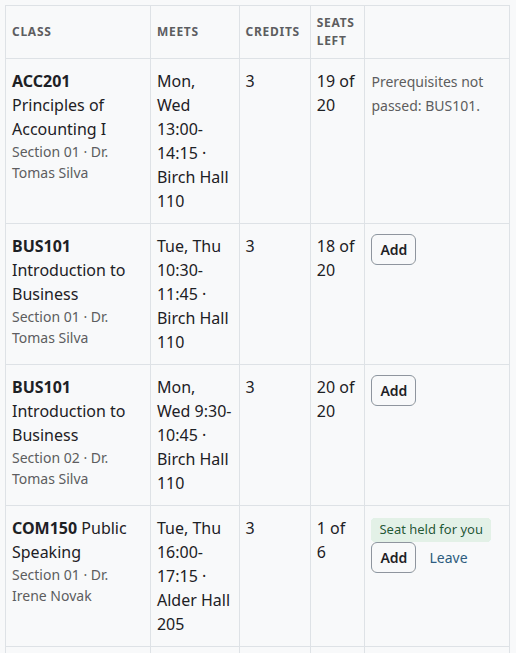

An offer lapses after 2 days. The daily task, at 6:30 by default, takes the student off the list and offers the seat to the next. The student gets no message, and must join again at the end of the list.

No seat is offered when self-registration is off, when the section isn't open, when the term isn't active, or after the add period.

Staff see who is waiting on the section's page. In the Student Records menu, select "Course offerings", then the section. The Waitlist table shows the order, the student, the state (Waiting or Seat offered) and the date. It needs `local/studentrecords:configure` to open the page.

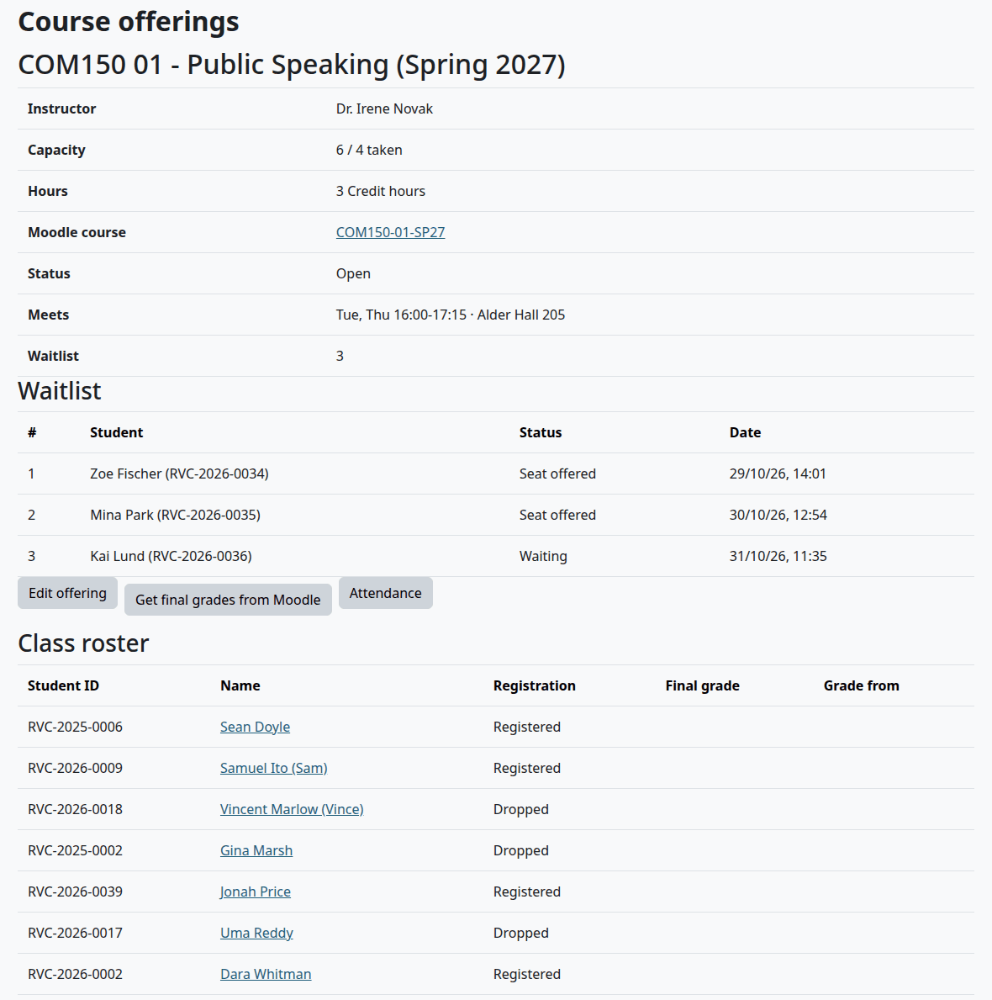

## Messages about registration

| Message | When |
|---|---|
| Registration confirmed | A registration is saved, by staff or online |
| Course dropped | Staff drop a course |
| Course withdrawal | Staff withdraw a course |
| Course access open | A waiting course opens |
| Seat open from the waitlist | A seat is offered |

They wait for Moodle's next cron run, and show in the student's notifications. [Messages](messages.md) shows how to change them.

> Not walked through: the email copy of a message needs a real mail server, so no test site can show it. The messages were checked in Moodle's notifications.

## Related pages

- [The student's guide](student.md)
- [Registrar's guide](registrar.md)
- [Course offerings](course-offerings.md)
- [Terms and calendar](terms-and-calendar.md)
- [Student accounts](student-accounts.md)
- [Refunds](refunds.md)
- [Holds and standing](holds-and-standing.md)
