# Reports and exports

Student Records has reports for the school, saved exports for a state agency or accreditor, counts for surveys and a National Student Clearinghouse file. This page is for the Registrar and records staff. It lists each report with its filters and columns.

## Contents

- [Where the reports are](#where-the-reports-are)
- [Who can do this](#who-can-do-this)
- [Download a report](#download-a-report)
- [Reports](#reports)
- [Admissions reports](#admissions-reports)
- [Saved exports](#saved-exports)
- [Add or change an export](#add-or-change-an-export)
- [Counts](#counts)
- [The Clearinghouse file](#the-clearinghouse-file)
- [Related pages](#related-pages)

## Where the reports are

| Menu item | What it holds | Page |
|---|---|---|
| Student Records > Reports | Enrollment, hours, completion, graduation and attendance | This page |
| Student Records > Admissions | The applicant list, and the Pipeline, Missing documents and Decisions reports | This page, and [Admissions process](admissions-process.md) for the applicant list |
| Student Records > Outside reports | Saved exports, Counts and the Clearinghouse file | This page |
| Finance > Reports | Who owes money, payments, refunds, late plans and the 1098-T | [Money reports](money-reports.md) |
| Financial Aid > Reports | Aid recipients, disbursements, enrollment status, withdrawals and the 90/10 worksheet | [Federal aid](federal-aid.md) |
| Student Records setup > Faculty roster | Faculty with credentials and qualified courses | [Faculty and staff](faculty-and-staff.md#the-faculty-roster) |

Student Records sends nothing to any agency. You download a file and send it the way the agency asks.

## Who can do this

| To do this | You need |
|---|---|
| Open Reports, Admissions and Outside reports, and run a saved export | `local/studentrecords:managestudents` |
| Add or change a saved export | `local/studentrecords:configure` as well |
| Run an export that lists race, ethnicity or sex | `local/studentrecords:viewdemographics` as well |
| See the Counts grid and download it | `local/studentrecords:viewdemographics` as well |

Site administrators and Managers have all of these. A role you make needs each one ticked. See [Moodle roles to make](install-and-setup.md#moodle-roles-to-make).

## Download a report

Most reports have a "Download" box under the table.

1. Open the report and set its filters.
2. Pick a format. The list holds the formats your Moodle site allows, such as CSV, Excel, HTML, JSON, OpenDocument and PDF.
3. Select "Download".

The download has every row, with the same filters. Each download is written in the audit log.

A cell that starts with `=`, `+`, `-`, `@`, a tab or a line break, and isn't a number, gets a `'` in front of it, so that a spreadsheet program opens it as text. Check for this if you load a file into another system.

## Reports

1. Go to Student Records > Reports.
2. Select a tab.
3. Under "Term", pick a term, or leave it on "All". The page reloads by itself.

"Graduation rate" has no term filter. With nothing to show, a report says "Nothing to report." The files are named `studentrecords_` and the report and date.

### Enrollment by term

Students with at least one course in the term, by program. A dropped course doesn't count. "Full-time" and "Part-time" come from the student's record, not from their hours, and "Load not set" counts students with neither.

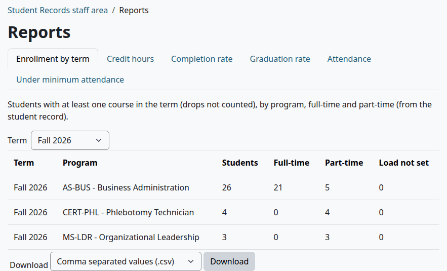

Columns: "Term", "Program", "Students", "Full-time", "Part-time", "Load not set".

### Credit hours

Hours attempted in the term, by program. A dropped course doesn't count, and a withdrawal does.

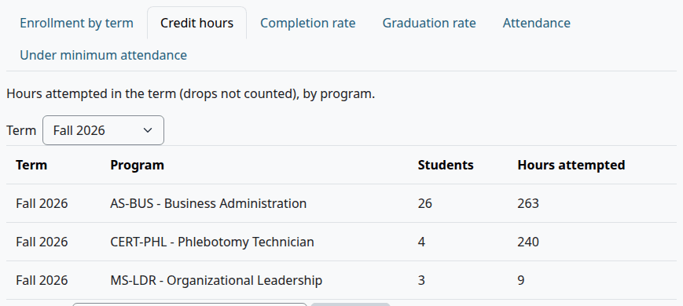

Columns: "Term", "Program", "Students", "Hours attempted".

### Completion rate

Courses attempted in the term, by program, with what became of them. A course is passed under the [pass rules](grading-and-levels.md#how-a-pass-is-decided). The rate is passed courses divided by courses attempted less those in progress.

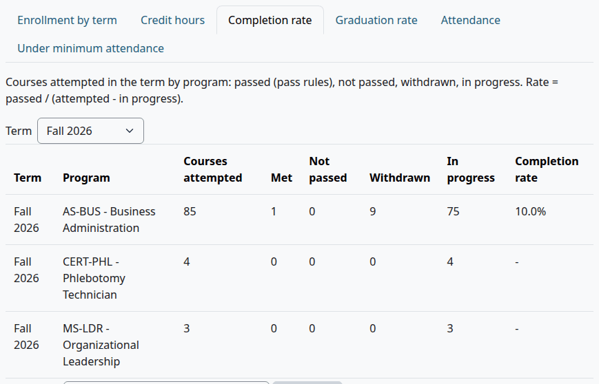

Columns: "Term", "Program", "Courses attempted", "Met", "Not passed", "Withdrawn", "In progress", "Completion rate".

### Graduation rate

Students by the term they were admitted for and their program, with what became of them. Students still in the admissions pipeline are left out. The rate is graduated students divided by the cohort. "Continuing" counts students who are active, enrolled or on leave, and "Other" counts the rest.

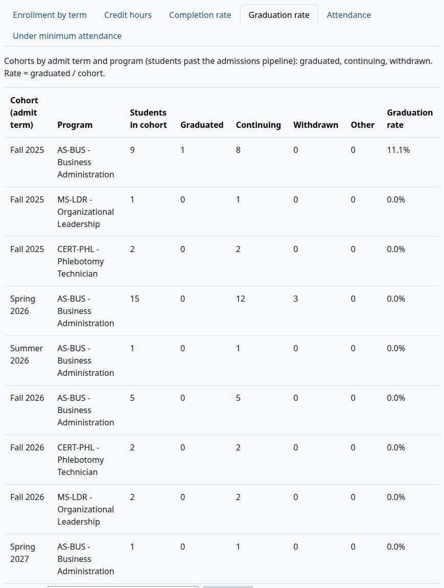

Columns: "Cohort (admit term)", "Program", "Students in cohort", "Graduated", "Continuing", "Withdrawn", "Other", "Graduation rate".

### Attendance

The average attendance of the students marked in each section. Attendance is present and late out of the meetings marked. A student left unmarked and excused meetings don't count. See [Attendance](attendance.md).

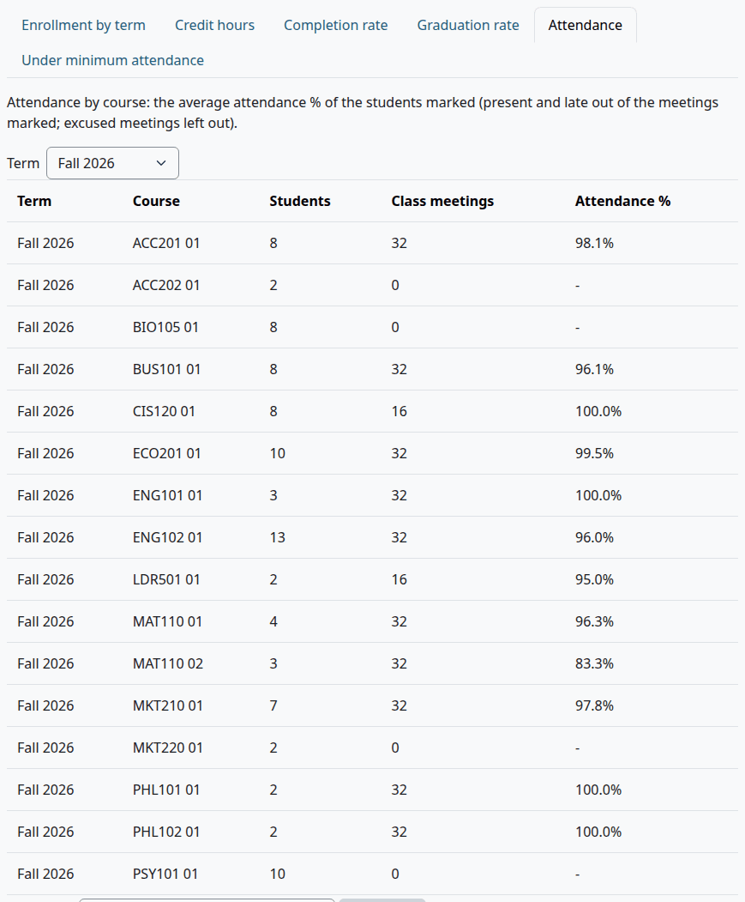

Columns: "Term", "Course", "Students", "Class meetings", "Attendance %".

### Under minimum attendance

Students whose attendance in a course is under "Minimum attendance (%)" of the [calendar settings](terms-and-calendar.md#the-calendar-settings), or under 80 with no setting.

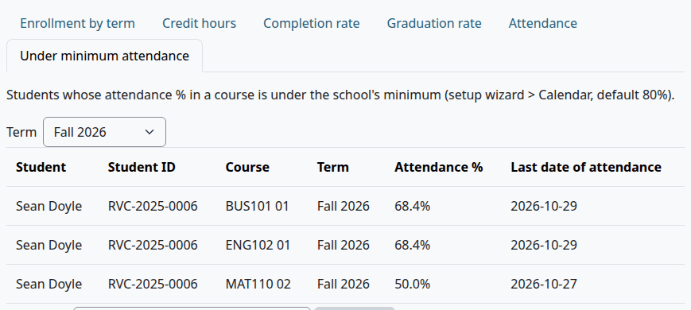

Columns: "Student", "Student ID", "Course", "Term", "Attendance %", "Last date of attendance".

## Admissions reports

1. Go to Student Records > Admissions. The page opens on "Applicants", the working list of [Admissions process](admissions-process.md).
2. Under "More admissions reports", at the foot of the page, select "Pipeline", "Missing documents" or "Decisions". Each report has tabs for the others.
3. Set the filters and select "Filter".

"Applicants" has no download. The files of the other three are named `admissions_` and the report and date.

| Report | Filters | Columns |
|---|---|---|
| "Pipeline" | "Admit term", "Program" | "Program", a column for each status from Inquiry to Deferred, Enrolled and Active, and Total, with a total row. A number opens the student list |
| "Missing documents" | "Admit term", "Program" | "Student ID", Name, "Program", "Admit term", "Status", "Missing documents". It lists students from inquiry to deferred with a required document not yet received or waived |
| "Decisions" | "Admit term", "Program", "Decision" | "Decision date", "Student ID", Name, "Program", "Admit term", "Decision", "Reason", "Conditions", "Decided by" |

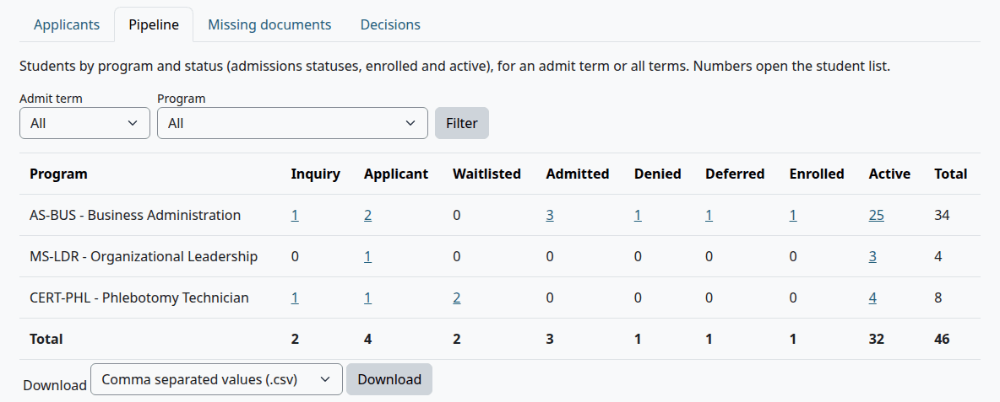

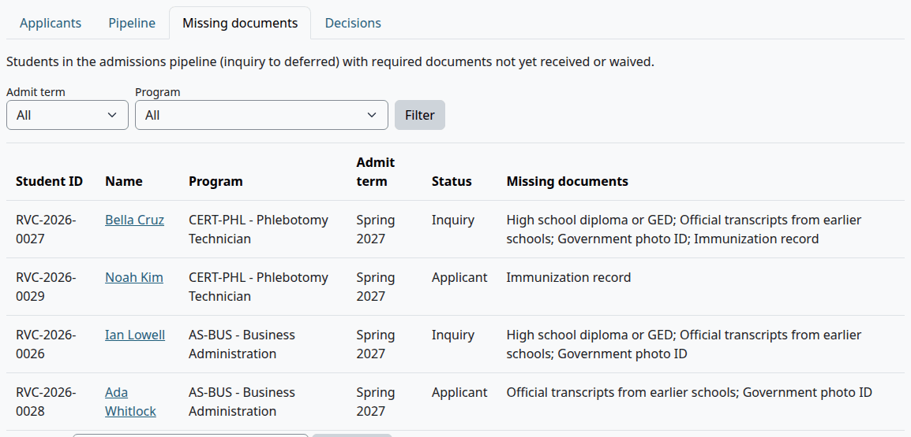

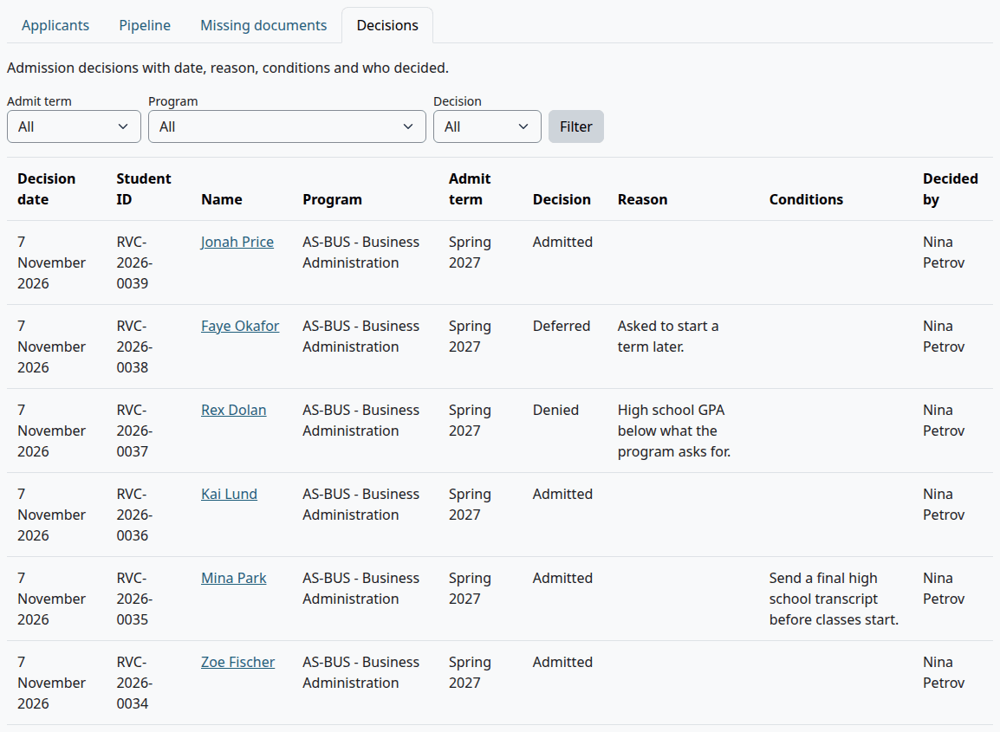

## Saved exports

A saved export remembers the students and the fields an agency asks for, with its column names.

1. Go to Student Records > Outside reports.

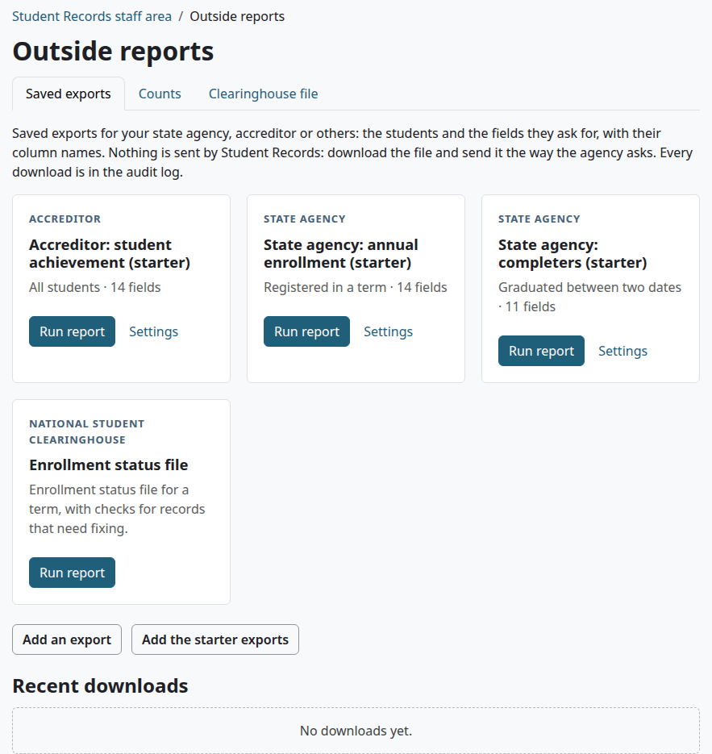

Each export has a card with who it's for, its name, its students and how many fields it has, and the buttons "Run report" and "Settings". "Settings" shows with `local/studentrecords:configure`.

An export that lists race, ethnicity or sex shows no "Run report" button to someone without `local/studentrecords:viewdemographics`. The card says "Lists race, ethnicity or sex. To run it, ask your site administrator for the permission "View student demographics (IPEDS)"."

To run one:

1. Select "Run report" on its card.
2. Read the rows. The page shows the first 50, and the note of the export.
3. Pick a format under "Download" and select "Download". The file has every row, and it's named `outside_` and the export's name and date.

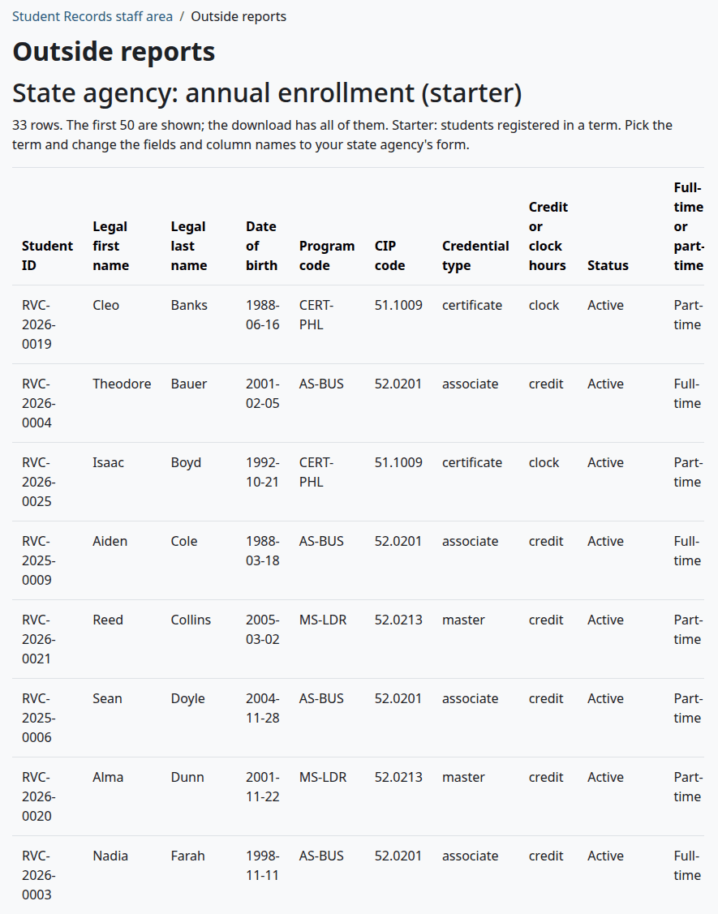

"Recent downloads" on the first tab lists the last 10 downloads from this page, with what, when and who.

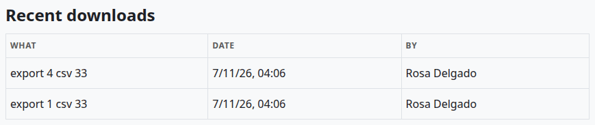

### The starter exports

"Add the starter exports" adds these three, if they aren't there yet. The page says, for example, "3 starter exports added. Change them to your agency's forms."

| Name | For | Students | What to set |
|---|---|---|---|
| "State agency: annual enrollment (starter)" | State agency | Registered in a term | The term. With none it has no rows |
| "State agency: completers (starter)" | State agency | Graduated between two dates | The dates |
| "Accreditor: student achievement (starter)" | Accreditor | All students | Nothing |

All three list sex and the IPEDS category, so they need `local/studentrecords:viewdemographics`. Change their fields and column names to your agency's form.

A starter's columns come in its own order, such as "Legal last name" before "Legal first name".

> Known problem in 1.4.6: the first time you save a starter's Settings, its columns move to the order of the "Fields" list. Write your own column names in that order, and run the report to check them.

## Add or change an export

Who can do this: people with `local/studentrecords:configure` and `local/studentrecords:managestudents`.

1. On Saved exports, select "Add an export", or "Settings" on a card.
2. Fill in the form.
3. Select "Save changes".

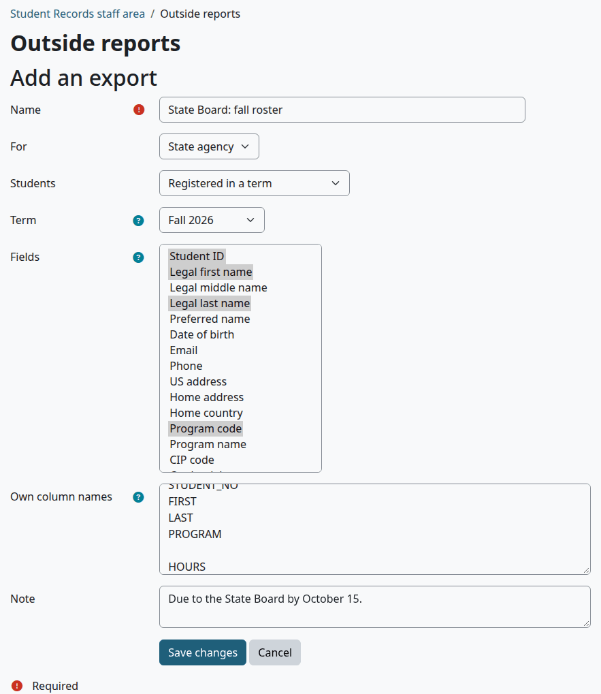

| Field | What it does |
|---|---|
| "Name" | Needed. The name on the card and in the file name |
| "For" | "State agency", "Accreditor" or "Other". Shown on the card |
| "Students" | Which students it lists. See below |
| "Term" | For "Registered in a term" and "Admitted for a term", where it's needed. It also gives "Hours in the term" for any list |
| "From" and "To" | For the two lists between two dates. Tick "Enable" to set one. A list with neither has everyone who has that date |
| "Fields" | Needed. Hold Ctrl or Command to pick more than one. The columns come in the order of this list, whatever order you pick them in |
| "Own column names" | One name per line, in the order of the fields. An empty line keeps the field's own name |
| "Note" | Shown above the rows when you run it |

> Known problem in 1.4.6: an empty first line in "Own column names" is lost when you save, so every name moves up one field. To keep the first field's own name, type that name on the first line.

| "Students" | Who is listed |
|---|---|
| "All students" | Every student record, applicants too |
| "Enrolled and active students" | Status Enrolled or Active |
| "Registered in a term" | Students with a registered, completed or withdrawn course in the term. A dropped course doesn't count |
| "Admitted for a term" | Students with this admit term |
| "Graduated between two dates" | Students with an award date in the range |
| "Withdrawn between two dates" | Students with a withdrawal date in the range |

The fields, in the order of the list:

| Group | Fields |
|---|---|
| The student | "Student ID", "Legal first name", "Legal middle name", "Legal last name", "Preferred name", "Date of birth", "Email", "Phone", "US address", "Home address", "Home country" |
| The program | "Program code", "Program name", "CIP code", "Credential", "Credential type", "Level", "Degree program (Y/N)", "Credit or clock hours", "Delivery mode" |
| Status | "Admit term", "Catalog year", "Status", "Full-time or part-time", "F-1 student (Y/N)" |
| Demographics | "Sex", "Hispanic or Latino", "Race (IPEDS codes)", "IPEDS race/ethnicity category" |
| Results | "Hours in the term", "Credits attempted (total)", "Credits earned (total)", "Cumulative GPA", "Award", "Award date", "Withdrawal date", "Last date of attendance" |

Check that:

- The card shows the new name.
- "Run report" shows the rows you expect, under your own column names.

What can go wrong:

- "Required" under "Fields" or "Term". An export needs at least one field, and a list by term needs a term.
- "Hours in the term" is empty. The export has no term.
- You can't delete an export. Change it to something useful instead, or leave it.

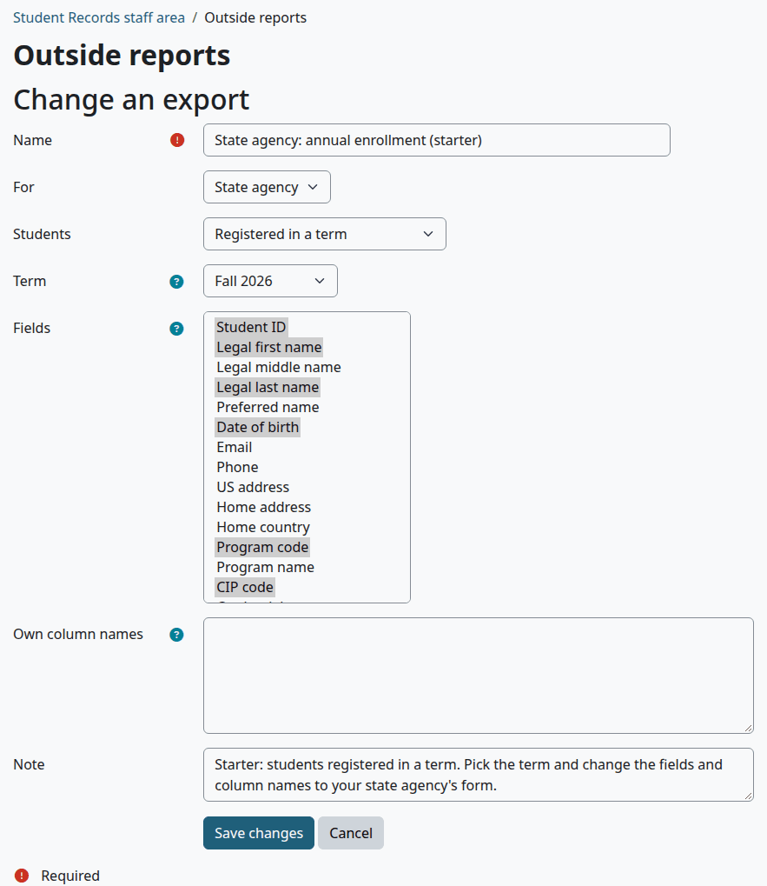

## Counts

Unduplicated counts for surveys such as IPEDS. Check the numbers against the survey's instructions.

1. Go to Student Records > Outside reports and select the tab "Counts".
2. Pick "Headcount (registered students)" or "Completions (awards conferred)".
3. Set "From" and "To". They start on July 1 of last year and June 30 of this year.
4. Select "Show".

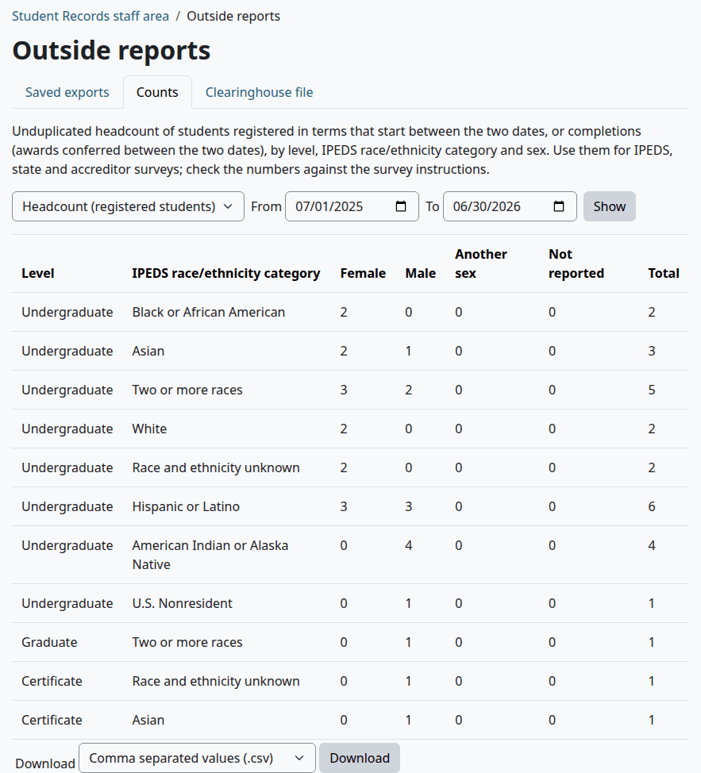

| Kind | What it counts |
|---|---|
| "Headcount (registered students)" | Students with a registered, completed or withdrawn course in a term that starts between the two dates. Each student counts once |
| "Completions (awards conferred)" | Students with an award date between the two dates |

The grid has "Level", "IPEDS race/ethnicity category", "Female", "Male", "Another sex", "Not reported" and Total. It needs `local/studentrecords:viewdemographics`. Without that the page says so, and the grid and its download aren't there.

Completions also shows a table by program, which needs no extra capability: "Program code", "Program name", "CIP code", "Credential", "Count".

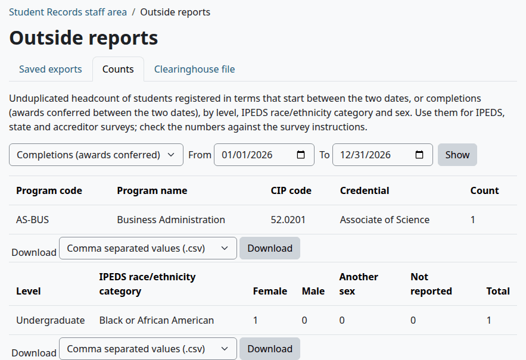

The files are named `headcount_`, `completions_` or `completions_programs_` and the date.

## The Clearinghouse file

An enrollment file for the National Student Clearinghouse. It's a starting file: check its columns against the Clearinghouse's current Enrollment Reporting specification before you send it. Student Records keeps no Social Security numbers, so that column is empty.

1. Go to Student Records > Outside reports and select the tab "Clearinghouse file".
2. Under "Term", pick the term.
3. Read the list of records that need fixing, and fix them on each student's file.
4. Pick a format under "Download" and select "Download".

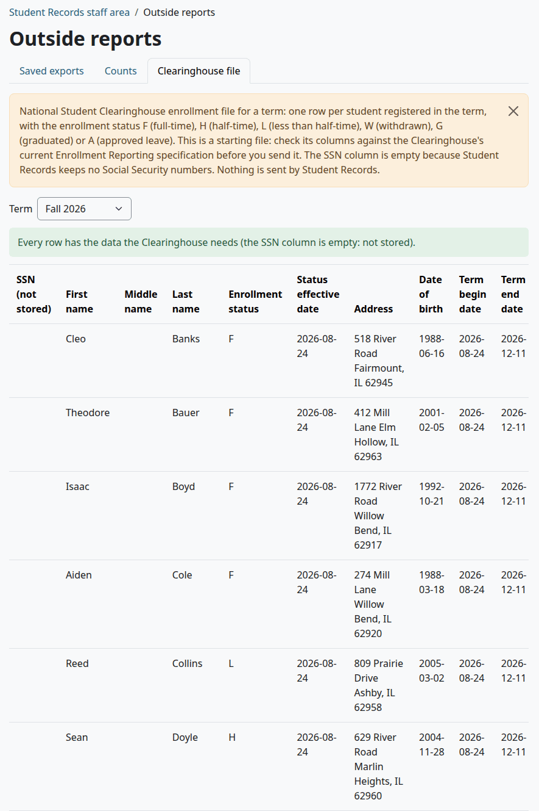

The file has one row for each student with any registration in the term, dropped ones too. The columns are, in this order: "SSN (not stored)", "First name", "Middle name", "Last name", "Enrollment status", "Status effective date", "Address", "Date of birth", "Term begin date", "Term end date", "Student ID", "Email", "CIP code", "Credential level", "Hours in the term". The file is named `clearinghouse_` and the term and date.

Check that:

- The page says "Every row has the data the Clearinghouse needs (the SSN column is empty: not stored)."

Otherwise it says how many records need fixing, and for each one which of these is missing: first name, last name, address, date of birth, student ID, CIP code or credential level. The CIP code and credential level come from the [program](programs-and-courses.md#add-a-program).

The enrollment status is the first of these that fits:

| Status | Meaning | When |
|---|---|---|
| G | Graduated | An award date by the term's end, or the status Graduated |
| A | Approved leave | The status On leave |
| W | Withdrawn | The status Withdrawn, or every course of the term dropped or withdrawn |
| F | Full-time | Full-time on the record, or at least "Full-time credit hours per term (Clearinghouse)" |
| H | Half-time | At least the half-time hours of [Billing setup](billing-setup.md), which default to 6 |
| L | Less than half-time | Anything else |

"Status effective date" is the award date for G, the withdrawal date or else the last date of attendance for W, and the term's start date for the rest. "Hours in the term" counts registered and completed courses.

> Known problem in 1.4.6: clock hours count the same as credit hours, so a student in a clock-hour program can show F or H from clock hours. Check those students yourself.

The status comes from the student's record as it is today. In a file for an earlier term, a student who graduated, withdrew or went on leave since then shows G, W or A.

## Related pages

- [Terms and the calendar](terms-and-calendar.md)
- [Programs and courses](programs-and-courses.md)
- [Faculty and staff](faculty-and-staff.md)
- [Attendance](attendance.md)
- [Admissions process](admissions-process.md)
- [Money reports](money-reports.md)
- [Federal aid](federal-aid.md)
- [Roles and permissions](../roles-and-permissions.md)
