# Setup wizard

The setup wizard takes you through the school's details in 11 steps. This page is for the site administrator or Registrar who sets up Student Records. It lists every question and what each answer changes.

## Contents

- [Who can run the wizard](#who-can-run-the-wizard)
- [How the wizard works](#how-the-wizard-works)
- [Step 1: School](#step-1-school)
- [Step 2: Approvals](#step-2-approvals)
- [Step 3: Calendar](#step-3-calendar)
- [Step 4: Grading](#step-4-grading)
- [Step 5: Programs](#step-5-programs)
- [Step 6: Courses](#step-6-courses)
- [Step 7: Admissions](#step-7-admissions)
- [Step 8: Billing](#step-8-billing)
- [Step 9: Roles and staff](#step-9-roles-and-staff)
- [Step 10: Import](#step-10-import)
- [Step 11: Summary](#step-11-summary)
- [What finishing the wizard checks](#what-finishing-the-wizard-checks)
- [Related pages](#related-pages)

## Who can run the wizard

Who can do this: site administrators, and anyone with the capability `local/studentrecords:configure`. Managers have it by default.

Some links in the wizard need more than that:

| Link | Step | It needs |
|---|---|---|
| "Billing setup" | 8 | `local/studentrecords:managebilling`. Without it the link doesn't show |
| "Manage faculty and staff" and "Faculty roster" | 9 | `local/studentrecords:viewfaculty` to open the pages, and `local/studentrecords:managefaculty` to add records |
| "Define roles" | 9 | Moodle's own permission to manage roles, so usually a site administrator |
| "Import from spreadsheet" | 4, 5, 6, 7, 9, 10 | `local/studentrecords:import` |

## How the wizard works

To open the wizard, go to Student Records > Setup wizard. You can also go to Site administration > Plugins > Local plugins > Student Records staff area and select "Setup wizard". Nothing sends anyone to the wizard by itself, so a new site doesn't remind you to run it.

Every step shows "Step 3 of 11", a line that says what the step is for, a progress bar, and links to all 11 steps.

- You can open the steps in any order. Select a step's name to go there.
- A tick next to a step means only that it comes before the step on screen. It doesn't mean that you finished it.
- Steps 1, 2, 3 and 7 have a form with a "Save and continue" button and no back button. If you leave one of these steps without saving, your answers on it are lost.
- Steps 4, 5, 6, 8, 9 and 10 have no form. They show links, with a "Back" button that names the step before and a "Continue" button that names the next step. All but step 10 also show a count.
- You can change any answer later: open the step again, change it and save.

If you import a spreadsheet, it can fill in many of these answers for you. See [Import from a spreadsheet](import.md).

## Step 1: School

The school's names, addresses and contacts. Set the time zone before you add any terms.

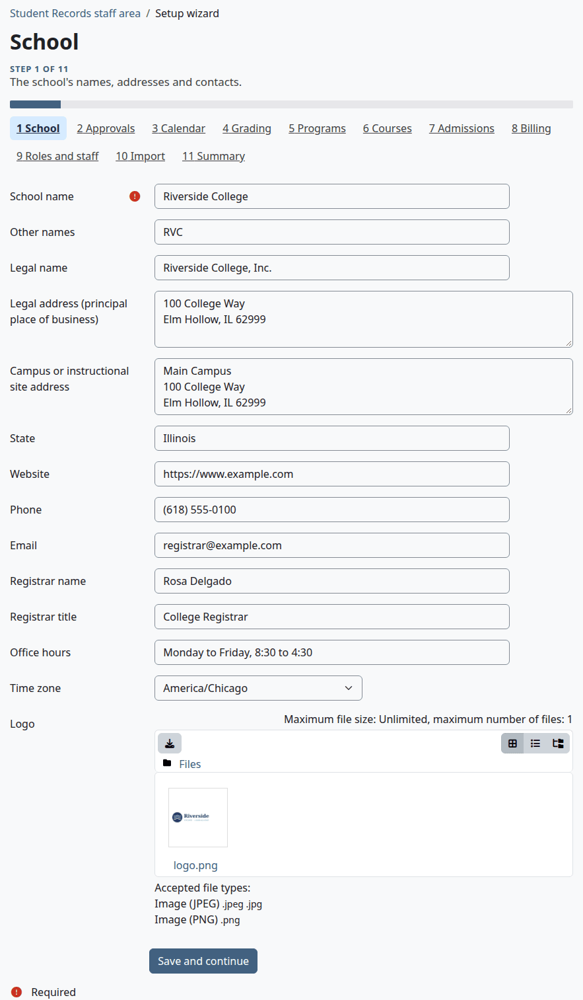

| Question | Default | What the answer changes |
|---|---|---|
| School name | Empty. You must answer this one | Shown on enrollment letters, statements, receipts and award letters, in the payment description, in `{school}` in messages, as the sender of messages, and on the Summary |
| Other names | Empty | Kept on file. No page uses it |
| Legal name | Empty | Kept on file. No page uses it |
| Legal address (principal place of business) | Empty | Printed on enrollment letters, statements and receipts |
| Campus or instructional site address | Empty | Kept on file. No page uses it |
| State | Empty | Kept on file. No page uses it |
| Website | Empty | Printed on enrollment letters |
| Phone | Empty | Printed on enrollment letters and statements, and used as `{office_phone}` in messages |
| Email | Empty | Printed on enrollment letters and statements |
| Registrar name | Empty | Signature block of enrollment letters |
| Registrar title | Empty | Signature block of enrollment letters. Empty prints "Registrar" |
| Office hours | Empty | Kept on file. No page uses it |
| Time zone | The server's time zone | Sets what "today" is for every date rule, the days of term dates, and how dates show |
| OPEID | Empty | Kept on file. No page uses it. This question appears only after federal aid is saved as on: see below |
| Logo | None | One .png, .jpg or .jpeg file. Printed on enrollment letters, statements and receipts |

Select "Save and continue".

OPEID isn't on this step the first time. Answer Yes to "Turn on the federal aid reporting module" in step 2, save, and open step 1 again:

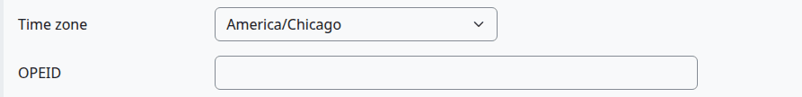

What can go wrong:

> Known problem in 1.4.6: if you change the time zone after you added terms, a term can show a day earlier than you set. A term saved on the Terms page is stored as the start of that day in the school's time zone, so a move to a zone further west shows the day before. Open each term, set its dates again and save. See [Terms and the calendar](terms-and-calendar.md).

## Step 2: Approvals

The state agency and license, the accreditor, and the two optional modules.

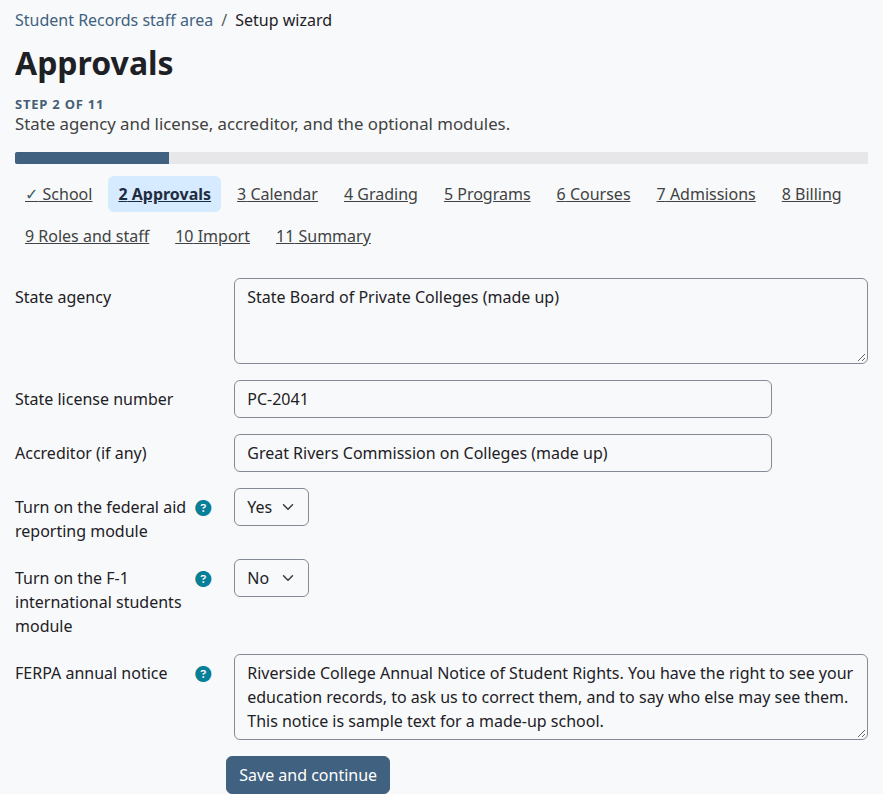

| Question | Default | What the answer changes |
|---|---|---|
| State agency | Empty | Shown on the Summary only |
| State license number | Empty | Kept on file. No page uses it |
| Accreditor (if any) | Empty | Shown on the Summary only |
| Turn on the federal aid reporting module | No | Only for schools approved for Title IV federal aid. Yes turns on the Federal aid page, the Financial Aid menu, the aid section of the student account, and award letters, and adds OPEID to step 1. No hides all of them. See [Federal aid](federal-aid.md) |
| Turn on the F-1 international students module | No | Only for schools approved to issue I-20s. Yes adds the F-1 fields to the student form, a filter to the student list, and F-1 rows to the facts on the student's file. No hides them |
| FERPA annual notice | Empty | The school's own notice. Students see it once per academic year and acknowledge it. With this empty, students get no prompt and no acknowledge button. The plugin has no default text. See [FERPA and letters](ferpa-and-letters.md) |

Select "Save and continue".

## Step 3: Calendar

The kind of term the school uses and the rules that follow the calendar. The term names and dates themselves are on the Terms page. This step shows how many terms exist and has a "Manage terms" link.

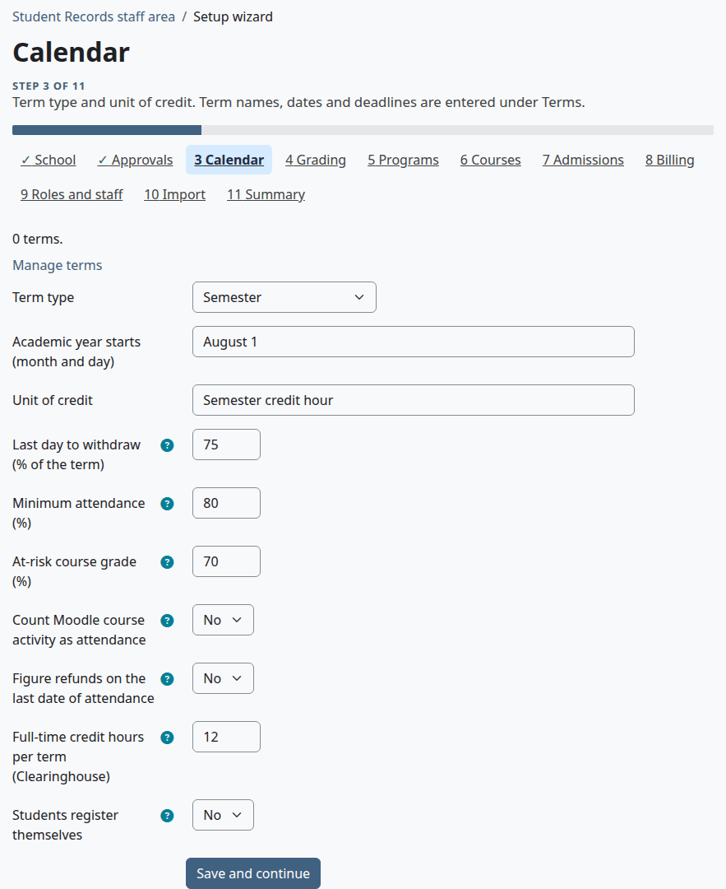

| Question | Default | What the answer changes |
|---|---|---|
| Term type | "Choose..." | Shown on the Summary only. The options are "Semester", "Quarter", "Trimester", "Term", "Continuous enrollment" and "Rolling start" |
| Academic year starts (month and day) | Empty, which means July 1 | The start of the FERPA year. Type it as `08-01`, `8/1` or `August 1` |
| Unit of credit | Empty | Kept on file. No page uses it |
| Last day to withdraw (% of the term) | Empty, which means 60 | Works out the last day to withdraw of a term when nobody picks a date |
| Minimum attendance (%) | Empty, which means 80 | The line for low attendance on reports, tiles and cards, and for the low attendance message |
| At-risk course grade (%) | Empty, which means 70 | A student under this course grade shows on the teacher's Students at risk list. Enter 0 to leave grades out of that list |
| Count Moodle course activity as attendance | No | Yes: the last date of attendance is the later of the last day marked present or late and the last visit to the Moodle course |
| Figure refunds on the last date of attendance | No | Yes: a refund uses the last date of attendance in the course, when there is one. No: it uses the day of the drop or withdrawal |
| Full-time credit hours per term (Clearinghouse) | Empty, which means 12 | The Clearinghouse enrollment status, the aid enrollment report, the loan percent, and the note about full-time hours when a student registers online |
| Students register themselves | No | Yes: students pick their classes online during the add period, and full sections offer a waitlist. No: staff register students. See [Registration](registration.md) |

[Terms and the calendar](terms-and-calendar.md) says more about each of these.

Select "Save and continue".

What can go wrong:

- A number is out of range, and the step shows an error under the field. The two percent fields take a number above 0, up to 100. "At-risk course grade (%)" also takes 0. "Full-time credit hours per term (Clearinghouse)" must be above 0, up to 100.

> Known problem in 1.4.6: under "Last day to withdraw (% of the term)" and "Minimum attendance (%)", the error says "Enter a number from 1 to 100.", though both take any number above 0, such as 0.5.

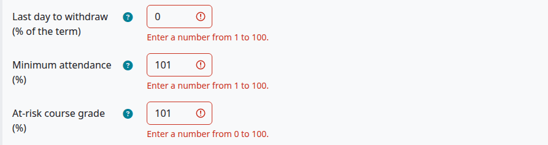

## Step 4: Grading

The school's grading scale, its levels and its pass rules. This step has no questions. It counts what you have, and has the links "Manage grading" and "Import from spreadsheet".

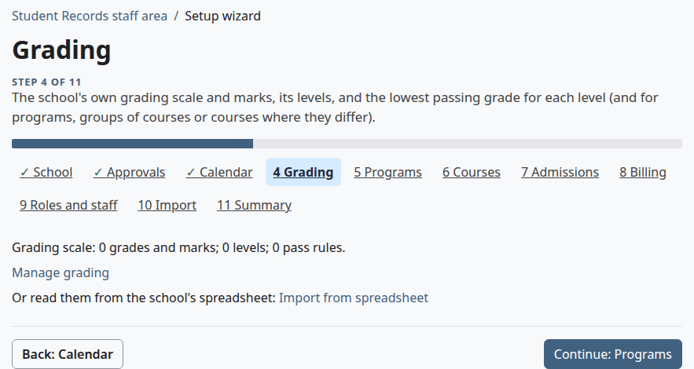

Fill this in on the Grading page. See [Grading and levels](grading-and-levels.md). Do this before you add programs and courses, so that you can give them a level.

## Step 5: Programs

This step has no questions. It counts your programs, and has the links "Manage programs" and "Import from spreadsheet".

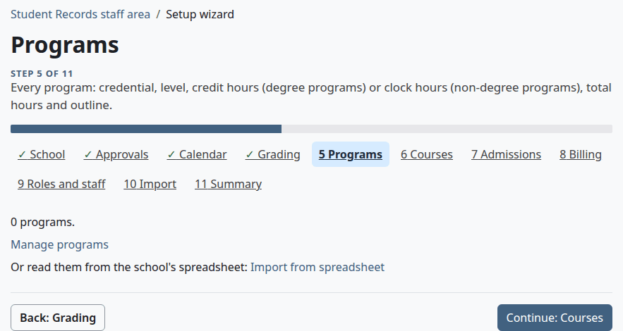

See [Programs and courses](programs-and-courses.md).

## Step 6: Courses

This step has no questions. It counts the courses in the catalog, and has the links "Manage courses" and "Import from spreadsheet".

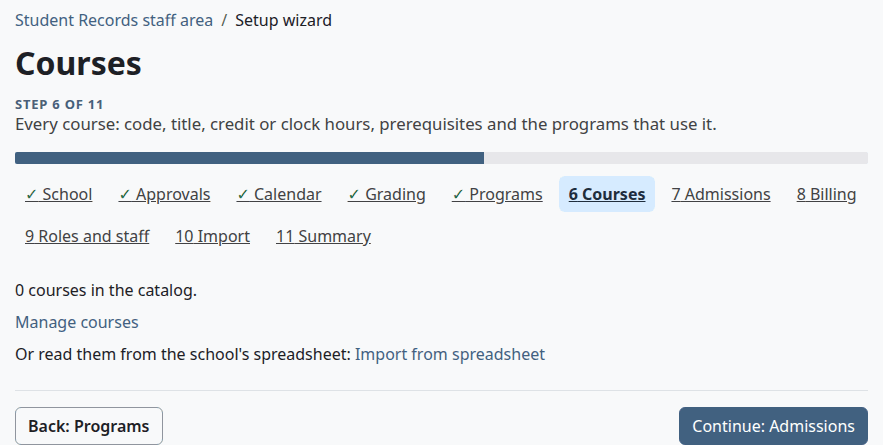

See [Programs and courses](programs-and-courses.md). A program's course list picks from the catalog, so add the courses before you fill in a program's list.

## Step 7: Admissions

The student ID format, the transfer credit default and the honors rules. Above the form, the step shows the next ID the format gives, how many documents are in the application checklist, and the links "Manage the application checklist" and "Import from spreadsheet".

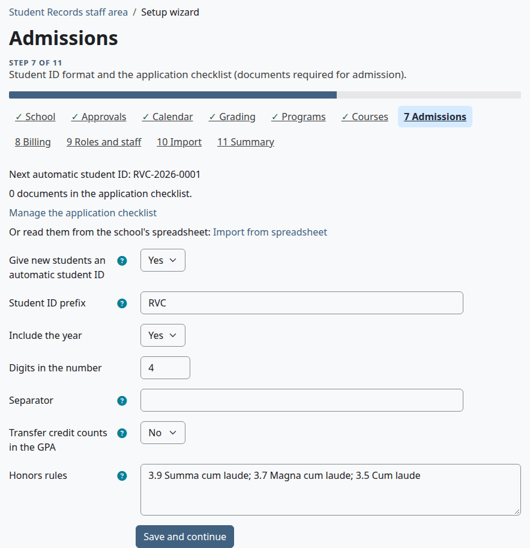

| Question | Default | What the answer changes |
|---|---|---|
| Give new students an automatic student ID | No | Yes: a new student record with no ID gets the next one in the format below. An ID that exists is never changed. No: staff type the ID |
| Student ID prefix | Empty | The start of the ID, such as RVC. It may be empty |
| Include the year | Yes | Puts this year, in the school's time zone, after the prefix |
| Digits in the number | 4 | How many digits the running number has. A whole number from 1 to 10 |
| Separator | Empty, which means `-` | The text between prefix, year and number. Type the word `none` for no separator |
| Transfer credit counts in the GPA | No | The starting value of "In the GPA" on a new transfer credit. Staff can change it on each one |
| Honors rules | Empty | One rule per line or separated by `;`: the lowest GPA and the honors. Empty means no honors are suggested at graduation |

For example, the prefix RVC, the year on, 4 digits and an empty separator give `RVC-2026-0001`. With `none` as the separator they give `RVC20260001`.

An honors rule looks like this: `3.9 Summa cum laude; 3.7 Magna cum laude; 3.5 Cum laude`.

Select "Save and continue". The line "Next automatic student ID" follows your answers when you open the step again.

What can go wrong:

- "Digits in the number" shows "Enter a whole number from 1 to 10."

To fill in the checklist, see [Admissions process](admissions-process.md).

## Step 8: Billing

This step has no questions. It says whether billing is on, counts the prices in use, and has a link to Billing setup when you have `local/studentrecords:managebilling`.

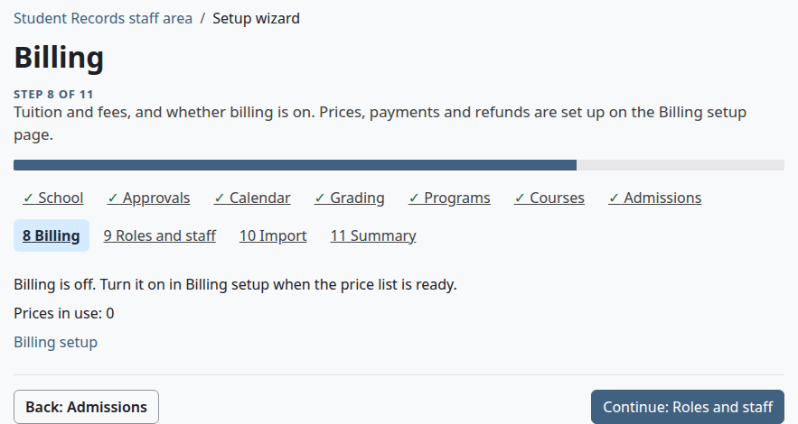

Billing stays off until you turn it on in Billing setup. See [Billing setup](billing-setup.md).

## Step 9: Roles and staff

This step has no questions. It counts faculty and staff records, and has the links "Manage faculty and staff", "Faculty roster", "Import from spreadsheet" and "Define roles".

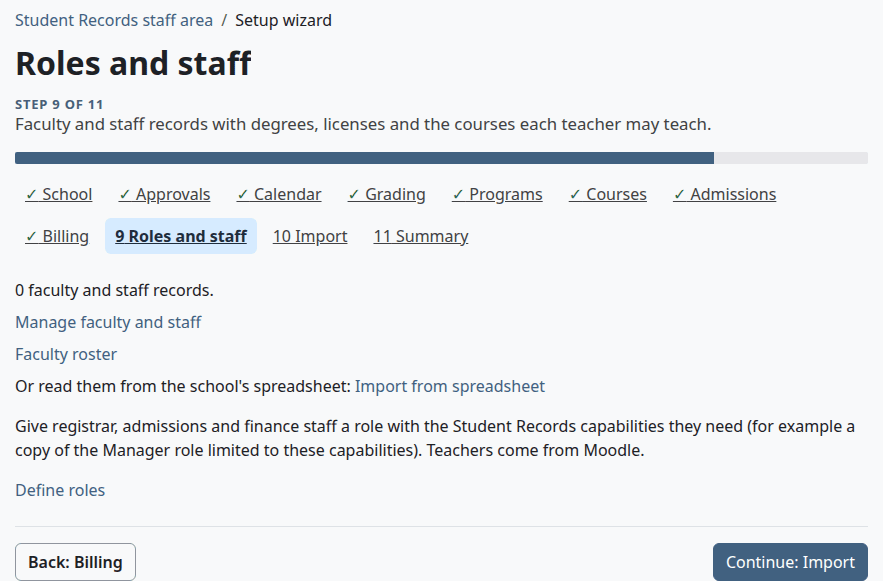

See [Faculty and staff](faculty-and-staff.md) for the records, and [Install and set up](install-and-setup.md#moodle-roles-to-make) for the roles to make.

## Step 10: Import

This step has no questions. It has one link, "Import from spreadsheet".

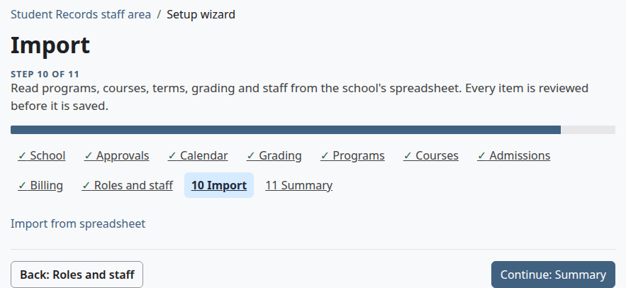

See [Import from a spreadsheet](import.md).

## Step 11: Summary

What is set up so far. This is the last step, so it has a "Back" button and no "Continue" button.

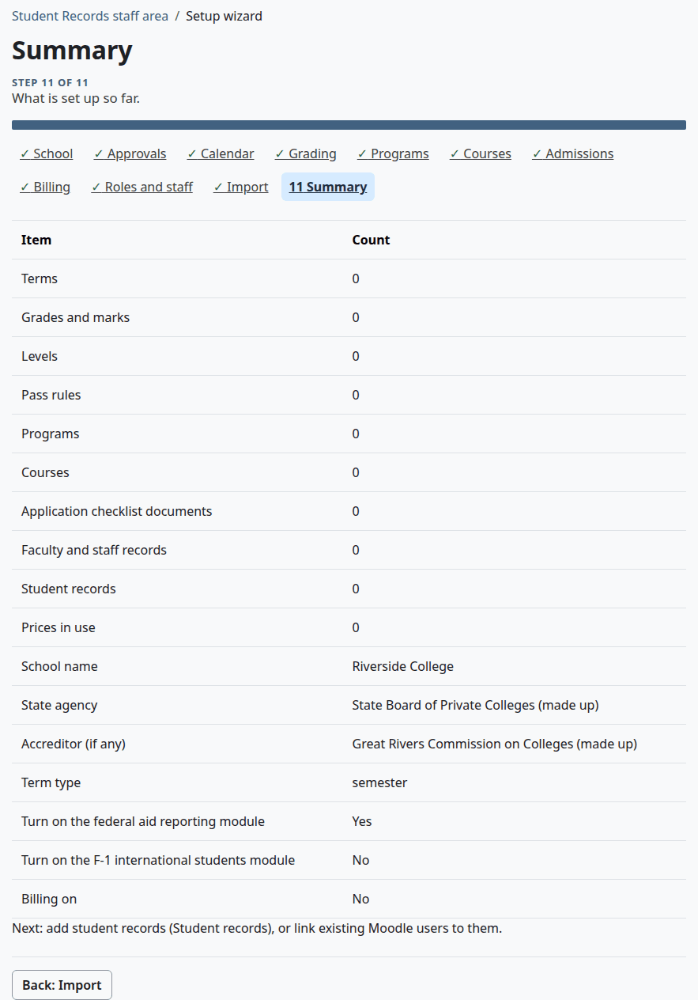

The table lists:

- A count of "Terms", "Grades and marks", "Levels", "Pass rules", "Programs", "Courses", "Application checklist documents", "Faculty and staff records", "Student records" and "Prices in use".
- "School name", "State agency", "Accreditor (if any)" and "Term type", with what you saved, or "Not set" in red. "Term type" shows the saved word in lower case, such as semester.
- Yes or No for "Turn on the federal aid reporting module", "Turn on the F-1 international students module" and "Billing on".

## What finishing the wizard checks

There is no finish button, and nothing stops you from using the plugin with steps left out. Only two things on the Summary point at a gap:

- "Not set" in red on one of the four settings above. An empty "Accreditor (if any)" shows it too, so a school with no accreditor can leave it.
- This warning, when a level has no pass rule of its own:

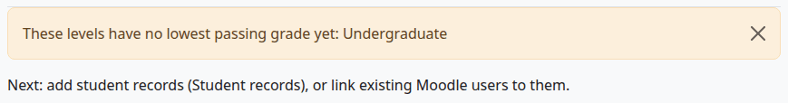

A level with no pass rule still works: any letter with grade points above 0 passes. See [Grading and levels](grading-and-levels.md#how-a-pass-is-decided).

The wizard doesn't check that you have terms, a grading scale, programs or faculty. Before you add students, check these yourself:

- At least one term, on the [Terms](terms-and-calendar.md) page.
- A grading scale with its marks, on the [Grading](grading-and-levels.md) page.
- Your programs and courses. See [Programs and courses](programs-and-courses.md).
- Your [messages](messages.md), with test mode on until the site goes live.

Then add [course offerings](course-offerings.md) for the term, and student records. See [The student file](student-file.md).

## Related pages

- [Install and set up](install-and-setup.md)
- [Import from a spreadsheet](import.md)
- [Terms and the calendar](terms-and-calendar.md)
- [Grading and levels](grading-and-levels.md)
- [Programs and courses](programs-and-courses.md)
- [Faculty and staff](faculty-and-staff.md)
- [Billing setup](billing-setup.md)
- [Roles and permissions](../roles-and-permissions.md)
