# Student accounts

A student account holds every charge, credit and payment of one student, with a running balance. This page shows finance staff how to read an account, add charges and credits, record payments, print receipts and statements, reverse a line, and open a course early.

Lines on an account are never changed or removed. You fix a mistake with a new line that cancels it.

## Contents

- [Find an account](#find-an-account)
- [Read an account](#read-an-account)
- [Add a charge](#add-a-charge)
- [Add a credit](#add-a-credit)
- [Record a payment](#record-a-payment)
- [Print a receipt](#print-a-receipt)
- [Print a statement](#print-a-statement)
- [Reverse a line](#reverse-a-line)
- [Give course access now](#give-course-access-now)
- [Add missing charges for a term](#add-missing-charges-for-a-term)
- [What the student sees](#what-the-student-sees)
- [Related pages](#related-pages)

## Find an account

Who can do this: finance staff and managers. It needs the capability `local/studentrecords:viewbilling`.

1. Select the Student Records tab, then select Student accounts in the left menu. The page's heading is Billing.
2. To narrow the list, type part of a name or a student ID in the box.
3. To see only some accounts, choose one of the options in the list next to the box:
   - All accounts
   - Student owes money
   - School owes the student
4. Select "Search".
5. Select the student's name.

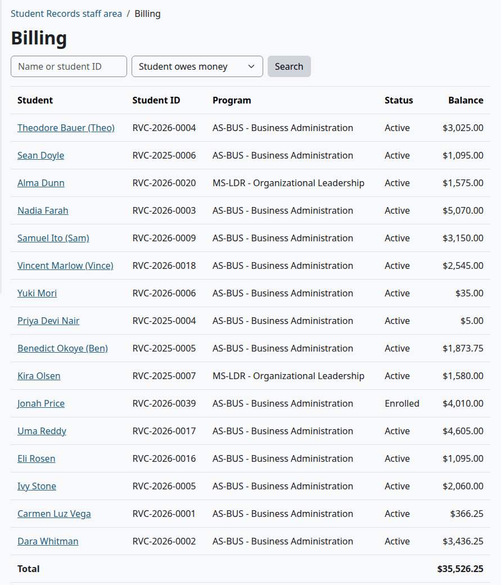

The list has every student record, including those with nothing on the account yet. The box looks in the student ID, the legal first and last names and the preferred name. The Total row adds up the balances shown. On Finance home, the box "Find a student account by name or student ID" does the same search.

Finance staff don't need an academic role for any of this. The Finance role can't open a student's academic file, so this list is how Finance reaches a student.

## Read an account

With a balance above zero, the student owes the school. Below zero, the school owes the student.

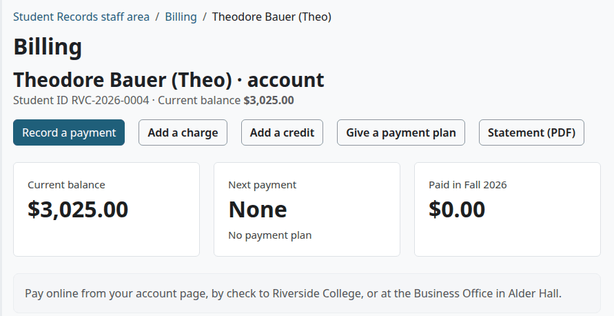

The top of the page has the student's name, student ID and "Current balance". When the student is on a plan, it also says "On a payment plan". Below that are the buttons:

| Button | What it does |
|---|---|
| "Record a payment" | See [Record a payment](#record-a-payment) |
| "Add a charge" | See [Add a charge](#add-a-charge) |
| "Add a credit" | See [Add a credit](#add-a-credit) |
| "Give a payment plan" | See [Give a payment plan](payment-plans.md#give-a-payment-plan) |
| "Record money paid back" | Shows only when the school owes the student. See [Record money paid back](refunds.md#record-money-paid-back) |
| "Statement (PDF)" | See [Print a statement](#print-a-statement) |

The first four, and the last but one, need `local/studentrecords:managebilling`. A person who may only view sees the statement button alone.

Three tiles follow:

| Tile | What it shows |
|---|---|
| Current balance | What the student owes. When the school owes the student, the tile says Credit on account. |
| Next payment | What is left of the next plan payment, and its due date. With no plan it says None and No payment plan. |
| Paid in, then the current term | The payments that have this term on them. A payment with no term isn't counted here, and neither is an online payment, which never has a term. The balance is right either way. |

The How to pay text shows when the student owes money and the setting has text. See [Billing setup](billing-setup.md#change-the-billing-settings). When any course waits for payment, a notice lists it. See [Give course access now](#give-course-access-now).

### Charges and payments

Each line of the account has one row, oldest date first.

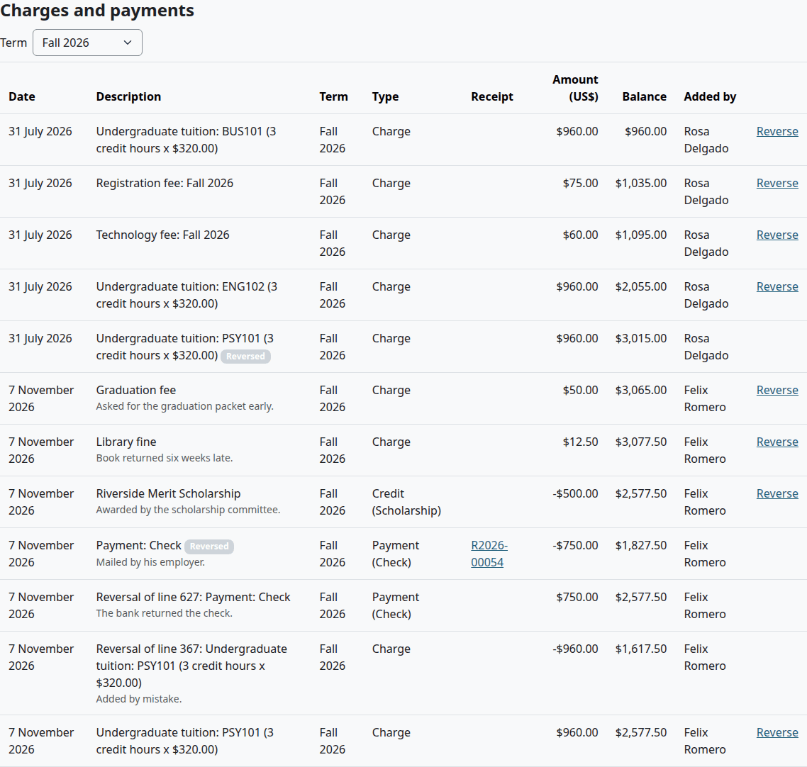

| Column | What it shows |
|---|---|
| Date | The date on the line. Staff can give an earlier date, so the order is by this date, not by when the line was added. |
| Description | What the line is for. A reversed line has the tag Reversed. A note or a reason shows under it, for staff only. |
| Term | The term on the line, if it has one |
| Type | The kind of line, and for a credit or a payment, its kind or how it was paid |
| Receipt | The receipt number of a payment, as a link to the receipt |
| Amount (US$) | The amount. A minus sign lowers the balance. |
| Balance | The balance after this line |
| Added by | Who added the line, for staff only. A line that the daily task added names the user Moodle's cron runs as, usually the admin. |
| Last column | "Reverse", when this person may reverse the line |

The Type column has five kinds of line:

| Type | What it is | How it gets here |
|---|---|---|
| Charge | Raises the balance | A registration, staff, a plan fee, a late fee, a transcript fee, or a return of aid |
| Credit | Lowers the balance | Staff, or an aid disbursement |
| Payment | Lowers the balance, and has a receipt | Staff, or an online payment |
| Refund | Lowers the balance | An approved refund. See [Refunds](refunds.md) |
| Money paid back | Raises the balance | Staff record money sent back to the student |

A reversal has the type of the line it reverses, with the opposite amount and no receipt.

A charge from a registration looks like "Undergraduate tuition: BUS101 (3 credit hours x $320.00)". With Academic Transcript installed, a transcript request can add its fee as a charge too.

To see one term, choose it in the Term list above the table. The page then says "Only the lines of this term are shown; the balance is for the whole account." The Balance column adds up only the lines shown, and the tiles still show the whole account.

### Lower on the page

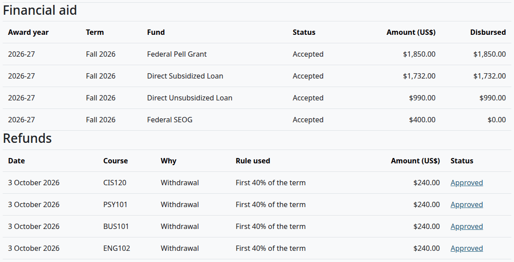

| Section | What it shows |
|---|---|
| Financial aid | With the federal aid module on: the student's awards, to read only. Staff with `local/studentrecords:viewaid` get a link "Open in Federal aid". |
| Refunds | Each refund of this student. For staff, the status is a link to the refund. |
| Payment plans | Each plan and its payments. See [Read a plan on the account](payment-plans.md#read-a-plan-on-the-account). |

## Add a charge

Registering adds its charges by itself. Use this for anything else, such as a replacement ID card.

Who can do this: finance staff and managers. It needs `local/studentrecords:managebilling`.

1. [Find the account](#find-an-account).
2. Select "Add a charge".
3. In "Price list item", pick the item, or leave "Other charge (not on the price list)".
4. Fill in the form. The table below says what each field does.
5. Select "Add a charge".

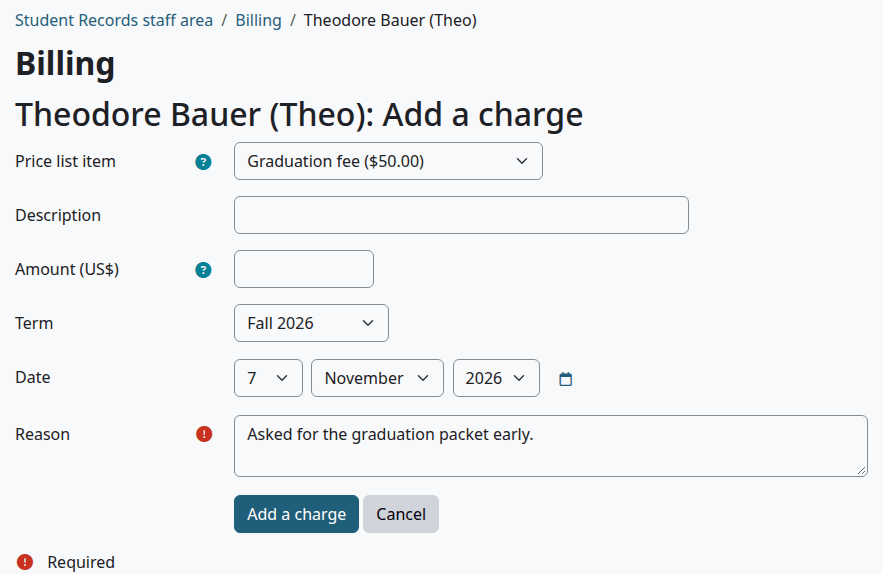

| Field | What to enter | Default |
|---|---|---|
| Price list item | One of your active prices, or "Other charge (not on the price list)" | Other charge (not on the price list) |
| Description | What the student sees. Needed for an other charge. Left empty with a price list item, it is the name of the price. | Empty |
| Amount (US$) | Leave it empty to use the price. An other charge needs an amount. It must be above zero. | Empty |
| Term | The term of the charge, or None | None |
| Date | The date on the line | Today |
| Counts for the 1098-T | Shows only for an other charge. A price list item sets it. | No |
| Refundable | Shows only for an other charge. A price list item sets it. | Yes |
| Reason | Why you add it. Needed. Staff see it under the description. | Empty |

An other charge shows two more fields:

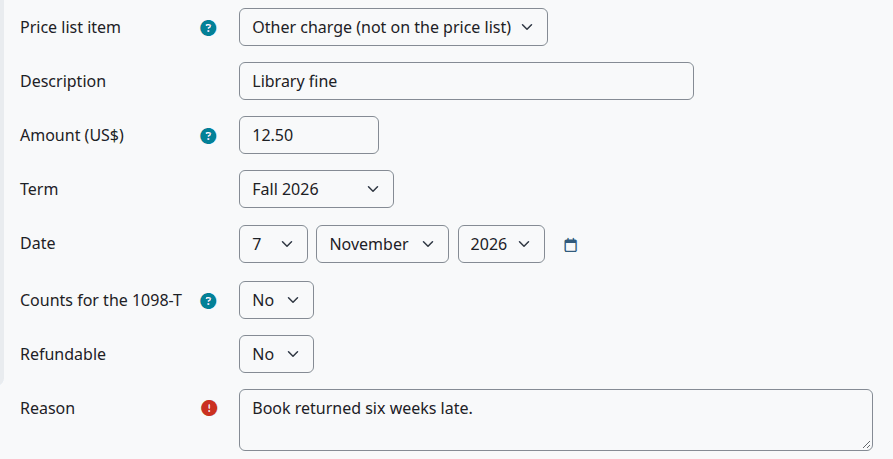

Check that:

- The page says "Saved."
- The new line is under Charges and payments, and the balance went up.

What can go wrong:

- "Enter an amount above zero, such as 150 or 1500.00." The amount is 0, or it isn't an amount. Commas go only between thousands.
- A price per credit hour used here isn't multiplied by hours. The line gets the price itself. Type the amount you want.

## Add a credit

A credit lowers what the student owes without money coming in at the office: a scholarship, a waiver or a sponsor's promise. To let a student off a charge, use a credit, not a reversal.

Who can do this: finance staff and managers. It needs `local/studentrecords:managebilling`.

1. [Find the account](#find-an-account).
2. Select "Add a credit".
3. Fill in the form. The table below says what each field does.
4. Select "Add a credit".

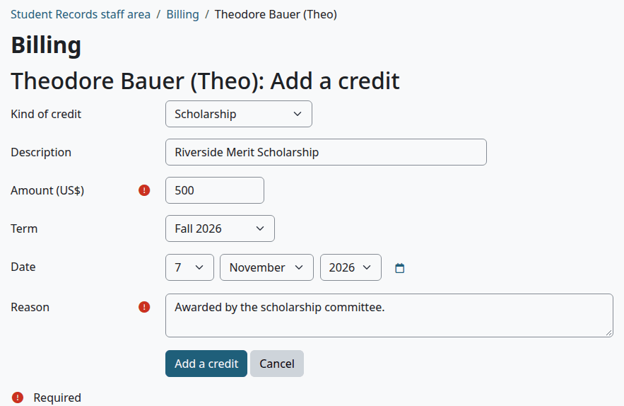

| Field | What to enter | Default |
|---|---|---|
| Kind of credit | Scholarship, Grant, Waiver, Discount, Sponsor or employer, or Adjustment | Scholarship |
| Description | What the student sees. Needed. | Empty |
| Amount (US$) | The amount, above zero. Needed. | Empty |
| Term | The term of the credit, or None | None |
| Date | The date on the line | Today |
| Reason | Why you add it. Needed. Staff see it under the description. | Empty |

> Known problem in 1.4.6: the form doesn't mark Description as needed, but it refuses a credit without one, with "Required". Type a description, such as the kind of credit.

The kind matters for the 1098-T data. See [How the 1098-T boxes are worked out](money-reports.md#how-the-boxes-are-worked-out).

Check that:

- The page says "Saved."
- The line shows Credit, with its kind in brackets, and the balance went down.

A credit counts toward a payment plan, and it can open a course that waits for payment.

Federal grants and loans never go here. They come from a disbursement on Federal aid. See [Federal aid](federal-aid.md#record-a-disbursement).

## Record a payment

Use this for money that reached the school outside Moodle: a check, cash, a card at the office, a wire. Online payments record themselves. See [Online payments](online-payments.md).

Who can do this: finance staff and managers. It needs `local/studentrecords:managebilling`.

1. [Find the account](#find-an-account).
2. Select "Record a payment".
3. Fill in the form. The table below says what each field does.
4. Select "Record a payment".

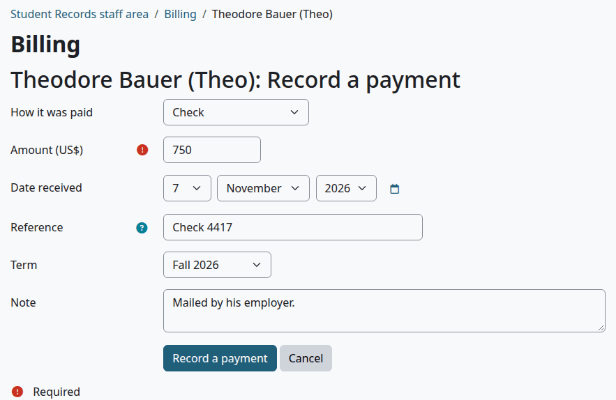

| Field | What to enter | Default |
|---|---|---|
| How it was paid | Check, Money order, Cash, Card at the office, Bank transfer or wire, Sponsor or employer, Flywire, PayMyTuition, or Other | Check |
| Amount (US$) | The amount, above zero. Needed. | Empty |
| Date received | The date on the line | Today |
| Reference | For example the check number, the bank transfer reference or the Flywire payment ID. Up to 100 characters. It prints on the receipt. | Empty |
| Term | The term of the payment, or None. The Paid in tile counts only payments with its term. | None |
| Note | For staff. It shows under the description. | Empty |

Flywire and PayMyTuition are names for your records. Student Records has no link to those companies, so you record such a payment by hand.

Check that:

- The page says "Saved."
- The new line shows Payment, with how it was paid, and a receipt number such as R2026-00054.
- The balance went down, and any plan payments it covers show Paid.
- Any course that waited and may now open is gone from the notice.

The amount can be more than the balance. The account then shows a credit, and the school owes the student the difference. See [Record money paid back](refunds.md#record-money-paid-back).

The student gets the message "Payment received". It says a payment came in and asks them to log in, with no amount and no receipt in it. It waits for Moodle's cron. See [Messages](messages.md).

What can go wrong:

- "Enter an amount above zero, such as 150 or 1500.00." The amount is 0, or it isn't an amount.
- A course stays on the notice after the payment. The course access rule isn't met yet, or the course can't open, for example because its Moodle course has no manual enrolment method. The payment stands either way. The audit log says why, and you can use [Give course access now](#give-course-access-now).

## Print a receipt

Every payment gets a receipt number when it is recorded: R, the year, a dash, and a number that goes up through the year. The year is this year at the school.

Who can do this: finance staff and managers with `local/studentrecords:viewbilling`, and the student on their own account.

1. [Find the account](#find-an-account).
2. Under Charges and payments, select the number in the Receipt column. A PDF opens.

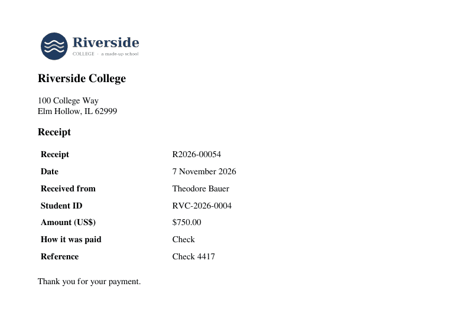

A receipt has the school's logo, name and address, the receipt number, the date, who it was received from, the student ID, the amount, how it was paid, and the reference. When the payment was reversed later, the receipt also prints "This payment was later reversed (for example a returned check)."

Each download goes in the audit log.

## Print a statement

Who can do this: finance staff and managers with `local/studentrecords:viewbilling`, and the student on their own account.

1. [Find the account](#find-an-account).
2. To print one term, choose it in the Term list above the table.
3. Select "Statement (PDF)".

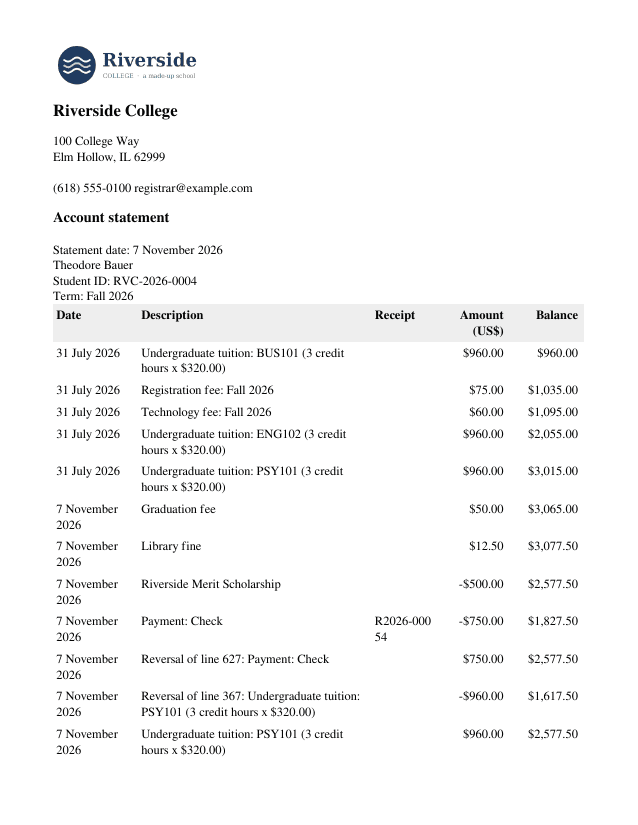

A statement has the school's logo, name, address, phone and email, the statement date, the student's legal name and ID, the term if you chose one, and each line with its balance. It ends with one of these, for the whole account:

| The account | The statement says |
|---|---|
| The student owes | "Balance due:" and the amount |
| The school owes | "The school owes the student" and the amount |
| Neither | "Nothing is owed (balance $0.00)." |

After that come the school's How to pay text and Note on statements, if they have text. See [Billing setup](billing-setup.md#change-the-billing-settings).

A statement of one term also says "Only the lines of this term are shown; the balance is for the whole account." Its Balance column adds up only the lines of that term.

Each download goes in the audit log.

## Reverse a line

Use this for a line added by mistake, or for a payment that bounced. The line stays on the account, and a new line with the opposite amount cancels it.

To let a student off paying, add a credit instead. See [Add a credit](#add-a-credit).

Who can do this: finance staff and managers. It needs `local/studentrecords:managebilling`. An aid line also needs `local/studentrecords:manageaid`, so the Finance role has no Reverse link on it. See [Reverse a disbursement](federal-aid.md#reverse-a-disbursement).

1. [Find the account](#find-an-account).
2. Select "Reverse" at the end of the line. The form shows the line under "Line", and this note: "Use this for a line added by mistake. The line stays, and a new line cancels it. A registration charge that is reversed is charged again (at today's price) by "Add missing charges for a term". To let a student off paying, add a credit (waiver or scholarship) instead."
3. In "Reason", say why.
4. Select "Reverse".

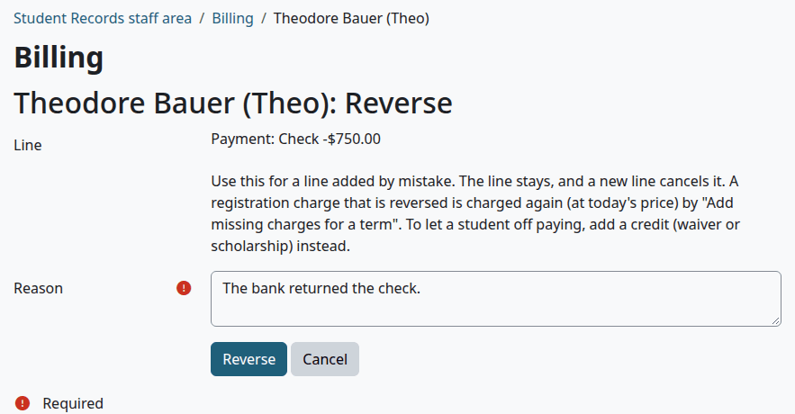

Check that:

- The page says "Saved."
- The first line has the tag Reversed.
- A new line says "Reversal of line", with the line's number and description, and the opposite amount. It has today's date, and the reason shows under it.

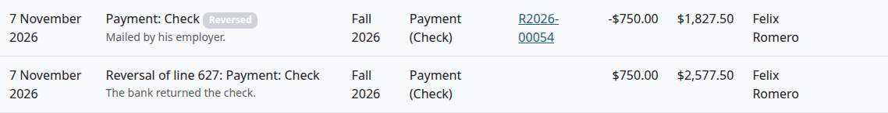

A reversal does these things as well:

- A reversed payment counts back on a payment plan. A plan payment it paid goes back to unpaid.
- Its receipt keeps its number, and prints a line saying that it was reversed.
- A reversed registration charge can be charged again, at today's price, by [Add missing charges for a term](#add-missing-charges-for-a-term). So a reversal alone doesn't let a student off.
- A reversal never closes a course. Nothing takes course access away.

What can go wrong:

- "This charge has a refund on it. Reverse the refund lines first." A refund and a reversal would give the same money back twice. Reverse each Refund line of this charge, then reverse the charge.
- There is no Reverse link. The line is already reversed, or it is itself a reversal, and neither can be reversed. On an aid line you need `local/studentrecords:manageaid`.

## Give course access now

Under the course access rule, a registered student can wait for payment before they get into the Moodle course. On the student's file, such a class has the tag Waiting for payment. Finance can open the course early, with a reason. See the rule in [Billing setup](billing-setup.md#change-the-billing-settings).

Who can do this: finance staff and managers. It needs `local/studentrecords:managebilling`.

Before you start:

- The account page shows the notice "Course access waits for payment."

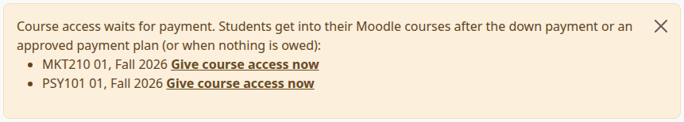

1. [Find the account](#find-an-account).
2. In the notice, select "Give course access now" next to the course.
3. In "Reason", say why.
4. Select "Give course access now".

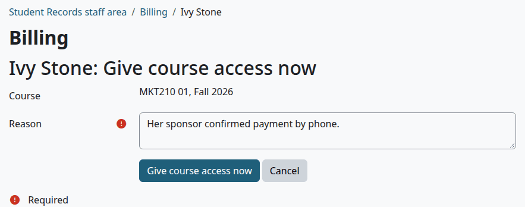

Check that:

- The page says "Saved."
- The course is gone from the notice. Do this for each course. The link opens one course at a time.

The student is enrolled in the Moodle course, and gets the message "Course access open" with Moodle's next cron run. The reason goes in the audit log.

## Add missing charges for a term

Use this for registrations made before billing was turned on, or after a price was added. It looks at every active registration of a term and adds what isn't on the account yet. Nothing is charged twice.

Who can do this: finance staff and managers. It needs `local/studentrecords:managebilling`. Billing must be on, and the school must have at least one term.

1. Select Student accounts in the left menu.
2. At the bottom of the page, under "Add missing charges for a term", choose the term.
3. Read the question, then select "Continue".

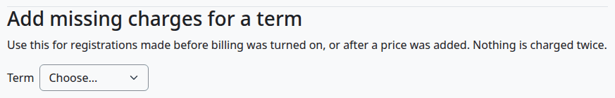

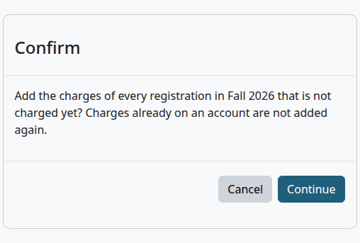

Check that:

- The page says how many lines it added, such as "1 charge lines added."
- Run it again, and it says "0 charge lines added."

It uses today's prices. It makes no one wait for payment, so a student who is already in a course stays in. A charge that was reversed counts as missing, so this adds it again.

## What the student sees

A student opens their own account with My account in the left menu. That link shows only with billing on.

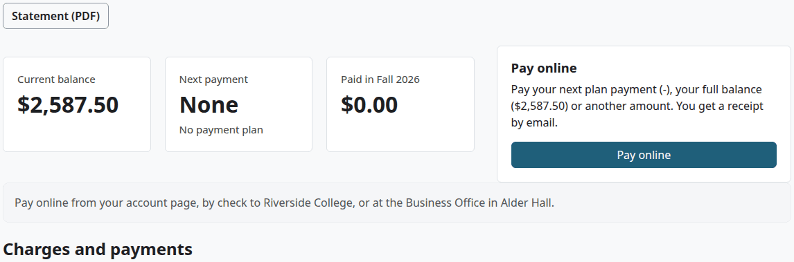

The student's page has the same tiles, lines, aid, refunds and plans as the staff page, with these differences:

| The student | Details |
|---|---|
| Sees the heading My account | No student ID or balance line above the tiles |
| Has one button | "Statement (PDF)" |
| Gets a Pay online card | Only when they owe money and online payment is set up. See [Pay online](online-payments.md#pay-online-as-a-student) |
| Doesn't see notes or reasons | Those are for staff only |
| Doesn't see Added by or Reverse | Those columns are for staff only |
| Can open receipts | The numbers in the Receipt column are links |
| Sees a course that waits | The notice has no link to open it |
| Sees a refund's status as text | Not as a link |

A student can't open any other student's account.

On a phone the tiles sit two to a row, the Pay online card moves under them, and the table of lines scrolls sideways.

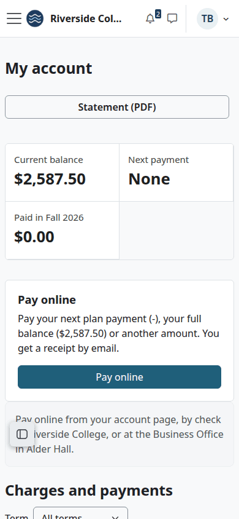

## Related pages

- [Finance guide](finance.md)
- [Billing setup](billing-setup.md)
- [Payment plans](payment-plans.md)
- [Refunds](refunds.md)
- [Online payments](online-payments.md)
- [Money reports](money-reports.md)
- [Federal aid](federal-aid.md)
- [Student guide](student.md)
