# The student file

Each student has one file. This page shows how staff find a file, add one, read each tab and change what is in it. It is for the Registrar, admissions staff and anyone else who keeps student records. Teachers and students see less of the file, and two sections below say what.

## Contents

- [Who can open a file](#who-can-open-a-file)
- [Find a student](#find-a-student)
- [Add a student record](#add-a-student-record)
- [Read the file](#read-the-file)
- [Profile tab](#profile-tab)
- [Edit a student record](#edit-a-student-record)
- [Student status](#student-status)
- [Add or change an emergency contact](#add-or-change-an-emergency-contact)
- [Edit demographics](#edit-demographics)
- [Admissions tab](#admissions-tab)
- [Add or change prior education](#add-or-change-prior-education)
- [Registration and grades tab](#registration-and-grades-tab)
- [Attendance tab](#attendance-tab)
- [Holds tab](#holds-tab)
- [Graduation tab](#graduation-tab)
- [Privacy tab](#privacy-tab)
- [Documents tab](#documents-tab)
- [History tab](#history-tab)
- [View as student](#view-as-student)
- [What a teacher sees](#what-a-teacher-sees)
- [What a student sees](#what-a-student-sees)
- [Your own record](#your-own-record)
- [Nothing is deleted](#nothing-is-deleted)
- [Related pages](#related-pages)

## Who can open a file

What you can do depends on your capabilities, not on the name of your role.

| Person | What decides it | What they get |
|---|---|---|
| Records and admissions staff | `local/studentrecords:managestudents` at system level | Every file, all tabs, the edit form, the names of documents, the History tab |
| Staff who only look | `local/studentrecords:viewstudents` at system level | Every file and all tabs but History. No edit form. On the Documents tab they see "No files on your record yet." even when files exist, because they can't open them. A student's withheld directory information shows as "Withheld (FERPA)" |
| Teachers | `local/studentrecords:viewstudents` in a course, for a student actively enrolled in that course | A table of facts. See [What a teacher sees](#what-a-teacher-sees) |
| Students | `local/studentrecords:viewown` and a file of their own. Every logged-in user holds this capability by default | Their own record, read only. See [What a student sees](#what-a-student-sees) |

Finance staff can't open the file unless they also hold a student capability. They reach a student through Student accounts, as [Student accounts](student-accounts.md) shows. Financial Aid staff work the same way, through [Federal aid](federal-aid.md).

Each time someone opens a file, the [audit log](audit-log.md) gets a row.

## Find a student

Who can do this: records and admissions staff, and staff who only look. It needs `local/studentrecords:managestudents` or `local/studentrecords:viewstudents` at system level.

1. In the Student Records menu, select "Find a student".
2. Type in Search, or choose a filter, and select "Filter".
3. Select a name to open the file.

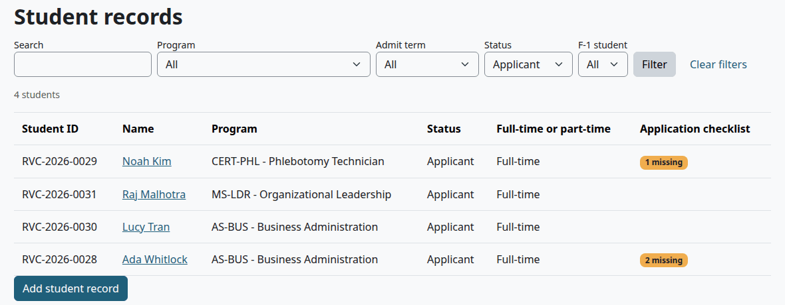

| Filter | What it does |
|---|---|
| Search | Finds part of a student ID, a legal first name, a legal last name or a preferred name |
| Program | All, or one program |
| Admit term | All, or one term |
| Status | All, or one [status](#student-status) |
| F-1 student | All, Yes or No. It shows only when the F-1 module is on |

The list shows 50 students a page, by legal last name. The Application checklist column shows, for example, "2 missing" when required documents are missing. "Clear filters" shows everyone again.

What can go wrong:

- A search finds nobody by middle name. The list doesn't search it.
- Staff who don't manage students can't find a student by preferred name when that student withheld directory information.

> Known problem in 1.4.6: each field is searched on its own, so a search for a whole name finds nobody. Search for the first name or the last name, not both. A search by email finds nobody either, though the box on the Staff home says "Find a student by name, student ID, or email".

## Add a student record

Who can do this: records and admissions staff. It needs `local/studentrecords:managestudents` and Moodle's `moodle/user:viewalldetails` at system level. A role made only of Student Records capabilities doesn't have the second one, so add it at Site administration > Users > Permissions > Define roles. The Manager role has both.

Before you start:

- The person has a Moodle account. A record belongs to one account, and no page of the plugin makes accounts. There is no public application form.
- The programs and terms exist, as [Programs and courses](programs-and-courses.md) and [Terms and calendar](terms-and-calendar.md) show.

1. In the Student Records menu, select "Find a student", then "Add student record" under the list. "Add a student" on the Staff home and "Add applicant" on Admissions open the same form.
2. In Moodle user, type part of the person's name and pick them.
3. Leave Student ID empty to give the next automatic ID, or type one. With automatic IDs off, you must type one.
4. Fill in Legal first name and Legal last name.
5. Fill in what else you know. [Edit a student record](#edit-a-student-record) lists every field. A new record starts with the status Applicant.
6. Select "Save changes".

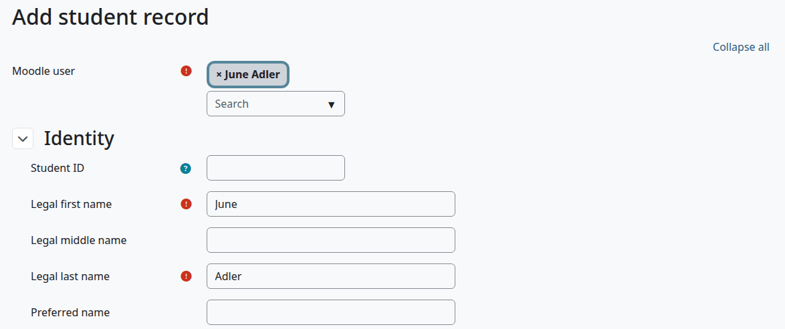

> Known problem in 1.4.6: saving this form stops with "There is no record." and no record is made. Cancel stops the same way once a person with no file is picked. It happens for every role, site administrators too, and from every button that opens the form. The page reads the Moodle user field as a request to open that person's existing file. The form is the only page that makes a record, so a site administrator has to make new records with a script until this is fixed, as below. Staff can then fill the record in with "Edit profile".

The script works on any site with the plugin. Save it as `addstudent.php` in Moodle's main folder, the one that holds `config.php`. Change the username, then run it in that folder as the web server user, for example `sudo -u www-data php addstudent.php`. Delete the file when you have finished.

```php
<?php
define('CLI_SCRIPT', true);
require('config.php');
\core\session\manager::set_user(get_admin());
$user = $DB->get_record('user', ['username' => 'jadler', 'deleted' => 0], '*', MUST_EXIST);
$id = \local_studentrecords\local\students::save([
    'userid' => $user->id,
    'legalfirstname' => $user->firstname,
    'legallastname' => $user->lastname,
    'email' => $user->email,
    'status' => 'applicant',
]);
echo "Made record $id\n";
```

With automatic IDs off, add a line such as `'studentid' => 'A1001',`, or the record has no student ID. The script gives the next automatic ID when they are on.

Check that:

- The student shows in "Find a student", with a student ID and the status Applicant.
- History lists the new values, with your name or the administrator's.

What can go wrong:

- The Moodle user box opens a window that says "Sorry, but you do not currently have permissions to do that (View user full information)." Your role lacks `moodle/user:viewalldetails`.
- Picking a person who already has a file stops with "Error writing to database". The file doesn't change.

## Read the file

A file opens on its Profile tab. Staff who manage students see a blue notice first, "Before releasing information". It turns yellow when the student withheld directory information. [FERPA and letters](ferpa-and-letters.md#read-the-release-check) explains its lines.

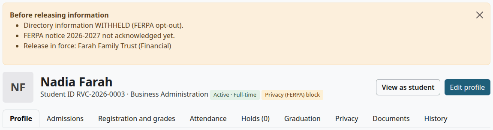

Under the notice are the student's initials and name, the student ID, the program and a tag with the status and load. A student who withheld directory information also has the tag "Privacy (FERPA) block". "View as student" is there for all staff, and "Edit profile" for staff who manage students.

Then come the tabs. If the row is too narrow for all of them, scroll it sideways, or close the Student Records menu with the button at its top.

| Tab | What it holds |
|---|---|
| Profile | Contact details, program facts, reporting facts, emergency contacts, demographics and At a glance |
| Admissions | Application checklist, admission decisions, status history, prior education |
| Registration and grades | Courses by term, grades, transfer credit, cumulative totals |
| Attendance | Attendance counts per course |
| Holds | Holds, with the number in force in the tab's name, and academic standing |
| Graduation | Graduation applications and the link to the degree audit |
| Privacy | FERPA acknowledgments, release authorizations, letters |
| Documents | Files on the record |
| History | Every change to the main record. Only staff who manage students see this tab |

## Profile tab

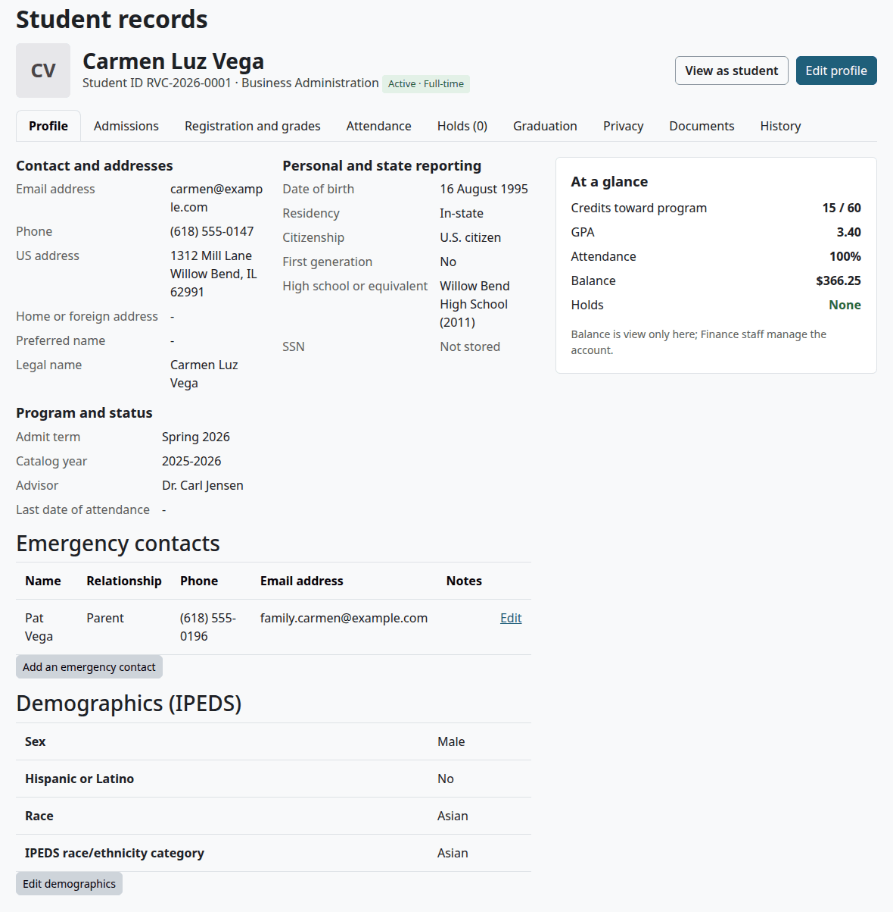

| Block | What it shows |
|---|---|
| Contact and addresses | Email address, Phone, US address, Home or foreign address, Preferred name, Legal name |
| Program and status | Admit term, Catalog year, Advisor, Last date of attendance |
| Personal and state reporting | Date of birth, Residency, Citizenship, First generation, High school or equivalent with the year, and SSN, which always says "Not stored" |
| Emergency contacts | The contacts, with "Add an emergency contact" and an Edit link for staff who manage students |
| Demographics (IPEDS) | Sex, Hispanic or Latino, Race and the IPEDS race/ethnicity category. It needs `local/studentrecords:viewdemographics` |
| At a glance | Credits toward program, GPA, Attendance, Balance and Holds |

At a glance shows the balance only when billing is on. With `local/studentrecords:viewbilling`, "Open the account" opens it. Without that capability you see "Balance is view only here; Finance staff manage the account."

## Edit a student record

Who can do this: records and admissions staff. It needs `local/studentrecords:managestudents` at system level.

1. Open the file and select "Edit profile".
2. Open the section you need, or select "Expand all". Only Identity starts open.
3. Change the fields.
4. Select "Save changes".

Check that:

- The file opens with "Saved."
- The History tab has a row for each field you changed.

These are the fields, section by section. Only the legal names are required, and Student ID when automatic IDs are off.

Identity:

| Field | What it does |
|---|---|
| Moodle user | The account this record belongs to. It shows only on a new record, and no page can change it later |
| Student ID | Leave it empty to give the next automatic ID. Two records can't share one |
| Legal first name, Legal middle name, Legal last name | The name on official papers |
| Preferred name | Shown in brackets after the legal name. It is directory information |
| Date of birth | Pick day, month and year, or leave all three blank. It can't be in the future |

Contact and addresses:

| Field | What it does |
|---|---|
| Email address | Kept on the record. It goes in the Clearinghouse file and the 1098-T list. Messages don't use it: they go to the Moodle account |
| Phone | Free text |
| US address, Home or foreign address | Free text, over several lines |
| Home country | None, or a country |

Program and status:

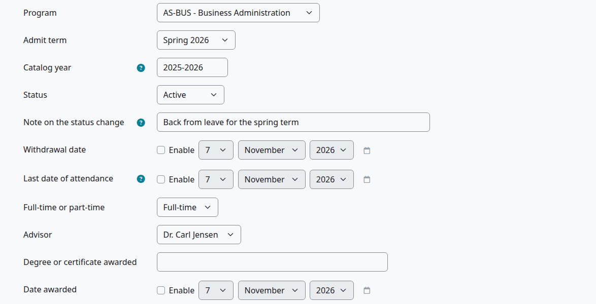

| Field | What it does |
|---|---|
| Program | None, or an active program. The degree audit and the grading rules follow it |
| Admit term | None, or a term. A decision or a deferral can change it |
| Catalog year | Free text, such as 2026-2027. It is a label and an export field. No rule reads it, so a student follows the program as it stands today |
| Status | One of the eleven [statuses](#student-status) |
| Note on the status change | Saved in the status history when the status changes |
| Withdrawal date | Needed for the status Withdrawn |
| Last date of attendance | Needed for the status Withdrawn, and it can't be after the withdrawal date. Attendance can fill it in, as [Attendance](attendance.md) shows |
| Full-time or part-time | None, Full-time or Part-time. Reports and the enrollment letter use it |
| Advisor | None, or active faculty. It gives the advisor no access to the student |
| Degree or certificate awarded, Date awarded | Filled in by conferral, as [Degree audit and graduation](degree-audit-and-graduation.md) shows |

> Known problem in 1.4.6: the Program list holds active programs only, and the Advisor list active faculty only. If a student's program or advisor has been switched off, the form shows None in that field, and saving it clears the field with no warning. Before you save, switch the program or the person back on. History keeps the old value if it happens.

Personal and state reporting:

| Field | Options |
|---|---|
| Residency | Not set, In-state, Out-of-state, International |
| Citizenship | Not set, U.S. citizen, Permanent resident, Other |
| First generation | Not set, Yes, No, Unknown. Yes means neither parent finished a bachelor's degree |
| High school or equivalent | Free text |
| Year completed | A year from 1900 to 2100 |

The plugin only keeps and shows Residency, Citizenship and First generation. No report reads them.

Privacy:

| Field | What it does |
|---|---|
| Withhold directory information (FERPA) | See [FERPA and letters](ferpa-and-letters.md#withhold-directory-information) |

F-1 international student, shown only when the F-1 module is on:

| Field | What it does |
|---|---|
| F-1 student | Marks a student on an F-1 visa. It also puts the student in the IPEDS category U.S. Nonresident |
| Visa type, SEVIS ID | Free text |

Documents:

| Field | What it does |
|---|---|
| Documents | Up to 20 files. See [Documents](documents.md) |
| Notes | Free text for staff. It shows only on this form and on the History tab |

## Student status

A status says where a student is, from first inquiry to graduation. Only two things change it by themselves: an admission decision, while the student is still in admissions, and conferring a credential. Staff set every other change by hand, on the edit form.

| Status | How a student gets it | What it means to the plugin |
|---|---|---|
| Inquiry | Edit form | Listed under New on Admissions |
| Applicant | The default on a new record, or the edit form | Listed as ready or missing documents on Admissions |
| Waitlisted | The decision Waitlisted | On the program waitlist |
| Admitted | The decision Admitted | Can register online |
| Denied | The decision Denied | Listed under Decided on Admissions |
| Deferred | The decision Deferred | Listed under Decided on Admissions |
| Enrolled | Edit form | Can register online |
| Active | Edit form | Can register online. The Staff home counts these |
| Graduated | Conferring, or the edit form | The award is on the record |
| Withdrawn | Edit form, with both dates | Left the school |
| On leave | Edit form | Away for now |

These facts surprise people:

- Registering doesn't change the status. A student stays Admitted after registering for classes until you set Enrolled or Active.
- Withdrawing a student from every course doesn't make the student Withdrawn, and setting Withdrawn doesn't touch the courses. [Registration](registration.md#withdraw-a-student-from-the-school) has the steps.
- Any status can be changed to any other on the edit form. Nothing checks the order.

Each change writes a row in Status history on the Admissions tab. Its From date is today, or the withdrawal date for Withdrawn. A decision uses its decision date, and conferring uses the conferral date.

## Add or change an emergency contact

Who can do this: records and admissions staff. It needs `local/studentrecords:managestudents` at system level. A student can't change their own contacts.

1. Open the file, on the Profile tab.
2. Select "Add an emergency contact", or Edit on a contact.
3. Fill in the form.
4. Select "Save changes".

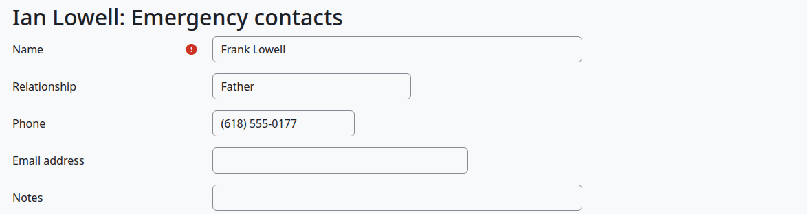

| Field | What it does |
|---|---|
| Name | Required |
| Relationship | Free text |
| Phone, Email address | At least one of the two |
| Notes | Free text |
| Keep on the record | Only when you edit. Untick it to take the contact off the record. It stays in the stored change history |

Check that:

- The contact is on the Profile tab.

## Edit demographics

Who can do this: staff who manage students and can see demographics. It needs `local/studentrecords:managestudents` and `local/studentrecords:viewdemographics` at system level.

The form opens with this note: "Optional. Students may decline to answer; "Not reported" is a valid answer. Seen only by staff with the "View student demographics" permission, never by teachers." The permission is `local/studentrecords:viewdemographics`. Moodle's Teacher and Non-editing teacher roles don't have it.

1. Open the file, on the Profile tab.
2. Select "Edit demographics".
3. Choose the answers.
4. Select "Save changes".

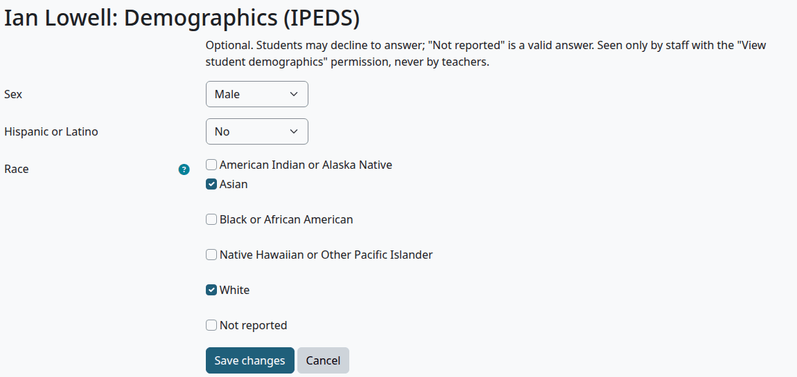

| Field | Options |
|---|---|
| Sex | Female, Male, Another sex, Not reported |
| Hispanic or Latino | Yes, No, Not reported |
| Race | American Indian or Alaska Native, Asian, Black or African American, Native Hawaiian or Other Pacific Islander, White, Not reported. More than one may be chosen, but not Not reported with a race |

The file works out the IPEDS race/ethnicity category from these answers, in this order:

1. An F-1 student is U.S. Nonresident.
2. Yes to Hispanic or Latino gives Hispanic or Latino.
3. Two or more races give Two or more races.
4. One race gives that race.
5. Anything else gives Race and ethnicity unknown.

Check that:

- The Profile tab shows the answers and the category.

## Admissions tab

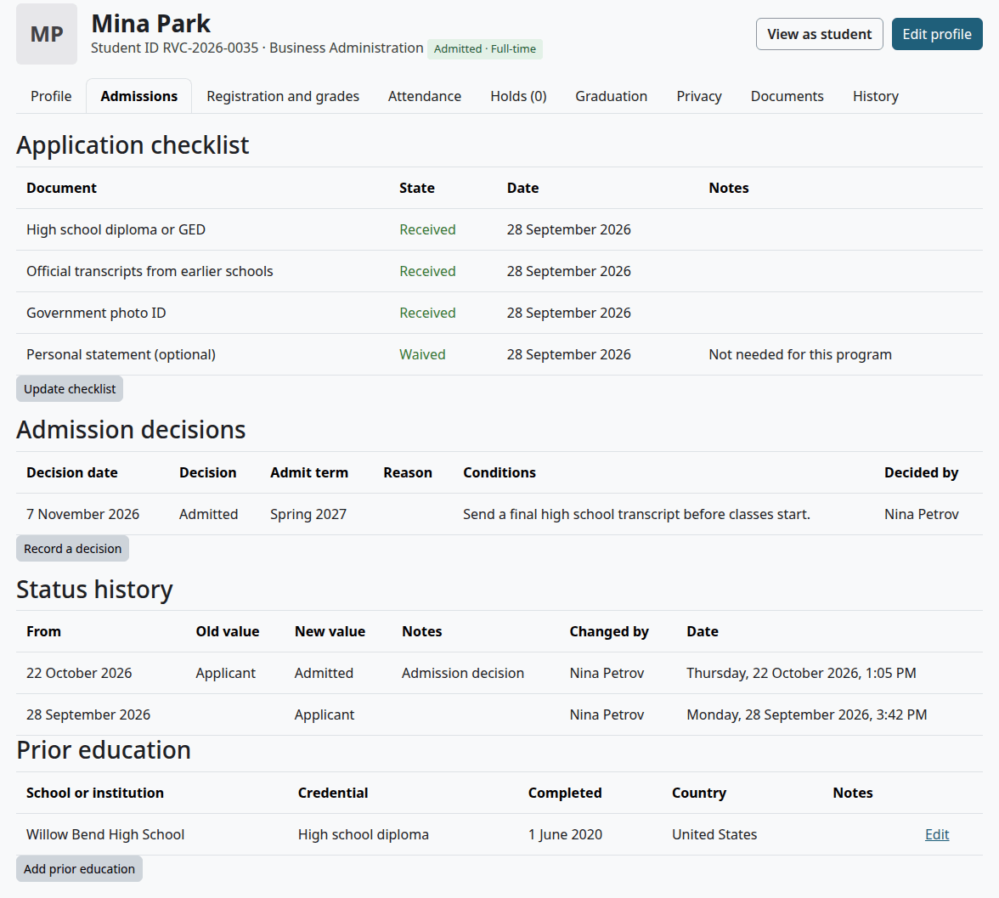

| Block | What it shows | Where the steps are |
|---|---|---|
| Application checklist | Each document that applies, its state, date and notes. A line lists required documents still missing | [Track documents](admissions-process.md#track-documents) |
| Admission decisions | Decision date, Decision, Admit term, Reason, Conditions, Decided by | [Decide on an application](admissions-process.md#decide-on-an-application) |
| Status history | From, Old value, New value, Notes, Changed by, Date | [Student status](#student-status) |
| Prior education | School or institution, Credential, Completed, Country, Notes | The next section |

## Add or change prior education

Who can do this: records and admissions staff. It needs `local/studentrecords:managestudents` at system level.

1. Open the file, on the Admissions tab.
2. Select "Add prior education", or Edit on a row.
3. Fill in the form.
4. Select "Save changes".

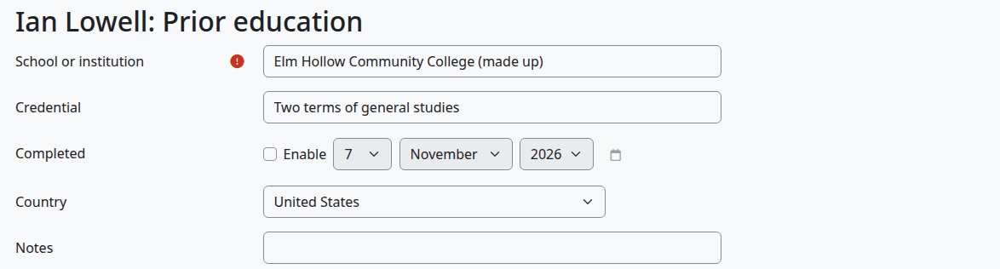

| Field | What it does |
|---|---|
| School or institution | Required |
| Credential | Free text |
| Completed | An optional date. Tick Enable to set it |
| Country | None, or a country |
| Notes | Free text |
| Keep on the record | Only when you edit. Untick it to take the row off the record |

Check that:

- The row is under Prior education.

## Registration and grades tab

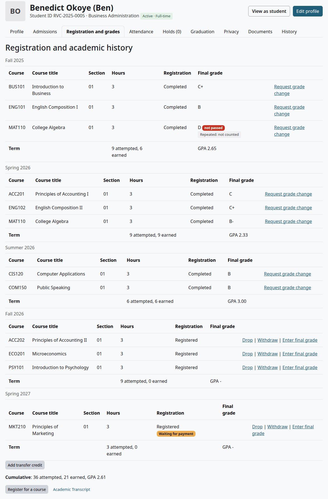

Each term has a table: Course, Course title, Section, Hours, Registration, Final grade and links. Its Term row gives the hours attempted and earned and the term GPA. Cumulative at the foot gives the totals of all terms. Transfer credit has its own table.

| Mark | What it means |
|---|---|
| `*` after the registration status | A staff member overrode the rules |
| "Waiting for payment" | The student is registered, and course access waits for payment |
| "not passed" | The grade is under the pass rule for this course |
| "Repeated: not counted" | The repeat rule leaves this attempt out of the hours earned and the GPA |

| Link or button | Shows on | Where the steps are |
|---|---|---|
| "Drop", "Withdraw" | A registered course | [Registration](registration.md#drop-or-withdraw-a-student-from-a-course) |
| "Enter final grade" | A registered or completed course, up to the term's freeze, and not on your own record | [Final grades](final-grades.md#enter-a-final-grade-by-hand) |
| "Request grade change" | A completed course | [Final grades](final-grades.md#request-a-grade-change) |
| "Register for a course" | Every file | [Registration](registration.md#register-a-student-for-a-course) |
| "Add transfer credit", Edit on a row | Every file but your own | [Degree audit and graduation](degree-audit-and-graduation.md#add-transfer-credit) |
| "Academic Transcript" | With that plugin installed | [Academic Transcript with Student Records](../academic-transcript/with-student-records.md) |

## Attendance tab

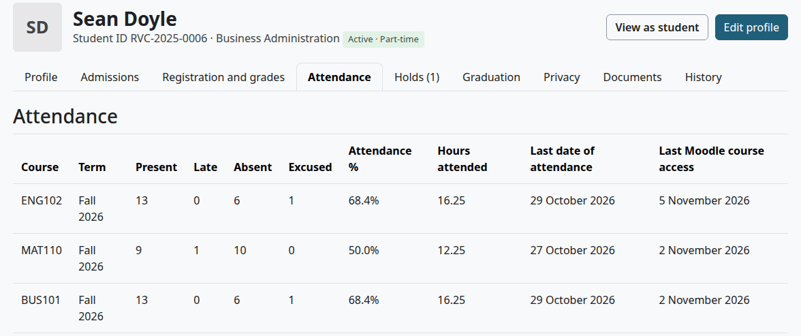

Each course shows Term, Present, Late, Absent, Excused, Attendance %, Hours attended, Last date of attendance and Last Moodle course access. A course with nothing marked and no Moodle access isn't listed, and a dropped course never is. For the steps, see [Attendance](attendance.md).

## Holds tab

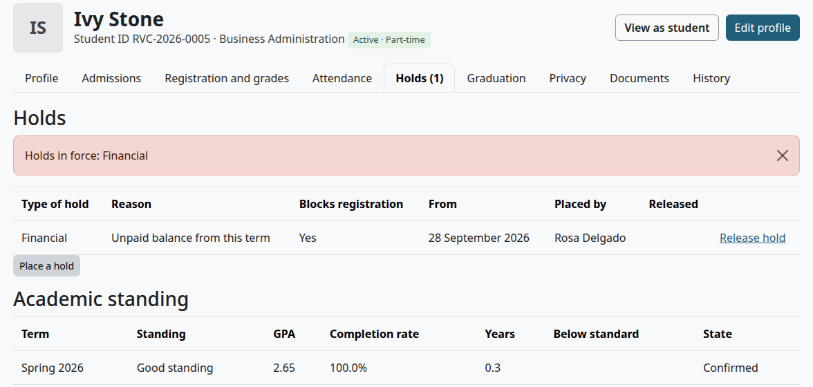

The tab lists every hold, in force or not, then Academic standing term by term. Holds in force also show in a red notice, and the tab's name counts them. For the steps, see [Holds and standing](holds-and-standing.md).

## Graduation tab

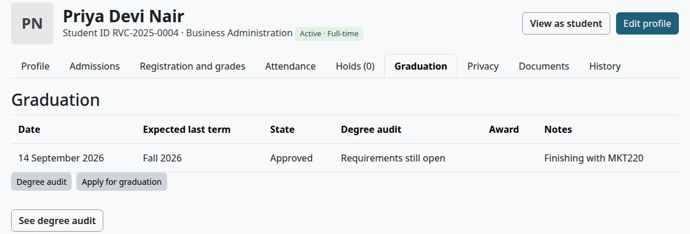

The tab lists graduation applications: Date, Expected last term, State, Degree audit, Award and Notes. "Degree audit" and "See degree audit" open the same page. "Apply for graduation" is there for staff who manage students. For the steps, see [Degree audit and graduation](degree-audit-and-graduation.md).

## Privacy tab

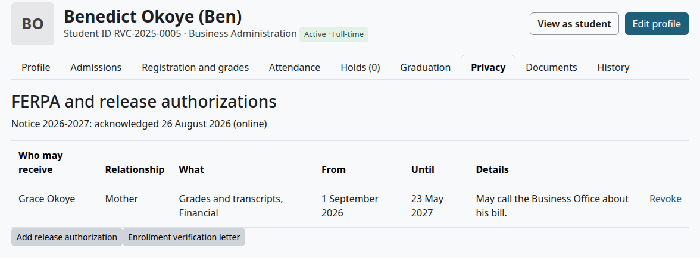

The tab lists FERPA acknowledgments and release authorizations. Staff who manage students also see the letters issued and the buttons that add to these lists. For the steps, see [FERPA and letters](ferpa-and-letters.md).

## Documents tab

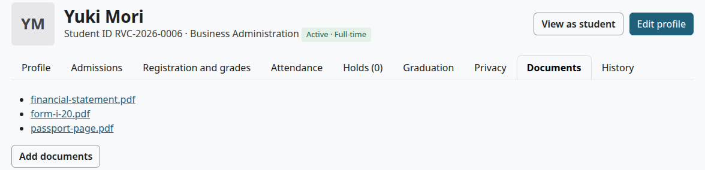

The tab lists the files on the record. "Add documents" opens the edit form. For the steps, see [Documents](documents.md).

## History tab

Who can do this: records and admissions staff. It needs `local/studentrecords:managestudents` at system level.

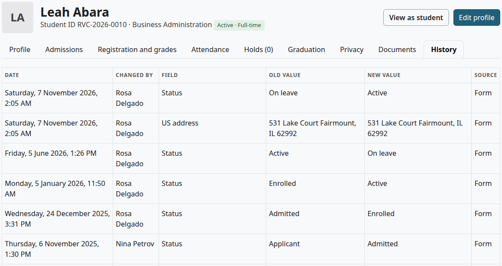

The tab lists each change to the main student record, newest first: Date, Changed by, Field, Old value, New value and Source. Source is Form, Attendance or Privacy request. Attendance means the last date of attendance was filled in by a course withdrawal.

Some values show as stored, such as `instate` for In-state.

The tab shows the main record only. The plugin also keeps the changes to the checklist, holds, grades, transfer credit and the other parts, but no page shows them.

## View as student

Who can do this: all staff who can open the file. It needs `local/studentrecords:managestudents` or `local/studentrecords:viewstudents` at system level.

1. Open the file and select "View as student".
2. Read the page. It holds the student's My home and My academic record.
3. Select "Back to the student file".

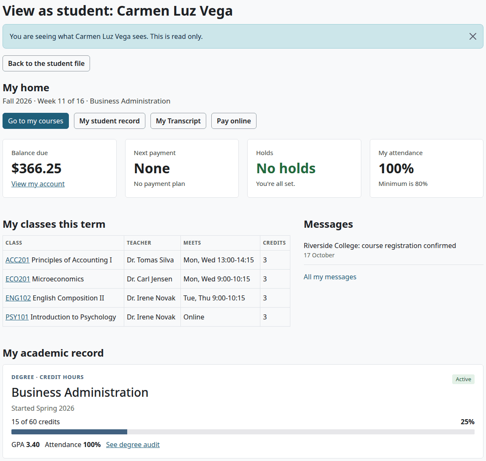

The page is read only, and you stay signed in as yourself. It shows the subjects of the student's messages. The audit log records that you looked.

## What a teacher sees

Who can do this: teachers. It needs `local/studentrecords:viewstudents` in the course, which Moodle's teacher roles hold. The student must be actively enrolled in the course.

1. Open the course and select More > Student records.
2. Select a name.

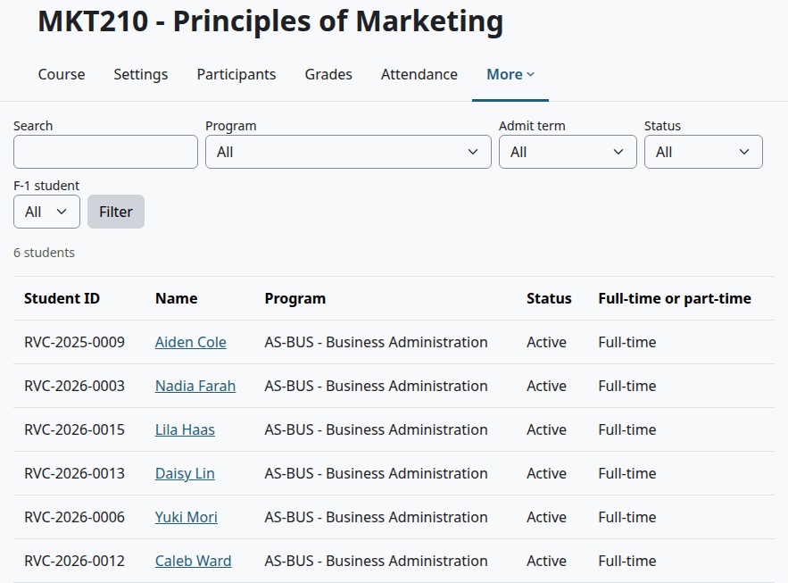

A teacher sees a table of facts, not the tabs: Student ID, Legal name, Preferred name, Date of birth, Email address, Phone, both addresses, Program, Admit term, Catalog year, Status, Withdrawal date, Last date of attendance, Full-time or part-time, Advisor, Degree or certificate awarded, Date awarded and Withhold directory information (FERPA).

When the student withheld directory information, the teacher sees "Withheld (FERPA)" in place of the preferred name, date of birth, email, phone and addresses, and the notice "This student withheld directory information (FERPA). Contact details and addresses are not shown."

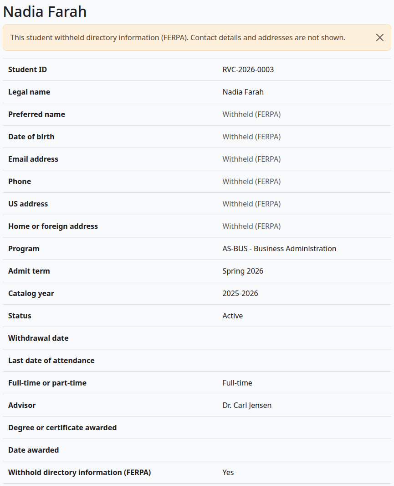

A teacher doesn't see grades, holds, documents, F-1 details or admissions data here. A teacher who opens "Student record" on a person's Moodle profile gets the same table. The list of a course leaves out students who aren't actively enrolled, such as a student whose course access waits for payment.

## What a student sees

A student has the page My academic record, not the tabs. [The student's guide](student.md#see-my-academic-record) walks through it. The student can change nothing there, not even emergency contacts.

## Your own record

Staff who are also students get the staff file on their own record, with some limits. Managers and site administrators get these limits too.

| On your own record you can't | What you see |
|---|---|
| Change your Program, Status, Degree or certificate awarded or Date awarded, or write a status note | The fields are frozen on the edit form, under the line "This is your own record, so another person must change your program, status and award." |
| Record an admission decision | No "Record a decision" button, and the page refuses |
| Add or edit transfer credit | No button, and the page refuses |
| Enter your own final grade | No "Enter final grade" link |
| Decide a grade change on your own grade | "Your own grade: another person must decide" |
| Approve a course substitution | No form on the degree audit |
| Review or confer your own graduation application | "Your own application: another person must decide" |
| Make your own record | The page refuses |

Everything else on your own record stays editable, not only your contact details. You can also place and release your own holds.

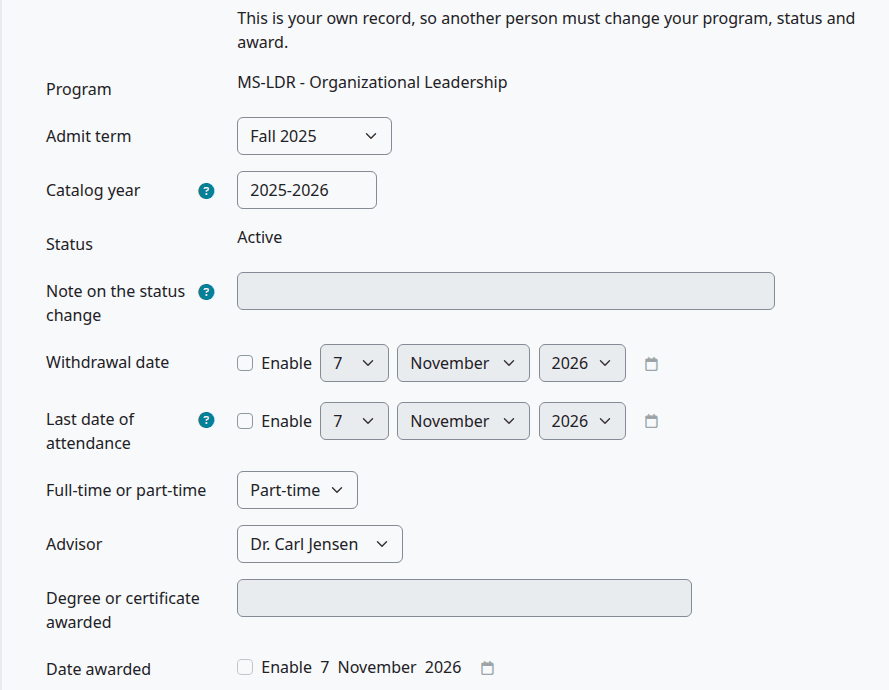

## Nothing is deleted

No page deletes a student record or any part of it, apart from the files on the Documents tab. Prior education, emergency contacts and transfer credit have "Keep on the record" instead: untick it to take a row off the record. A privacy deletion request removes optional personal data and keeps the academic record, as [Privacy and uninstall](privacy-and-uninstall.md) shows.

## Related pages

- [Registrar's guide](registrar.md)
- [Admissions guide](admissions.md)
- [Admissions process](admissions-process.md)
- [Registration](registration.md)
- [FERPA and letters](ferpa-and-letters.md)
- [Documents](documents.md)
- [Roles and permissions](../roles-and-permissions.md)
