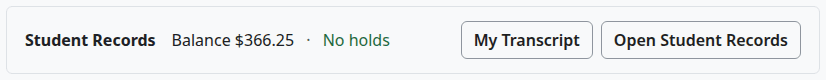
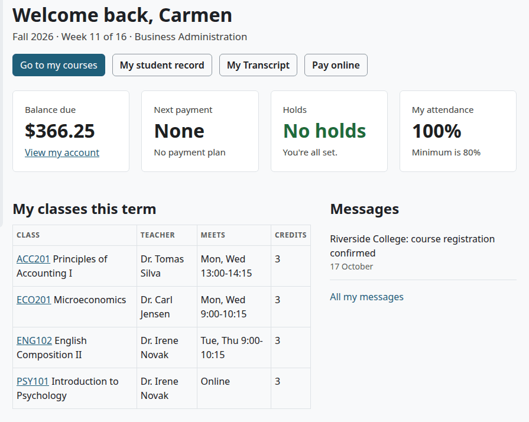
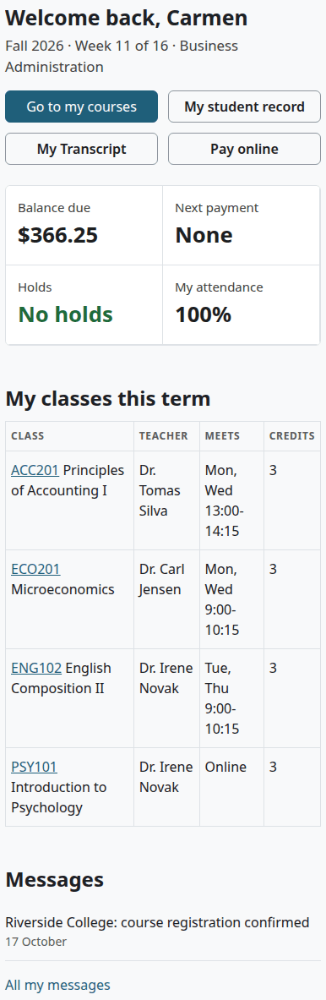
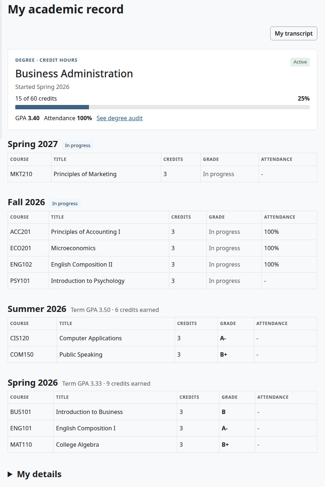
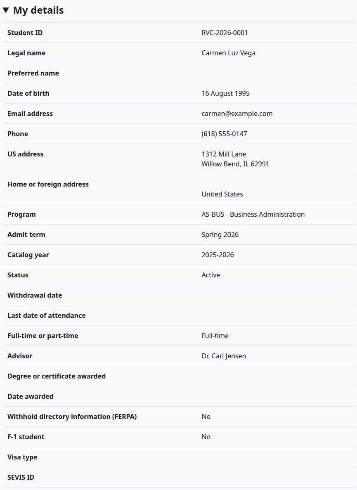
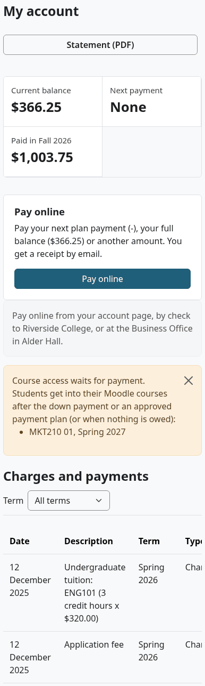

# The student's guide

This guide is for students. It shows where to find your record, your classes, your account and your documents, and what to do when something needs the school office. Student Records works on a phone too.

## Contents

- [Find your way](#find-your-way)
- [My home](#my-home)
- [See my academic record](#see-my-academic-record)
- [My details](#my-details)
- [Read the FERPA notice](#read-the-ferpa-notice)
- [Register for classes](#register-for-classes)
- [Drop or leave a class](#drop-or-leave-a-class)
- [Check your attendance](#check-your-attendance)
- [My account](#my-account)
- [My documents](#my-documents)
- [My Transcript](#my-transcript)
- [Messages](#messages)
- [Ask the office](#ask-the-office)
- [Related pages](#related-pages)

## Find your way

You need a Moodle account, and a student record that the school has made for it.

Select "Student Records" in the top menu. With the Student Records theme, your Dashboard also has a strip at the top with your balance, your next payment and your holds, and a link to Student Records.

The Student Records menu on the left has these items:

| Item | What it opens |
|---|---|
| My home | Your day-to-day page |
| My account | Your charges and payments. It shows only when your school uses billing |
| My academic record | Your program, terms, grades and details |
| Registration | The page where you add classes |
| My Transcript | Your transcript, with Academic Transcript installed |
| My documents | Files on your record and required documents |
| Messages | Your Moodle messages |

## My home

| Part | What it shows |
|---|---|
| The line under the title | The term, the week of the term and your program |
| "Go to my courses" | Your Moodle courses |
| "My student record" | My academic record |
| "My Transcript" | Your transcript |
| "Pay online" | Shows when you owe money. It works when the school has set up online payments. See [My account](#my-account) |
| Balance due | What you owe. "View my account" opens the account |
| Next payment | The next plan payment, if you are on a plan |
| Holds | The number of holds, or "No holds". See [Holds](holds-and-standing.md#what-a-student-sees-of-a-hold) |
| My attendance | Your average attendance this term, with the school's minimum |
| My classes this term | Each class with the teacher, the meeting times and the credits. The code links to the Moodle course once you have access |
| Messages | Your latest three messages from Student Records, and "All my messages" |

On a phone the parts stack.

## See my academic record

Select "My student record" on My home, or "My academic record" in the menu.

The card at the top shows your program, your status, when you started, your progress in credits or clock hours, your GPA and your attendance. "See degree audit" opens your [degree audit](degree-audit-and-graduation.md#what-a-student-sees), which says what you still need.

Under the card is each term, newest first, with each course, its credits, your grade and your attendance. A class still running says "In progress". A finished term shows its GPA and credits earned.

"My transcript" at the top opens your transcript.

## My details

"My details", at the foot of My academic record, opens the rest of your record.

It holds, in this order:

- The facts: student ID, names, date of birth, contact details, program, status and advisor.
- Documents on your record.
- Your student account, in short.
- Holds.
- Registration and academic history, with transfer credit.
- Attendance, course by course.
- Academic standing.
- Graduation.
- FERPA and release authorizations.
- Your application checklist, decisions, status history and prior education.
- Emergency contacts.

Everything here is read only. If something is wrong, even an emergency contact, ask the school office.

## Read the FERPA notice

Once a year the school may ask you to read its notice. A yellow line in My details says "Please read the FERPA annual notice". Select it, read the notice, and select "I have read this notice". See [Acknowledge the notice](ferpa-and-letters.md#acknowledge-the-notice).

## Register for classes

If your school lets students register, the Registration page lists the classes of the open term. Add what you want, look at the cost, and confirm. See [Register for classes online](registration.md#register-for-classes-online).

A full class has "Join waitlist". If a seat opens for you, you get a message and have 2 days to take it. See [Waitlists and seat offers](registration.md#waitlists-and-seat-offers).

If you can't register online, the page says why. See [When a student can't register online](registration.md#when-a-student-cant-register-online).

## Drop or leave a class

You can't drop or withdraw online. Ask the Registrar's office. Before you confirm, you can still take a class out of your picks with "Remove".

## Check your attendance

My home shows your average. My academic record shows the rate of each class, with "under minimum" or "near minimum" when it matters. With the Student Records theme, a card beside each course shows your rate and how many meetings you missed. See [What the student sees](attendance.md#what-the-student-sees).

If your rate falls under the minimum, you get a message. Talk to your teacher or the school office.

## My account

Select "My account" in the menu. It shows your balance, your next payment, your charges and payments, your payment plan, your aid and your refunds. You can download a statement and your receipts, and pay online if your school has set that up. See [What the student sees](student-accounts.md#what-the-student-sees) and [Online payments](online-payments.md).

If a class says it waits for payment, you get into its Moodle course when your school's rule is met. The account page says which rule that is.

## My documents

Select "My documents" in the menu to see files on your record and the state of your required documents. To add a document, give it to the school office. See [What a student sees](documents.md#what-a-student-sees).

## My Transcript

Select "My Transcript" in the menu to see your transcript and to request an Official transcript. See the [student guide for Academic Transcript](../academic-transcript/student-guide.md).

## Messages

The school sends messages about your registration, grades, holds and account. They show in Moodle's notifications, the bell at the top of the page, and by email if your Moodle preferences say so. A message never shows a grade or an amount, so log in to read those. "All my messages" on My home opens that list. "Messages" in the menu opens Moodle's messages page.

> Not walked through: the email copy of a message needs a real mail server, so no test site can show it. The messages were checked in Moodle's notifications.

## Ask the office

Only staff can do these:

- Dropping or withdrawing from a class.
- Changing your name, address or emergency contacts on your record.
- Adding a document to your record.
- Withholding your directory information.
- Letting someone else hear about your record, with a release authorization.
- A letter that proves you are enrolled.
- Applying for graduation.
- Accepting or declining an aid award.

## Related pages

- [Registration](registration.md)
- [Attendance](attendance.md)
- [Documents](documents.md)
- [FERPA and letters](ferpa-and-letters.md)
- [Student accounts](student-accounts.md)
- [Student guide for Academic Transcript](../academic-transcript/student-guide.md)
