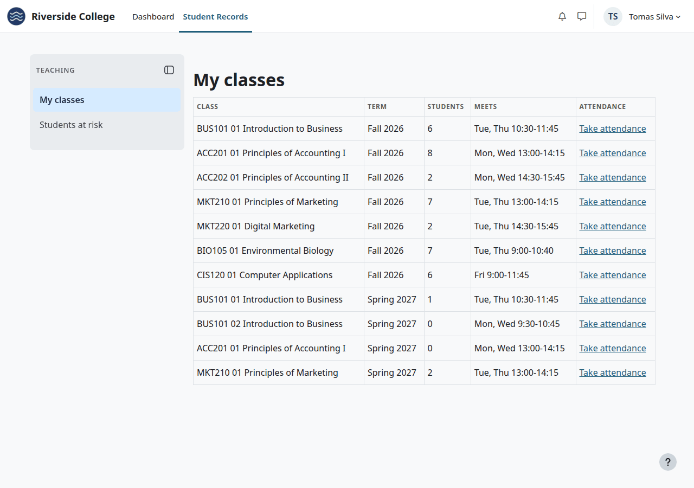
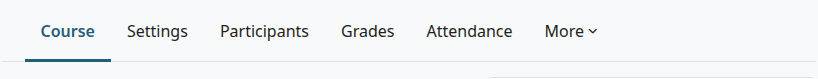

# Teacher's guide

This guide covers what you do with Student Records as a teacher in a term: seeing your classes, taking attendance, following students who are at risk, looking up a student and posting final grades. Each step links to the page that holds the fields and the steps.

## Contents

- [What you need](#what-you-need)
- [Your classes](#your-classes)
- [At the start of a term](#at-the-start-of-a-term)
- [Each class meeting](#each-class-meeting)
- [Students at risk](#students-at-risk)
- [Look up a student](#look-up-a-student)
- [At the end of a term](#at-the-end-of-a-term)
- [What you can't do here](#what-you-cant-do-here)
- [Related pages](#related-pages)

## What you need

- You are enrolled in the Moodle course as a teacher or non-editing teacher. Both roles hold `local/studentrecords:viewstudents` and `local/studentrecords:takeattendance` in the course.
- The Registrar has linked your section to that Moodle course, as [Course offerings](course-offerings.md) shows. Without the link, your class isn't in My classes, and only records staff can mark its attendance.
- The term is active.

## Your classes

In the top menu, select "Student Records". You land on My classes. If you are also a student, you land on My home: select "My classes" in the menu.

Inside a course, the course menu has Attendance, and More has Student records.

## At the start of a term

[Add a weekly schedule](attendance.md#add-a-weekly-schedule) for each class, unless someone did it already. Add [single meetings](attendance.md#add-one-class-meeting) for anything outside the pattern. No page changes or deletes a meeting, so check the days first.

## Each class meeting

[Take attendance](attendance.md#take-attendance):

1. Open the class from My classes, from the course's Attendance link, or from the card beside the course.
2. Select "Take attendance" on the meeting.
3. Select "Mark everyone present", change the exceptions, and select "Save attendance".

A student who falls under the school's minimum gets a warning by message. You don't.

## Students at risk

In the Student Records menu, select "Students at risk". It lists students of your classes under or near the attendance minimum, or with a low course total. See [Students at risk](attendance.md#students-at-risk).

## Look up a student

Open the course and select More > Student records, then a name. You see the student's program, status and contact details. See [What a teacher sees](student-file.md#what-a-teacher-sees).

A student who withheld directory information shows "Withheld (FERPA)" in place of the contact details. Don't ask the office for them unless your school's policy allows it.

## At the end of a term

With Academic Transcript installed, and with Student Records as its source, you post final grades. It needs `local/academictranscript:postgrades` in the course. Moodle's teacher role holds it, and the non-editing teacher role doesn't.

1. Open the course and select More > Post final grades, as [Post final grades](../academic-transcript/teacher-guide.md#post-final-grades) shows.
2. Post the students who are ready. The grades go on the students' registrations in Student Records.
3. To change a posted grade, select "Request change" on the student's row. The request lands on the [Grade changes](final-grades.md#approve-or-reject-a-grade-change) page, and someone else decides it.

[Grades posted by teachers](final-grades.md#grades-posted-by-teachers) lists what can stop a post.

Without Academic Transcript, you have no way to enter a final grade in Student Records. Keep your gradebook up to date: the Registrar can bring in the course totals with [Get final grades from Moodle](final-grades.md#get-final-grades-from-moodle).

## What you can't do here

- Register, drop or withdraw a student. Students ask the Registrar's office.
- See grades, holds, documents or a student's account on the file.
- Open the degree audit, or a student who isn't actively enrolled in your course.
- Enter or post your own grade, if you take a course yourself.

## Related pages

- [Attendance](attendance.md)
- [Final grades](final-grades.md)
- [The student file](student-file.md)
- [Teacher guide for Academic Transcript](../academic-transcript/teacher-guide.md)
