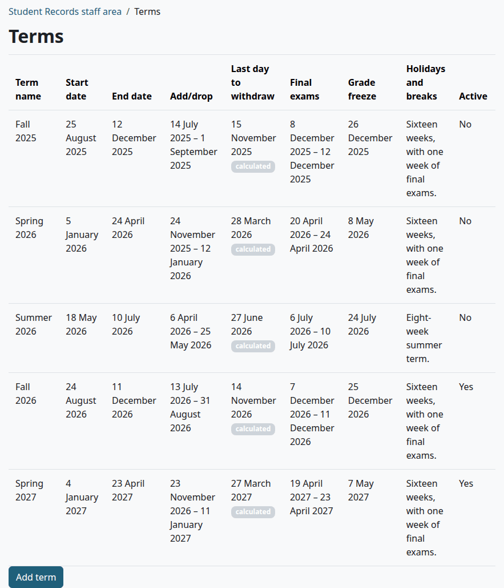
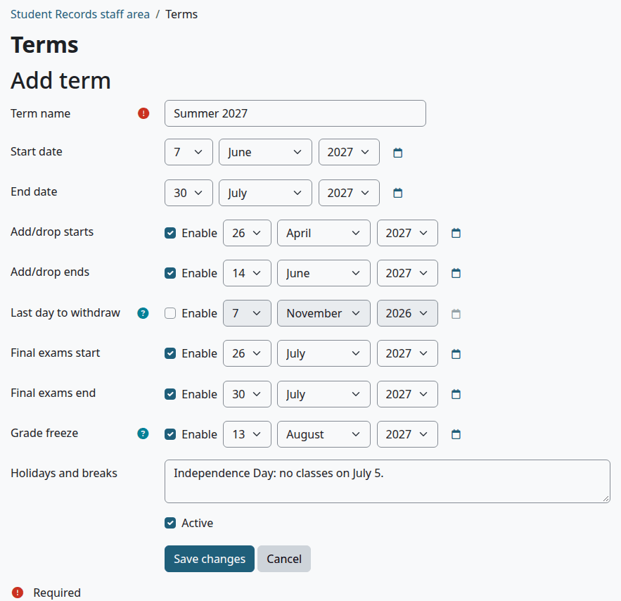
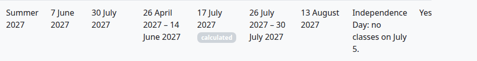
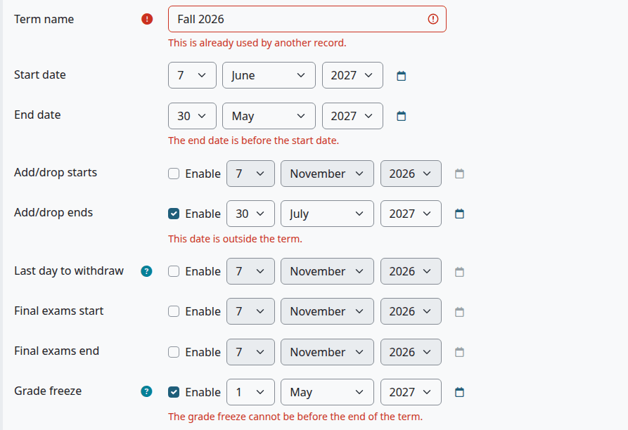
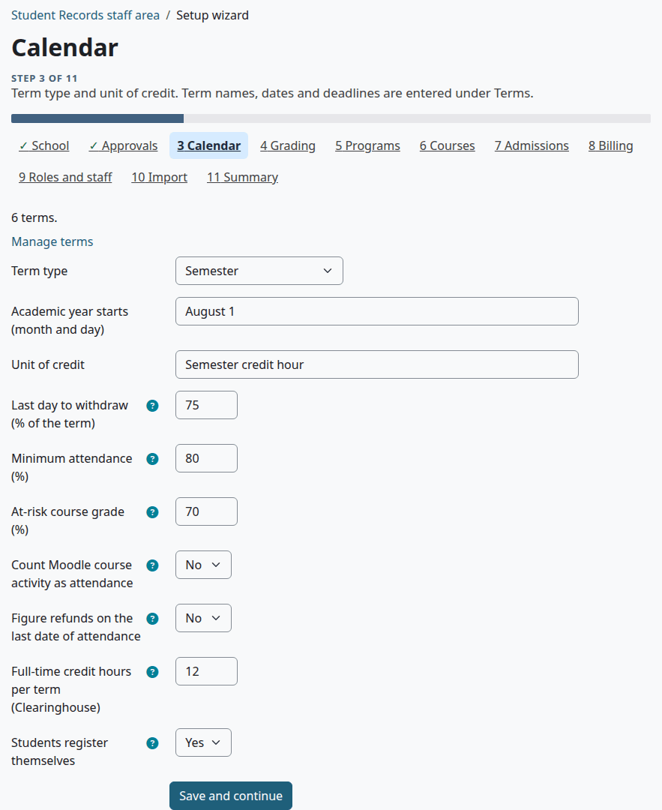

# Terms and the calendar

A term holds the dates that open and close registration, withdrawal and final grades. This page is for the Registrar and whoever sets up the school. It covers every date on a term, what each date does, and the calendar settings.

## Contents

- [See the terms](#see-the-terms)
- [Add a term](#add-a-term)
- [What each date does](#what-each-date-does)
- [How the last day to withdraw is worked out](#how-the-last-day-to-withdraw-is-worked-out)
- [Change a term](#change-a-term)
- [Turn a term off](#turn-a-term-off)
- [The calendar settings](#the-calendar-settings)
- [Related pages](#related-pages)

## See the terms

Who can do this: anyone with the capability `local/studentrecords:configure`. Site administrators and Managers have it. A Registrar needs it on their role, or the Terms page won't open. See [Install and set up](install-and-setup.md#moodle-roles-to-make).

1. Go to Student Records > Terms. The Calendar step of the [setup wizard](setup-wizard.md) has a "Manage terms" link to the same page.

The list runs from the earliest start date to the latest. A term with a worked-out last day to withdraw shows a "calculated" badge. The list has no delete link, because no page deletes a term: a term you no longer use can only be [turned off](#turn-a-term-off).

## Add a term

Who can do this: the same people.

Before you start:

- The Time zone on the School step of the [setup wizard](setup-wizard.md) is right. Term dates are days in that time zone, whatever the time zone of the person who types them.
- The percent on the Calendar step is right, if your school has its own rule for the last day to withdraw.

1. Go to Student Records > Terms and select "Add term".
2. Type the "Term name", such as Summer 2027.
3. Set the "Start date" and "End date".
4. For each other date you want, tick "Enable" next to it and set the date. Leave "Last day to withdraw" unticked to have it worked out.
5. In "Holidays and breaks", type any notes for staff.
6. Leave "Active" ticked.
7. Select "Save changes".

Check that:

- The term is on the list.
- "Last day to withdraw" shows a date with the "calculated" badge, if you left it unticked.

What can go wrong:

The form checks the dates when you save.

| Message | Cause |
|---|---|
| "This is already used by another record." | Another term has this name |
| "The end date is before the start date." | Fix the end date |
| "This date is outside the term." | "Add/drop ends" or "Last day to withdraw" isn't between the start date and end date. "Add/drop starts" may be before the term |
| "The grade freeze cannot be before the end of the term." | The grade freeze must be on or after the end date |

You can also bring terms in from a spreadsheet. See [Import from a spreadsheet](import.md).

## What each date does

| Field | Needed | What it does |
|---|---|---|
| "Term name" | Yes, and each name once | Shown wherever a term is named |
| "Start date" | Yes | The term's first day. With no "Add/drop ends", it's the last day to drop. The Counts report, the refund rules and the Return of aid worksheet read it. "Copy from last term" goes by it |
| "End date" | Yes | The term's last day. With no "Add/drop ends", it's the last day to add. A weekly attendance schedule stops at it |
| "Add/drop starts" | No | Shown on this page. Nothing checks it |
| "Add/drop ends" | No | The last day to add and to drop. Withdrawal opens the day after. A refund rule can go by it |
| "Last day to withdraw" | No, because it's always filled in | The last day a course can be withdrawn from |
| "Final exams start" and "Final exams end" | No | Shown on this page. Nothing else uses them |
| "Grade freeze" | No | The last day final grades can be entered. After this day they change only through an approved grade change. With no date, grades never freeze |
| "Holidays and breaks" | No | Notes, shown on this page. A weekly attendance schedule doesn't skip them |
| "Active" | Ticked by default | See [Turn a term off](#turn-a-term-off) |

The windows work like this. A date counts up to the end of that day in the school's time zone.

| Action | From | Until |
|---|---|---|
| Add a course | As soon as the term is active, however far ahead it starts | "Add/drop ends". With none, the "End date" |
| Drop a course | As soon as the student is registered | "Add/drop ends". With none, the "Start date" |
| Withdraw from a course | The day after "Add/drop ends". With none, the day after the "Start date" | "Last day to withdraw" |

> Known problem in 1.4.6: "Add/drop starts" doesn't hold back registration. A student who registers online can add a class as soon as the term is active. To keep a term closed, leave "Active" off until registration opens.

Staff can go outside these windows on a student's page, with a reason. See [Registration](registration.md).

## How the last day to withdraw is worked out

A term always has a last day to withdraw. If you leave it unticked, Student Records counts the calendar days of the term, from the first day to the last day, and takes the school's percent of them. It rounds to a whole day. The percent comes from "Last day to withdraw (% of the term)" on the Calendar step, and it's 60 when that's empty.

For example, Fall 2026 runs from August 24 to December 11, which is 110 days. At 75%, that's day 83, which is November 14. Weekends and holidays count.

A worked-out date shows the "calculated" badge. It follows the term:

| You do this | What happens |
|---|---|
| Change a term's dates and save, with the worked-out date left as it is | The date is worked out again |
| Change the percent on the Calendar step | Saved terms keep their date until you open each one and select "Save changes" |
| Pick another date on the term | It's yours: the badge goes, and it no longer changes by itself |
| Untick "Enable" next to the date and save | It's worked out again |

> Known problem in 1.4.6: when new term dates leave the old worked-out date outside the term, saving stops with "This date is outside the term." under "Last day to withdraw". Untick "Enable" next to that date and save again: the date is then worked out from the new dates.

## Change a term

Who can do this: the same people.

1. Go to Student Records > Terms.
2. On the term's row, select "Edit".
3. Change what you need.
4. Select "Save changes".

The page says "Saved." and the list shows the change. Changes reach every page at once, including registrations that exist: a new end of add/drop applies to the next student who tries.

What can go wrong:

> Known problem in 1.4.6: a term shows a day earlier than you set when the school's Time zone changed after the term was saved. A date saved on this page is the start of that day in the school's time zone, so a move further west shows the day before. Set the time zone first. To repair a term, open it, set each date again and save.

## Turn a term off

Who can do this: the same people.

Terms can't be deleted. To retire one:

1. Go to Student Records > Terms and select "Edit" on its row.
2. Untick "Active".
3. Select "Save changes".

An inactive term:

- Doesn't open for online registration, and no waitlist seat is offered in it.
- Doesn't count for the teacher's "My classes" menu or the attendance cards on course pages.
- Stays on every report, on the Course offerings page, and on each student's record.

Staff can still register a student in a section of an inactive term.

## The calendar settings

These are answers on the Calendar step of the [setup wizard](setup-wizard.md). To change one, go to Student Records > Setup wizard, select "Calendar", change it and select "Save and continue".

| Setting | Default | How it works |
|---|---|---|
| "Term type" | Not set | Shown on the wizard's Summary. Nothing else uses it: one kind of term works like another |
| "Academic year starts (month and day)" | July 1 | Decides which year a FERPA notice belongs to, so when students are asked to acknowledge it again. It reads `08-01`, `8/1` or `August 1`. Text it can't read counts as July 1 |
| "Unit of credit" | Empty | Kept on file. Each course and program has its own "Credit or clock hours" |
| "Last day to withdraw (% of the term)" | 60 | See [How the last day to withdraw is worked out](#how-the-last-day-to-withdraw-is-worked-out). A number above 0, up to 100 |
| "Minimum attendance (%)" | 80 | A student under this rate in a course shows on the report Under minimum attendance, on the tiles on the staff home, on cards in the course, and gets the "Low attendance warning" message when saved attendance takes them under it. A teacher's Students at risk list shows students under it or near it. A number above 0, up to 100. See [Attendance](attendance.md) |
| "At-risk course grade (%)" | 70 | A teacher's Students at risk list shows a student whose Moodle course grade is under this. 0 leaves grades out of the list. A number from 0 to 100 |
| "Count Moodle course activity as attendance" | No | Yes: the last date of attendance is the later of the last day marked present or late and the student's last visit to the Moodle course. That date feeds refunds and the Return of aid worksheet. No: only marked attendance counts, and the last visit is shown for information |
| "Figure refunds on the last date of attendance" | No | Yes: a refund goes by the last date of attendance in that course, when there is one. No: it goes by the day of the drop or withdrawal. See [Refunds](refunds.md) |
| "Full-time credit hours per term (Clearinghouse)" | 12 | A student set to "Full-time" on their record, or with at least this many hours in a term, is full time on the Clearinghouse file and the aid enrollment report. The loan check and the note a student sees when registering online use it too. A number above 0, up to 100 |
| "Students register themselves" | No | Yes: students add their own classes during the add period, and full sections offer a waitlist. No: staff register students. See [Registration](registration.md) |

## Related pages

- [Setup wizard](setup-wizard.md)
- [Import from a spreadsheet](import.md)
- [Course offerings](course-offerings.md)
- [Registration](registration.md)
- [Final grades](final-grades.md)
- [Attendance](attendance.md)
- [Refunds](refunds.md)
- [Reports and exports](reports-and-exports.md)
