# Student Records theme

The Student Records theme (`theme_studentrecords` 1.0.3) puts your school's name, logo and colour on Moodle, and gives it a simple login page. This page is for site administrators who want to know what the theme does before they turn it on, and for anyone who wants to know why a page looks the way it does.

## Contents

- [What it does](#what-it-does)
- [What it doesn't do](#what-it-doesnt-do)
- [Requirements](#requirements)
- [Install the theme](#install-the-theme)
- [Turn the theme on](#turn-the-theme-on)
- [What changes on each kind of page](#what-changes-on-each-kind-of-page)
- [The top bar](#the-top-bar)
- [The login page](#the-login-page)
- [The Dashboard](#the-dashboard)
- [Course and activity pages](#course-and-activity-pages)
- [Student Records and Academic Transcript pages](#student-records-and-academic-transcript-pages)
- [With and without Student Records](#with-and-without-student-records)
- [The menu on another theme](#the-menu-on-another-theme)
- [Privacy](#privacy)
- [The pages of this manual](#the-pages-of-this-manual)
- [Related pages](#related-pages)

## What it does

- A top bar with the school's logo and name, the main tabs, notifications, messages and the user menu.
- One login card with the logo, the name, a welcome line and a help line around Moodle's own form.
- One colour, which you pick, for buttons, links and the active tab. Colours too light to read are refused.
- Links in text are underlined, buttons and fields have small rounded corners, and tables that scroll sideways can be reached by keyboard.
- With the [Student Records](../student-records/README.md) plugin, it adds the Student Records menu in the left drawer, a strip on the Dashboard, and a side card on course and activity pages.

The theme is a small child theme of Boost, Moodle's standard theme. Everything it doesn't change stays as Boost has it.

## What it doesn't do

- It doesn't change the browser tab's title or icon, the footer, or the emails Moodle sends. Those stay Moodle's.
- It adds no page of its own, no capability, no role and no task.
- It keeps no personal data.
- It doesn't turn on dark mode. Moodle 5.3 does that, in the settings of Boost. See [Dark mode](on-phones-and-dark-mode.md#dark-mode).

## Requirements

| What | Needed |
|---|---|
| Moodle | 4.5 to 5.3 |
| Boost | Moodle's standard theme, which every Moodle has |
| [Student Records](../student-records/README.md) | Optional. The theme works without it. See [With and without Student Records](#with-and-without-student-records) |

## Install the theme

Who can do this: a site administrator.

> Not walked through: the test site has the theme installed from the start, so no test site can show this. The steps come from Moodle's plugin installer and the theme's release files.

1. Download `theme_studentrecords-1.0.3.zip` from the [releases page](https://github.com/Clouve/moodle-plugins/releases). Don't unzip it.
2. Go to Site administration > Plugins > Install plugins.
3. Drop the ZIP file into "ZIP package" and select "Install plugin from the ZIP file".
4. Select "Continue" and then "Upgrade Moodle database now". Follow the screens.

To install by hand, unzip the file into the `public/theme/` folder of your Moodle code on Moodle 5.1 and later, or into `theme/` on Moodle 5.0 and earlier. Then go to Site administration > Notifications and follow the screens.

Installing the theme doesn't turn it on.

## Turn the theme on

Who can do this: a site administrator.

1. Go to Site administration > Appearance > Themes.
2. On the card "Student Records theme", select "Select theme".

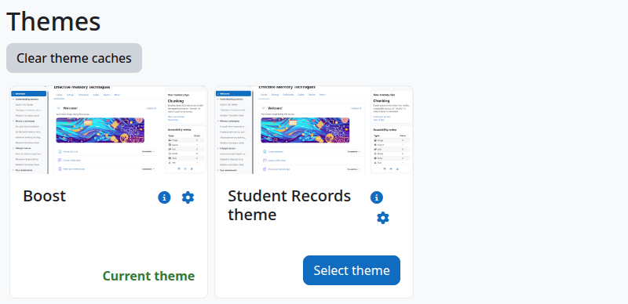

Check that:

- The card says "Current theme".
- The top bar shows the site's full name. [Theme settings](settings.md) says how to set the school's name, logo and colour.

To go back, select "Select theme" on the Boost card. Nothing is lost: the settings stay for next time.

## What changes on each kind of page

| Kind of page | Top bar | Left drawer | From Student Records |
|---|---|---|---|
| Login page | A bar with the logo and name only | None | Nothing |
| Other pages on the login layout, such as "Forgot password?" and sign-up | The same bar | None | Nothing |
| Dashboard | Full | None | A strip above the content |
| Site home, My courses, profiles, Site administration | Full | None | Nothing |
| A course | Full | Course index | A side card |
| An activity or resource | Full | Course index | A side card |
| A Student Records or Academic Transcript page | Full | The Student Records menu | Nothing |
| A Student Records or Academic Transcript page inside a course | Full | Course index, with no menu | A side card, on some pages |
| Printable pages and pop-up windows | None | None | Nothing |
| A quiz in Moodle's secure window | Boost's bar, with the site's short name | None | Nothing |
| The page Moodle shows during maintenance | None | None | Nothing |

The school's colour reaches all of them. The school's name and logo don't reach the last three.

## The top bar

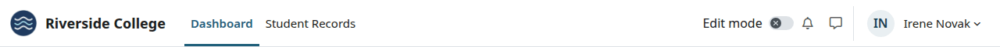

From left to right:

| Part | What it shows |
|---|---|
| Logo | The logo from the theme settings. Without one, Moodle's compact logo. Without that, a square with two letters of the school's name |
| School name | The name from the theme settings, or else the site's full name. It links to the site's home page |
| Main tabs | Moodle's tabs, such as Dashboard and Site administration. Student Records adds its own tab. The tabs that fit show here, and the rest go in "More" |
| "No LMS access" | A small note for staff marked "No LMS access". See [Faculty and staff records](../student-records/faculty-and-staff.md) |
| Search | Moodle's search box, when the site has global search |
| Language menu | When the site has more than one language |
| "Edit mode" | Moodle's switch, on pages where it applies |
| Colour mode | The colour mode menu, a sun, a moon or a half circle, on Moodle 5.3 with colour modes on. See [Dark mode](on-phones-and-dark-mode.md#dark-mode) |
| Notifications and messages | Moodle's two icons, with a count of what's new |
| User menu | The user's picture or initials, and their name |

The name beside the picture shows only on screens 992 pixels wide or more. On a narrower screen, only the picture or the initials show. While you are logged in as someone else, the name is your own.

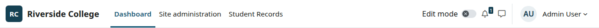

The two letters are the first letters of the first two words of the name. The small words a, an, and, at, for, in, of, on, the and to are skipped, so "The School of Cooking" gives SC.

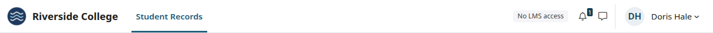

The note shows from 768 pixels wide. On a phone, staff don't see it.

## The login page

The login page is a bar with the logo and the name, and one card with the form in it. The layout is the same on every Moodle version the theme supports.

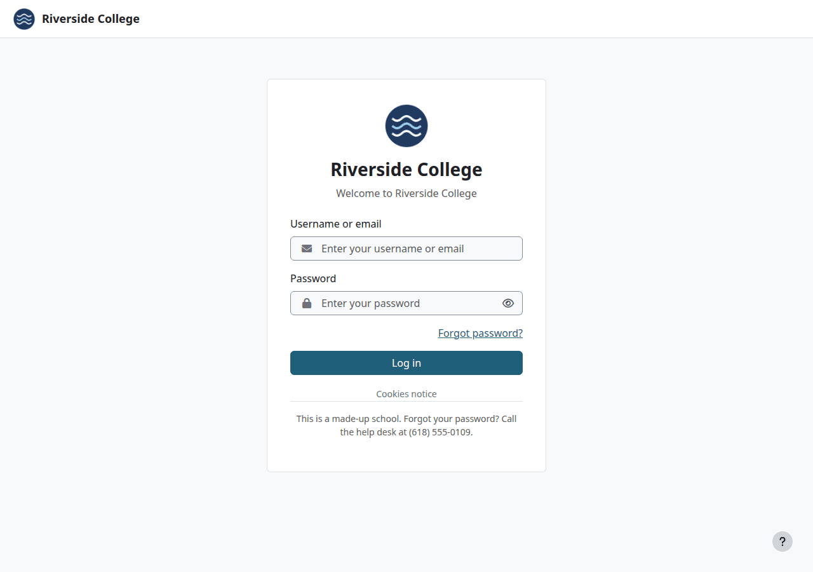

In the card, from the top:

| Part | Where it comes from |
|---|---|
| Logo | The same as in the top bar, up to 160 by 72 pixels |
| School name | The same as in the top bar |
| Welcome line | "Login page welcome text" in the [theme settings](settings.md#login-page-welcome-text) |
| The form | Moodle's own. It differs a little between Moodle versions. From Moodle 5.2, "Forgot password?" sits above the button |
| Help line | "Login page help text" in the [theme settings](settings.md#login-page-help-text), when it isn't empty |

The logo, name, welcome line and help line show only on the main login page. Moodle's other pages on the login layout, such as "Forgot password?" and sign-up, get the bar and the card, with no school heading:

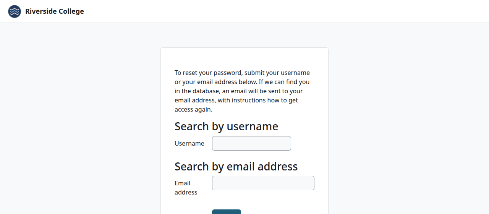

## The Dashboard

With Student Records, the Dashboard has a strip above the content. Each person gets one of two strips, and someone with no Student Records pages gets none.

A person with a student record gets the student strip, even if they are staff too:

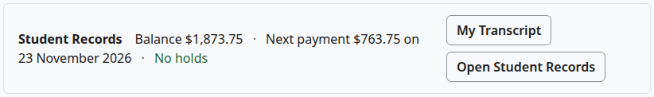

| Part | When it shows |
|---|---|
| "Balance" | When billing is on. A credit shows as $0.00 |
| "Next payment" | When a payment plan has a payment due |
| "No holds", or the number of holds | Always |
| "My Transcript" | With Academic Transcript, for someone who can see their own transcript |
| "Open Student Records" | Always |

Anyone else with a Student Records menu gets the staff strip:

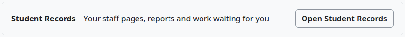

With Academic Transcript, staff who hold `local/academictranscript:issueofficial` at system level also get a "Transcript requests" button.

The strip isn't printed.

## Course and activity pages

A course page has the course index in the left drawer, as in Boost. With Student Records, a side card shows beside the content when the course is linked to a section. It sits on the right on screens 992 pixels wide or more, and above the content on narrower ones.

A teacher who can take attendance in a section of an active term sees this:

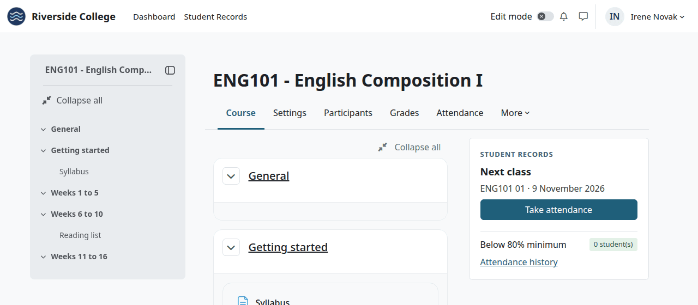

| Part | What it says |
|---|---|
| Heading | "Today's class" when a meeting is today, and "Next class" when the next one is later |
| Line under it | The course code, the section and the date of the meeting |
| "Take attendance" | Opens that day's meeting today, and the section's attendance page on other days |
| "Below 80% minimum" | How many students are under the school's minimum in this section. The number is red above zero |
| "Attendance history" | The section's attendance page |

With no meeting today or later, the card's heading is the section, and its button says "Attendance":

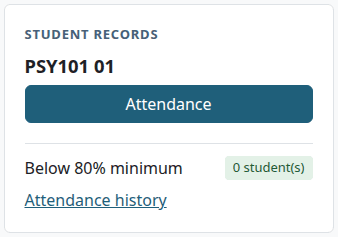

A student registered in the section sees this:

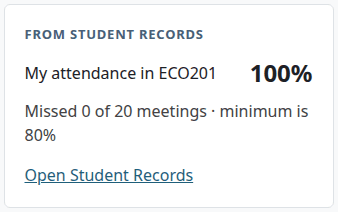

Before the first marks, it says "No attendance taken yet."

Someone who is both a teacher and a student in a course gets the teacher card. Nobody else gets a card, and a course with no section linked to it has none. The card isn't printed.

## Student Records and Academic Transcript pages

These pages have the Student Records menu in the left drawer, in the place of the course index. It lists what your roles open, under one heading for each kind of work. The first heading sits at the top of the drawer, so a person whose first group is Finance sees "Finance" there. [Roles and permissions](../roles-and-permissions.md#the-menu-of-each-role) lists each role's menu.

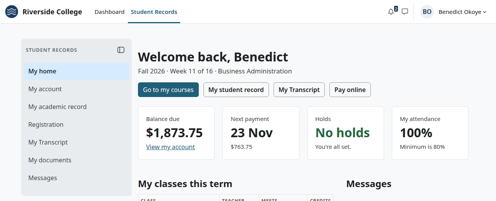

The button at the top of the drawer closes it. Closing it also closes the course index on your next course page, because Moodle keeps one setting for both. The button at the left of the page opens it again, with the label "Open the Student Records menu".

A Student Records page that runs inside a course shows the course index in the drawer, and no menu. An example is the list a teacher opens with More > "Student records":

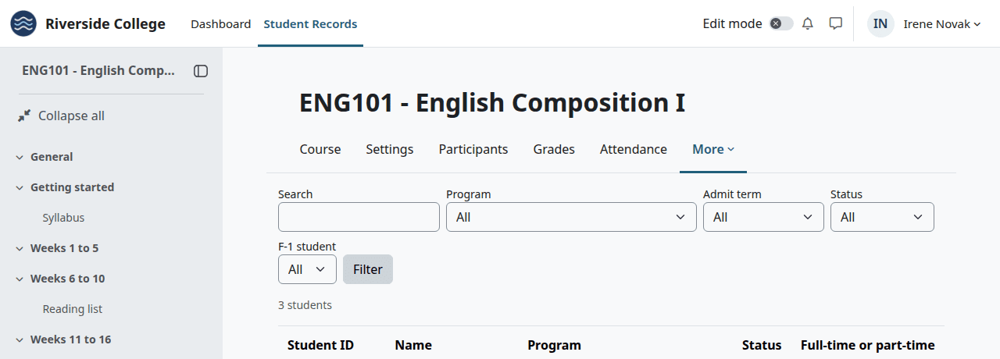

## With and without Student Records

| | The theme with Student Records | The theme alone | Student Records on another theme |
|---|---|---|---|
| School's logo, name and colour | Yes | Yes | No |
| The login card | Yes | Yes | No |
| The "Student Records" tab | Yes | No | Yes |
| The Student Records menu | In the left drawer | No | In a box at the top of the page, on most pages |
| The Dashboard strip | Yes | No | No |
| The side card | Yes | No | No |
| The "No LMS access" note | Yes | No | No |
| The "Attendance" tab in a course | Yes | No | Yes |

The theme alone isn't the same as Boost. It keeps its top bar, with the logo and name on phones too, the user's name beside the picture, the one-card login page, the rounded corners, the bold outline buttons and the underlined links. On Moodle 5.2 and later, Boost has a split login screen, and the theme keeps its one card.

Without Student Records, the Dashboard has no strip:

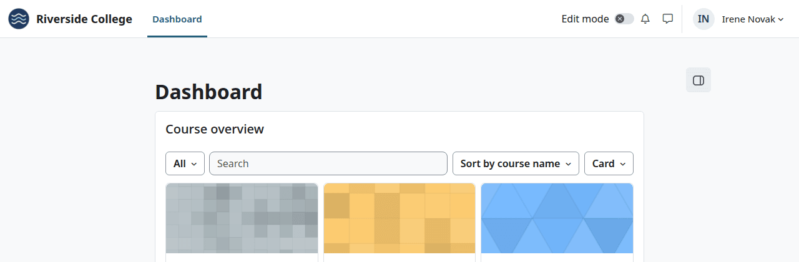

A course has no side card, and no "Attendance" tab:

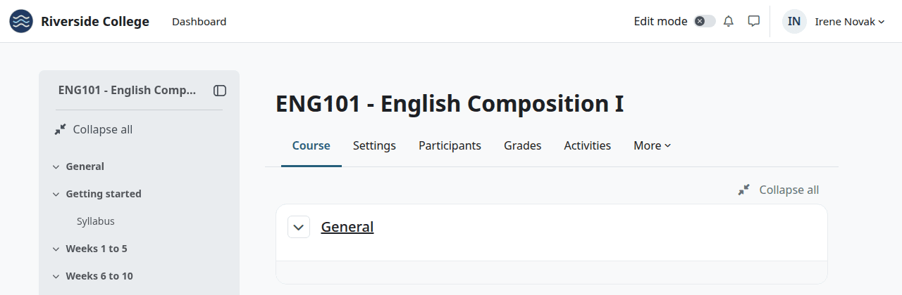

A visitor who isn't signed in, a guest, and a person with no Student Records pages see the same as this, on a site that has the plugin.

## The menu on another theme

Student Records works on Boost and other themes. Its pages then show the menu in a box at the top of the page, under the heading. There is no drawer, no Dashboard strip, no side card and no "No LMS access" note.

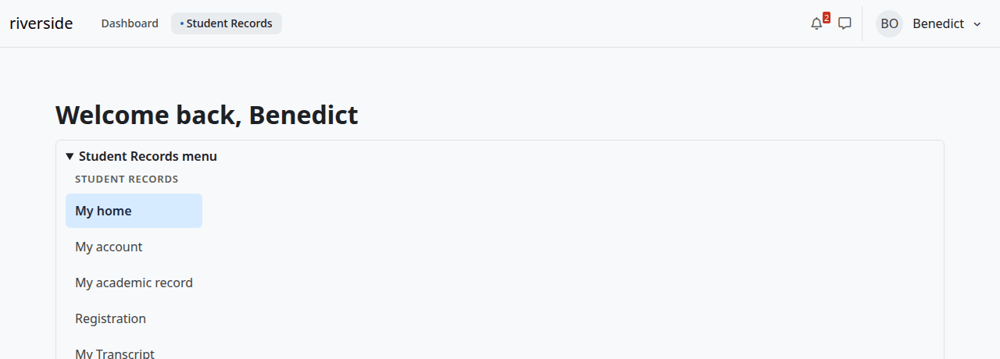

The box is open on wide screens. On screens narrower than 768 pixels it is folded, and you select "Student Records menu" to open it:

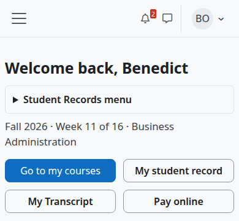

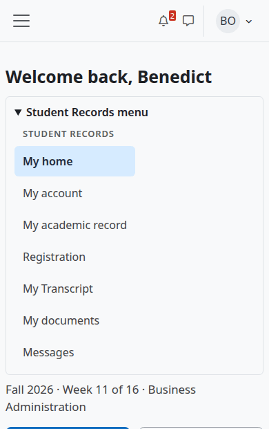

Some pages don't draw the box, so on another theme they have no menu. Use the "Student Records" tab to get back. The pages without the box are:

- A student's own "My account" and degree audit, the FERPA notice, "Pay online" and the award letter.
- The staff area.
- The attendance page of a teacher.
- All Academic Transcript pages but My transcript and Transcript requests.
- Student Records pages inside a course.

On Boost the Dashboard is Moodle's own, with no strip:

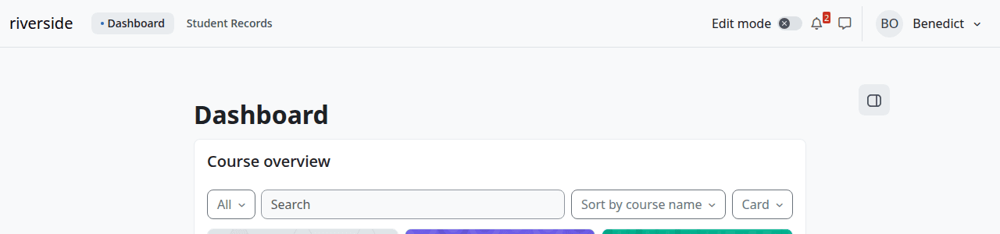

## Privacy

The theme stores no personal data. Moodle keeps each person's drawer settings and colour mode with Boost. The strip and the cards show data from Student Records, and the theme doesn't store it.

## The pages of this manual

| Page | What it covers |
|---|---|
| [Theme settings](settings.md) | Every setting, its default and its effect, and the contrast rule |
| [On phones and in dark mode](on-phones-and-dark-mode.md) | What changes at each width, the tab row, the menu on a phone, dark mode |

## Related pages

- [The user manual](../README.md)
- [Student Records](../student-records/README.md)
- [Academic Transcript](../academic-transcript/README.md)
- [Roles and permissions](../roles-and-permissions.md)
- [Troubleshooting](../troubleshooting.md)
- [Glossary](../glossary.md)
