# On phones and in dark mode

This page says what the Student Records theme does on a small screen, and how dark mode works on Moodle 5.3. It is for everyone who uses the site on a phone, and for the site administrator who decides on dark mode.

## Contents

- [What changes at each width](#what-changes-at-each-width)
- [The login page on a phone](#the-login-page-on-a-phone)
- [The top bar on a phone](#the-top-bar-on-a-phone)
- [The main tabs on a phone](#the-main-tabs-on-a-phone)
- [The Student Records menu on a phone](#the-student-records-menu-on-a-phone)
- [The Dashboard on a phone](#the-dashboard-on-a-phone)
- [A course on a phone](#a-course-on-a-phone)
- [Wide tables](#wide-tables)
- [Dark mode](#dark-mode)
- [Turn dark mode on for the site](#turn-dark-mode-on-for-the-site)
- [Choose your colour mode](#choose-your-colour-mode)
- [What dark mode changes](#what-dark-mode-changes)
- [Related pages](#related-pages)

## What changes at each width

The widths are of the browser window, in pixels. A phone held upright is about 390 wide, and held sideways about 844.

| Below | What changes |
|---|---|
| 992 | The name beside the user's picture hides. The side card moves above the content. From 991 down, drawers start closed |
| 768 | The main tabs move into a menu behind the three-line button. The "No LMS access" note hides |
| 576 | The top bar gets tighter, and a long school name is cut. The course tab row scrolls sideways. The login card loses its frame. The Dashboard strip stacks |

## The login page on a phone

The card has no frame on a phone, so the form sits on the page's own colour. The logo, the school's name, the welcome line, the form and the help line stay in the same order.

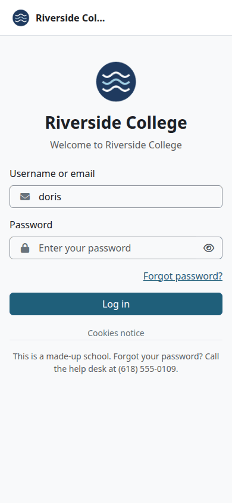

## The top bar on a phone

From the left: the three-line button, the logo, the school's name, then what fits of Moodle's icons, and the user's picture or initials.

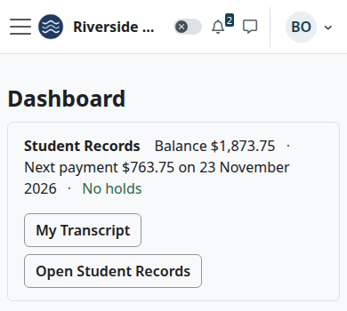

- The logo shows at up to 60 by 30 pixels, and a long school name is cut with three dots.
- The "Edit mode" switch keeps its place and loses its label.
- The user's name doesn't show. Select the picture or the initials to open the user menu.

## The main tabs on a phone

Select the three-line button at the top left. The drawer lists the main tabs, with Student Records among them.

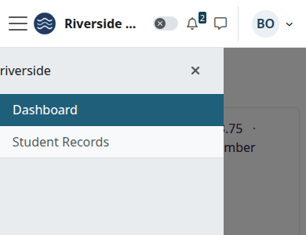

The head of this drawer comes from Moodle. It shows the site's short name or the compact logo, not the school's name or the logo from the theme settings.

## The Student Records menu on a phone

Who can do this: anyone with a Student Records menu.

The left drawer starts closed on a screen below 992 pixels wide.

1. Open a Student Records page. Select the "Student Records" tab, which below 768 pixels is in the menu behind the three-line button, or use the button on your Dashboard.
2. Select the button at the lower left of the page. Its label is "Open the Student Records menu".
3. Select a page in the menu.

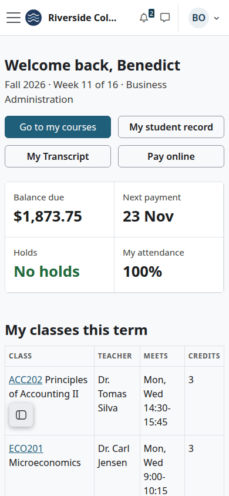

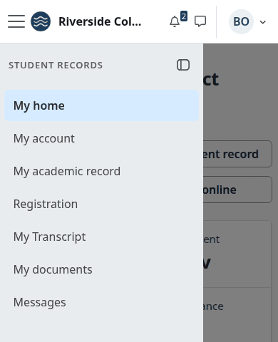

To close the menu without choosing, select the button at the top of the drawer. On a small screen Moodle doesn't remember whether you left it open.

## The Dashboard on a phone

The parts of the [strip](README.md#the-dashboard) run on as text, and the buttons go under them. On the Dashboard, the button at the lower right opens Moodle's block drawer.

## A course on a phone

The course's tabs stay in one row that you swipe sideways. The right edge of the row fades, to show there is more.

The side card sits above the content.

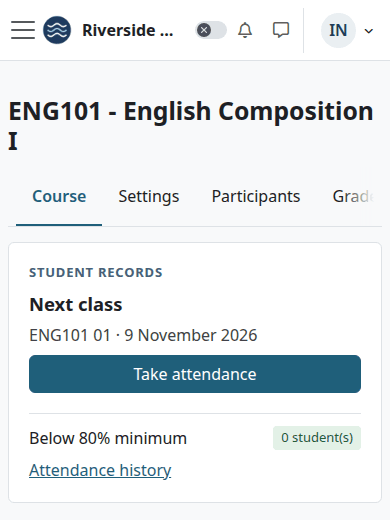

The row keeps its tabs on a phone, and they don't go in "More". "More" keeps only what's always there, such as Reports, "Transcript codes", "Post final grades" and "Student records". The same goes for every tab row of this kind, in Site administration too. From 576 pixels wide the row works as in Boost: the tabs that don't fit go in "More".

> Known problem in 1.0.3: below 576 pixels wide, "More" in a tab row opens nothing you can use. The menu opens inside the tab row, which is one line high, so you see at most two of its entries, and only if you swipe up on the row. Turn the phone sideways, or use a wider screen: from 576 pixels wide "More" opens as it should.

This is what you see after selecting "More" with the phone upright:

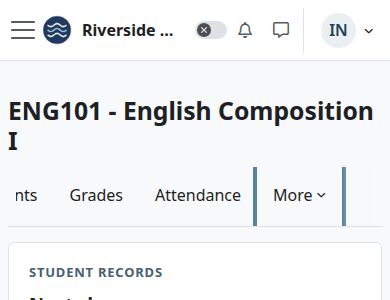

And with the phone sideways:

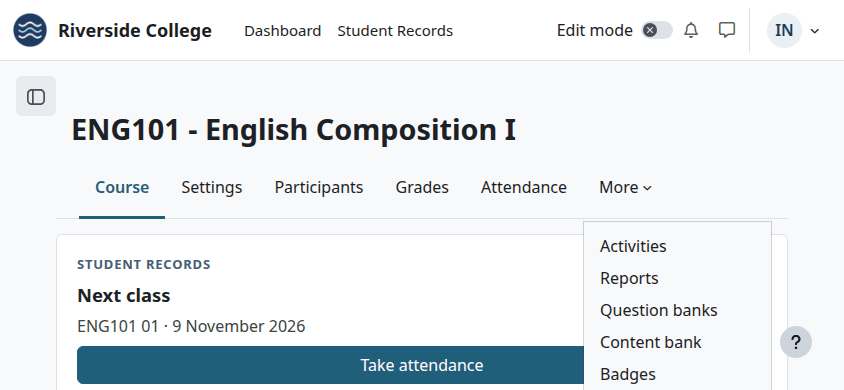

The "Attendance" tab stays in the row, and "Take attendance" is on the side card, so a teacher can mark a class with the phone upright. "Post final grades", "Transcript codes", "Students' transcripts" and "Student records" are only under "More".

## Wide tables

A table too wide for the screen scrolls sideways inside its own box. Swipe the table, not the page.

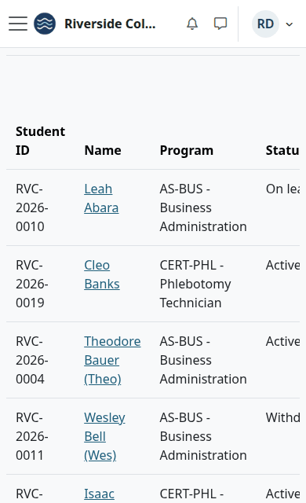

For people who use a keyboard, the box can take the focus, and the arrow keys scroll it. A screen reader names it after the table's caption, or else "Table (scrolls sideways)". The theme checks each table once, when the page opens. If you turn a phone or change the window's size after that, a table that has only then become too wide doesn't get this.

## Dark mode

Moodle 5.3 has a dark colour mode, which it calls experimental. It belongs to Boost, and the theme follows it. Moodle 5.2 and earlier have no such mode.

It is off until a site administrator turns it on. Then each signed-in person chooses for themselves.

## Turn dark mode on for the site

Who can do this: a site administrator.

Before you start:

- The site runs Moodle 5.3.

1. Go to Site administration > Appearance > Themes.
2. On the card "Boost", select the gear icon. Its label is "Edit theme settings 'Boost'".
3. Select the tab "Experimental settings".
4. Tick "Enable colour modes".
5. Leave "Default colour mode" on "Light", or pick another mode for people who haven't chosen one.
6. Select "Save changes".

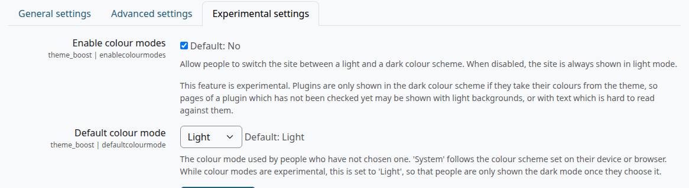

| Setting | Default | What it does |
|---|---|---|
| "Enable colour modes" | No | Lets people switch between light and dark. Off means the site is always light |
| "Default colour mode" | Light | The mode for people who haven't chosen one. "System" follows their device. It shows only when the first box is ticked |

Check that:

- A sun icon shows in the top bar, or a moon or a half circle if you picked Dark or System.

## Choose your colour mode

Who can do this: any signed-in person, once the site has colour modes on.

1. In the top bar, select the colour mode icon. It shows the mode in use: a sun for Light, a moon for Dark and a half circle for System.
2. Select "Light", "Dark" or "System".

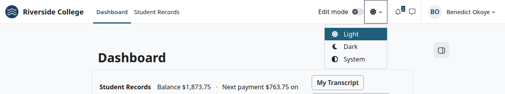

The page changes at once, and the choice stays with your account. "System" follows the setting of your device or browser.

Guests and visitors have no menu, and they get the site's default. The browser remembers the last mode chosen on it, so after you sign out, the login page stays as you left it. The menu shows on pages with the full top bar.

## What dark mode changes

The top bar, the drawers, the login card and the pages of Student Records and Academic Transcript all follow it.

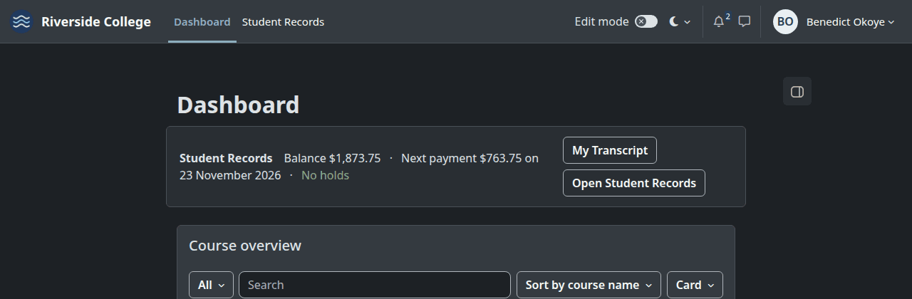

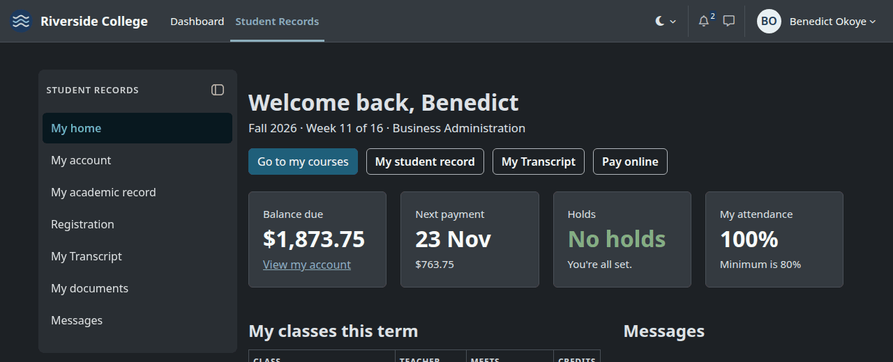

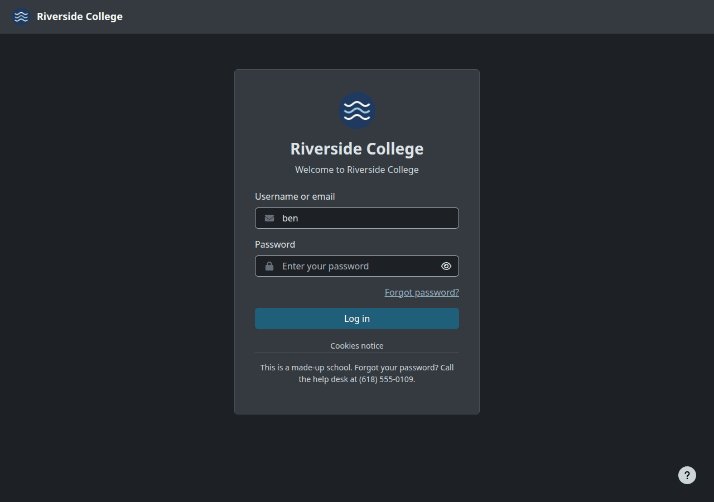

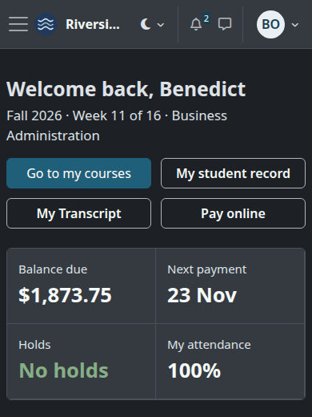

Buttons keep your accent colour, with white text. Links take a lighter colour that Moodle works out from your accent, so they stay readable on a dark page.

Two parts of the top bar don't change: the "No LMS access" note and the circle with the user's initials stay light.

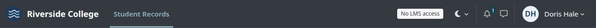

What stays as it is, whatever the mode:

- PDFs, such as transcripts, statements and receipts.
- Course images, and your logo. A dark logo with no light edge is hard to see on the dark top bar, so check yours before you turn dark mode on.

Moodle warns on its settings page that pages of a plugin that hasn't been checked may show light backgrounds. Check any other plugins your site has.

## Related pages

- [Student Records theme](README.md)
- [Theme settings](settings.md)
- [Troubleshooting](../troubleshooting.md#the-theme)
