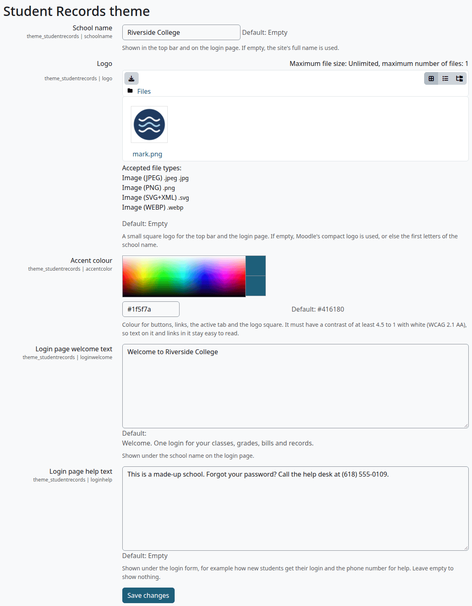
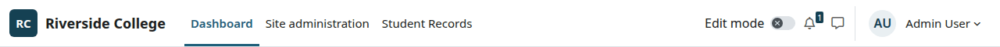
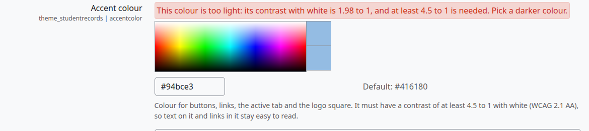
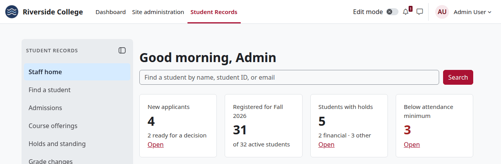
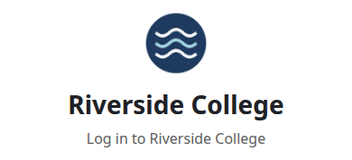

# Theme settings

This page lists every setting of the Student Records theme, with its default and its effect, and the contrast rule for the accent colour. It is for site administrators.

## Contents

- [Open the settings](#open-the-settings)
- [All the settings](#all-the-settings)
- [School name](#school-name)
- [Logo](#logo)
- [Accent colour](#accent-colour)
- [Login page welcome text](#login-page-welcome-text)
- [Login page help text](#login-page-help-text)
- [When a change shows](#when-a-change-shows)
- [Settings of Boost](#settings-of-boost)
- [Related pages](#related-pages)

## Open the settings

Who can do this: a site administrator.

Before you start:

- The theme is installed. See [Install the theme](README.md#install-the-theme).

1. Go to Site administration > Appearance > Themes.
2. On the card "Student Records theme", select the gear icon. Its label is "Edit theme settings 'Student Records theme'".
3. Change what you need, and select "Save changes" at the foot of the page.

The page's breadcrumb says Custom theme settings > Student Records theme. You can fill it in before you turn the theme on.

Check that:

- The page says "Changes saved".

What can go wrong:

- The page says "Some settings were not changed due to an error." The field at fault has a message in red, and nothing else on the page is lost. Fix that field and save again.

## All the settings

| Setting | Default | What it does |
|---|---|---|
| "School name" | Empty | The name in the top bar and on the login page. Empty means the site's full name |
| "Logo" | None | The picture in the top bar and on the login page. None means Moodle's compact logo, or else two letters of the school's name |
| "Accent colour" | `#416180` | The colour of buttons, links and the active tab, and the base of the logo square |
| "Login page welcome text" | Welcome. One login for your classes, grades, bills and records. | The line under the school's name on the login page |
| "Login page help text" | Empty | A line under the login form. Empty shows nothing |

The theme has no other settings. Dark mode isn't one of them: see [Settings of Boost](#settings-of-boost).

## School name

Type the name as you want people to see it. It shows in the top bar and on the login card, and it gives the letters of the logo square and the label of the home link for screen readers.

- Empty means the site's full name, from Site administration > General > Site home > Site home settings.
- Plain text only. Text with HTML tags is refused with "This value is not valid".
- Moodle's filters and multi-language tags work here.
- On a phone a long name is cut with three dots, so that it can't push the user menu off the screen.

The name doesn't reach the browser tab's title, the footer or Moodle's emails. Those use the site's own name.

## Logo

Drop a file into the box, or select "Add..." and upload it. The box holds one file. To remove a logo, select the file, select "Delete", then "Yes", and save the page.

| What | Rule |
|---|---|
| File types | `.png`, `.jpg`, `.jpeg`, `.svg`, `.webp` |
| Top bar | Shown at up to 120 by 36 pixels |
| Login card | Shown at up to 160 by 72 pixels |
| On a phone | Shown at up to 60 by 30 pixels in the top bar |

The setting's own text asks for a small square logo, and a wide one works too, within these sizes.

With no logo here, the theme uses the compact logo from Site administration > Appearance > Logos. Moodle's main "Logo" setting isn't used. With neither, it shows a square with two letters of the school's name:

The logo is open to everyone, because the login page shows it before anyone signs in.

## Accent colour

Type a colour, or pick one with the colour box. It must be dark enough for white text.

The rule is the one in the setting's text: the colour must have a contrast of at least 4.5 to 1 with white (WCAG 2.1 AA). White text on a button stays easy to read, and so does a link in that colour on a white page.

| Colour | Contrast with white | Result |
|---|---|---|
| `#416180`, the default | 6.46 to 1 | Saved |
| `#1f5f7a` | 7.05 to 1 | Saved |
| `#767676` | 4.54 to 1 | Saved |
| `#777777` | 4.47 to 1 | Refused |
| `#ff0000` | 3.99 to 1 | Refused |
| `#94bce3` | 1.98 to 1 | Refused |

A colour that's too light stays in the box with a message, and the old colour stays in use:

The message gives the contrast rounded down, so a colour just under the limit never reads as 4.50.

| You type | What happens |
|---|---|
| `#416180` | Saved as it is |
| `#416180` in capitals, or with spaces round it | Saved in small letters, with no spaces |
| `416180`, with no `#` | Saved as `#416180` |
| `#a13` or `a13`, three digits | Saved as six: `#aa1133` |
| Nothing | Saved as the default, `#416180` |
| A colour name such as `blue`, or anything else | Refused with "Enter the colour as # and six letters or numbers, for example #416180." |

Only the digits 0 to 9 and the letters a to f make a colour.

After a save, the colour reaches every page:

| Follows the colour | Doesn't follow it |
|---|---|
| Buttons such as "Save changes" | The pale blue of the current item in the Student Records menu |
| Links, and the underline of the active tab | Progress bars, and the selected filter on the Admissions page, which keep `#416180` |
| The logo square and the count on the notification bell, in a darker shade | The line that marks the attendance button in focus |
| The initials circle, in a pale shade | Green, amber and red status tags, which keep their meaning |

In dark mode, links use a lighter colour that Moodle works out from your accent, and buttons keep the accent.

## Login page welcome text

The line under the school's name on the login card. See [The login page](README.md#the-login-page).

- Plain text only. Text with HTML tags is refused with "This value is not valid".
- Line breaks don't show: all the text runs on as one paragraph.
- Multi-language tags don't work here.

When this box is empty, the card says "Log in to" and the school's name, because the card always has a line there:

## Login page help text

A line under the form, for example how new students get their login and the phone number for help. With an empty box, nothing shows and the card ends at the form.

The rules of the welcome text apply. The text shows only on the main login page, and not on "Forgot password?".

## When a change shows

| Setting | When it shows |
|---|---|
| "Login page welcome text", "Login page help text" | At once, on the next load of the login page |
| "School name" | At once. Moodle also clears the theme's caches, as for the two below |
| "Logo", "Accent colour" | After Moodle rebuilds the theme's styles, on the first page anyone opens after the save |

The first page after such a save can take a little longer. A person who keeps seeing the old colour should reload the page. If that doesn't help, go to Site administration > Appearance > Themes and select "Clear theme caches".

A site with a colour set by hand in the database or in `config.php` falls back on the default when the value isn't `#` and six digits, or when it's too light, with no message.

## Settings of Boost

The theme is a child of Boost, and Moodle's Boost page stays in the same place: Site administration > Appearance > Themes, then the gear icon on the card "Boost". Most of it does nothing on this theme.

| Setting of Boost | On this theme |
|---|---|
| "Enable colour modes", "Default colour mode" | They work. See [Dark mode](on-phones-and-dark-mode.md#dark-mode) |
| "Theme preset", "Additional theme preset files" | No effect. The theme always uses the default preset |
| "Background image", "Login page background image" | No effect |
| "Brand colour" | No effect. Use "Accent colour" |
| "Raw initial SCSS", "Raw SCSS" | No effect |
| "Unneeded blocks" | No effect. "Add a block" also lists the blocks that Boost hides: Navigation, Administration and Courses |

## Related pages

- [Student Records theme](README.md)
- [On phones and in dark mode](on-phones-and-dark-mode.md)
- [Troubleshooting](../troubleshooting.md#the-theme)
